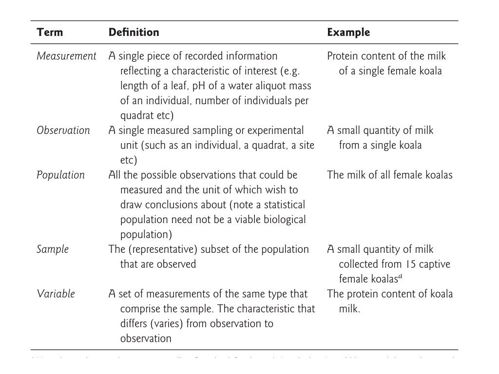

# Tidy Data Principles {#sec-tidy-data}

```{r}
#| label: ch08-setup
#| include: false
library(tidyverse)
library(gt)
theme_set(theme_minimal())
```

::: {.callout-note title="Learning Objectives"}
After completing this chapter, you will be able to:

- Define tidy data and explain its three principles
- Identify common problems in messy datasets
- Apply tidy data principles to your own data
- Distinguish between different data types
- Implement best practices for data organization
- Use appropriate file formats for data storage
:::

This chapter is about how to *think* about and *organize* data, whether it lives in a spreadsheet, a text file, or a data frame. The small R examples are illustrations you can read without knowing R yet; the tools for actually wrangling data in R (the tidyverse) come in @sec-data-wrangling, after R itself is introduced in @sec-r-programming.

## Why Data Organization Matters {#sec-why-data-organization}

Before you can analyze data, you must organize it. The structure of your data profoundly affects how easily you can work with it. A well-organized dataset can be analyzed in minutes; a poorly organized one might require hours of preprocessing.

Consider this scenario: you've completed an experiment measuring gene expression levels in fish embryos exposed to different environmental stressors. You carefully collected samples at multiple developmental stages, ran your assays, and now have a spreadsheet full of numbers. The analysis should be straightforward—just load the data and run some statistical tests.

But then reality sets in. Your spreadsheet has multiple header rows. Some columns contain merged cells indicating experimental blocks. Treatment conditions are color-coded rather than labeled. Missing values appear as empty cells, question marks, or the word "missing" depending on who entered the data. Suddenly, what should have been an afternoon of analysis becomes a week of data cleaning.

This scenario plays out in laboratories around the world, every day. The solution isn't just better software—it's better data organization from the start.

### A cautionary tale: when Excel renamed the genes {#sec-excel-genes}

The costs of careless data handling are not hypothetical. Spreadsheet programs helpfully guess what a cell contains, and for years Excel converted the gene symbol *SEPT2* into the date "2-Sep" and *MARCH1* into "1-Mar" the moment a gene list was pasted in. A 2016 survey of the supplementary files attached to genomics papers found such gene-name errors in roughly one in five of the spreadsheets that contained gene lists [@ziemann2016gene], and a follow-up five years later found that the problem had, if anything, grown [@abeysooriya2021gene]. The errors were so persistent that in 2020 the HUGO Gene Nomenclature Committee changed the official symbols of the affected genes, so that *SEPT2* is now *SEPTIN2* and *MARCH1* is *MARCHF1* [@bruford2020guidelines]. It is a remarkable thing for a spreadsheet's autocorrect feature to rename part of the human genome.

The lessons generalize far beyond gene names. Keep raw data in plain-text files (CSV or TSV) that no program will silently reinterpret; never "fix" data by hand inside a spreadsheet, because there is no record of what was changed; and let scripts do the transformations, so that every step is written down and can be re-run. When you must use a spreadsheet for data entry, Broman and Woo's short paper on data organization in spreadsheets is the best available guide [@broman2018data], and its rules are the ones this chapter builds on.

**Tidy data** provides a standard way to organize data that makes analysis easier. It's not the only valid way to structure data, but it's particularly well-suited for analysis in R and Python (pandas follows the same ideas; see @sec-py-pandas). When your data is tidy, you spend less time wrestling with data formats and more time answering scientific questions.

::: {.callout-note title="Data Wrangling in the Wild"}
It's often said that 80% of data analysis is spent on data cleaning and preparation [@dasu2003exploratory]. While this statistic varies by field and project, the underlying truth remains: thoughtful data organization at the start of a project saves enormous time and frustration later.
:::

## The Three Principles of Tidy Data {#sec-tidy-principles}

Hadley Wickham formalized the concept of tidy data in an influential paper [@wickham2014tidy]. Tidy data follows three rules:

::: {.callout-important title="The Three Rules of Tidy Data"}
1. Each **variable** forms a column
2. Each **observation** forms a row
3. Each **value** has its own cell
:::

{#fig-tidy-structure width="80%"}

Wickham's original paper states the third rule slightly differently: each **type of observational unit** forms its own table (we return to this in @sec-messy-multiple-units). The rules are interrelated—it is impossible to satisfy only two of the three—which leads to an even simpler pair of practical instructions:

1. Put each dataset in a tibble (or data frame)
2. Put each variable in a column

Real-world data rarely arrives in this form. Spreadsheets often encode information in column names, spread a single variable across several columns, or combine several variables in one column. **Data wrangling** is the process of transforming such messy data into tidy data, and the rest of this chapter is about the tools for doing so.

Let's unpack what the three rules mean.

### Variables as Columns {#sec-variables-as-columns}

A **variable** is a characteristic that you measure, observe, or categorize. Examples:

- Gene expression level
- Treatment group
- Patient age
- Sample ID
- Measurement date

Each variable should have its own column with a descriptive header.

### Observations as Rows {#sec-observations-as-rows}

An **observation** is a single unit of data collection—typically one measurement from one subject at one time point. Each observation gets its own row.

### Values in Cells {#sec-values-in-cells}

Each cell contains exactly one value. No merged cells, no multiple values crammed together, no implicit values indicated by color or formatting.

## Tidy vs. Messy Data: Examples {#sec-tidy-examples}

### A Tidy Dataset {#sec-tidy-example}

```{r}
#| label: tbl-tidy-example
#| tbl-cap: "Example of tidy data organization"

tidy_data <- tibble(
  sample_id = c("S001", "S002", "S003", "S001", "S002", "S003"),
  timepoint = c("0h", "0h", "0h", "24h", "24h", "24h"),
  gene = rep("BRCA1", 6),
  expression = c(4.2, 3.8, 4.5, 8.1, 7.9, 9.2)
)

tidy_data |>
  gt() |>
  tab_header(title = "Gene Expression Data (Tidy Format)")
```

This is tidy because:

- Each column is a variable (sample_id, timepoint, gene, expression)
- Each row is an observation (one expression measurement)
- Each cell has one value

### A Messy Dataset (Same Data) {#sec-messy-example}

A common messy format spreads measurements across columns:

```{r}
#| label: tbl-messy-example
#| tbl-cap: "The same data in messy (wide) format"

messy_data <- tibble(
  sample_id = c("S001", "S002", "S003"),
  `BRCA1_0h` = c(4.2, 3.8, 4.5),
  `BRCA1_24h` = c(8.1, 7.9, 9.2)
)

messy_data |>
  gt() |>
  tab_header(title = "Gene Expression Data (Messy Format)")
```

This is messy because:

- Time point and gene are embedded in column names
- Each row represents multiple observations
- Adding genes or timepoints requires adding columns

### Why It Matters {#sec-why-it-matters}

With tidy data, operations are straightforward:

```{r}
#| label: tidy-operations

# Calculate mean expression by timepoint
tidy_data |>
  group_by(timepoint) |>
  summarize(mean_expression = mean(expression))

# Easy to filter and plot
tidy_data |>
  filter(timepoint == "24h")
```

With messy data, you must first reshape it—or write complex code to work around the structure.

## Common Data Problems {#sec-data-problems}

### Straight from the Lab Notebook {#sec-messy-lab-notebook}

Before cataloguing the problems one by one, here is what several of them look like together, in a table typed straight out of a lab notebook spreadsheet:

| Fish | Treatment | Length | Notes |
|------|-----------|--------|----------------|
| AC1 | conv/A | 42 mm | healthy |
| AC2 | conv/A | 4.1cm | ? |
| AM1 | mono A | missing | died, replaced |
| BC1 | B - conventional | 44 | |

Every row records real information, and nothing here is wrong *in the lab*. But almost nothing is ready for analysis. The `Treatment` column packs two variables---genotype and microbiota---into one cell, and codes the combination three different ways (`conv/A`, `mono A`, `B - conventional`). The `Length` column mixes numbers, units, and text, so no tool can average `42 mm`, `4.1cm`, and `missing`. And missing values appear as `?`, as the word `missing`, and as a blank, when one convention (`NA`) should serve throughout. The tidied version puts each variable in its own column, moves the units into the column name, and settles on one missing-value code:

| Individual | Genotype | Microbiota | Length_mm |
|------------|----------|------------|-----------|
| AC1 | A | conventional | 42 |
| AC2 | A | conventional | 41 |
| AM1 | A | mono | NA |
| BC1 | B | conventional | 44 |

Turning the first table into the second is **data wrangling**, and the sections that follow take the problems one at a time. A related layout you will often meet is the **contingency table**---counts cross-tabulated by two factors, with one factor's levels as rows and the other's as columns. It is compact and pleasant to read, but like the wide layouts below it needs reshaping to tidy form before analysis.


### Problem 1: Column Headers Are Values {#sec-messy-headers-are-values}

Often, column names contain data values rather than variable names:

```{r}
#| label: headers-are-values

# Messy: years in column headers
population_messy <- tibble(
  country = c("USA", "Canada", "Mexico"),
  `2020` = c(331, 38, 129),
  `2021` = c(332, 38, 130),
  `2022` = c(333, 39, 131)
)

population_messy |> gt()
```

Solution: "Pivot" the data to create a `year` column:

```{r}
#| label: pivot-longer

population_tidy <- population_messy |>
  pivot_longer(
    cols = `2020`:`2022`,
    names_to = "year",
    values_to = "population"
  )

population_tidy |> gt()
```

### Problem 2: Multiple Variables in One Column {#sec-messy-multiple-variables}

Sometimes multiple pieces of information are crammed into one cell:

```{r}
#| label: multiple-vars

# Messy: rate contains both values
messy_rates <- tibble(
  country = c("USA", "Canada", "Mexico"),
  rate = c("1000/50000", "200/10000", "500/25000")
)

messy_rates |> gt()
```

Solution: Separate into distinct columns:

```{r}
#| label: separate-cols

tidy_rates <- messy_rates |>
  separate(rate, into = c("cases", "population"), sep = "/", convert = TRUE)

tidy_rates |> gt()
```

### Problem 3: Variables in Both Rows and Columns {#sec-messy-rows-and-columns}

Complex tables sometimes mix variables across dimensions:

```{r}
#| label: both-dimensions

# Messy: measurement type in rows, conditions in columns
messy_experiment <- tibble(
  measurement = c("weight", "height", "weight", "height"),
  subject = c("A", "A", "B", "B"),
  control = c(70, 170, 65, 165),
  treatment = c(68, 170, 64, 166)
)

messy_experiment |> gt()
```

This requires multiple steps to tidy: pivot longer, then pivot wider.

### Problem 4: Multiple Observational Units {#sec-messy-multiple-units}

When a single table contains data about different types of things:

```{r}
#| label: multiple-units

# Messy: patient and hospital info in same table
combined_data <- tibble(
  patient_id = c("P001", "P002"),
  patient_name = c("Alice", "Bob"),
  hospital_id = c("H1", "H1"),
  hospital_name = c("General", "General"),
  hospital_beds = c(500, 500),  # Repeated!
  diagnosis = c("Flu", "Cold")
)

combined_data |> gt()
```

Solution: Normalize into separate tables linked by keys.

## Best Practices for Data Organization {#sec-data-best-practices}

### Naming Conventions {#sec-tidy-naming-conventions}

Good names are the cheapest documentation you will ever write, and the shell, R, and Python all reward the same habits. A file name should say what the file contains and, where it matters, when: `patient_outcomes_2024-03-15.csv` tells you more than `data_final_v2.csv` ever will, and a date written in ISO 8601 order (`YYYY-MM-DD`) sorts chronologically when the files are listed alphabetically. Avoid spaces, which every command-line tool treats as a separator between arguments, and avoid characters with special meanings in the shell or in URLs such as `& ? * / \ : ( ) ' "`; underscores and hyphens are the safe separators. Remember that Unix file systems are case-sensitive, so `Data.csv` and `data.csv` are different files; pick one convention (lower case is the usual choice) and keep to it.

Column names follow the same logic with one extra constraint: they become variable names inside your code. Lower case with underscores (`sample_id`, `gene_expression`) can be typed without back-ticks or brackets in every language we use, a name should be meaningful (`treatment_group`, not `tg`), and it should start with a letter, because a name beginning with a digit is not a legal identifier in R or Python. The course dataset's fourth column, `Geno&Micro`, is a small illustration of what happens otherwise: it has to be quoted or renamed in every tool that touches it (@sec-data-wrangling).

### File Formats {#sec-file-formats}

@tbl-file-formats lists the formats you will meet most often; @sec-appendix-data-formats describes them in more detail.

| Format | Extension | Best For |
|:-------|:----------|:---------|
| Comma-separated | `.csv` | General tabular data |
| Tab-separated | `.tsv` | Data containing commas |
| Plain text | `.txt` | Simple data, scripts |
| Excel | `.xlsx` | Sharing with non-programmers |
| RDS | `.rds` | R-specific data with types preserved |
| Parquet | `.parquet` | Large datasets, fast reading |

: Common data file formats {#tbl-file-formats}

For long-term storage and sharing, prefer plain text formats (CSV, TSV) over proprietary formats. They're human-readable and don't require specific software.

### Documentation {#sec-documentation}

A data file is only as useful as the description that travels with it. The standard form is a **data dictionary**, sometimes called a codebook: a second, small table with one row per variable that records the variable's name, what it measures, its units, the values or categories it may take, how missing values are coded, where the data came from, and when the file was created or last changed. It need not be elaborate; a `README.md` or a `variables.csv` next to the data is enough. The `Data_Folder/README.md` that accompanies the course dataset (@sec-course-dataset) is an example. Write it while you still remember what the columns mean, because six months later you will not, and neither will the collaborator who inherits the project.

### Preserving Raw Data {#sec-preserving-raw-data}

::: {.callout-warning title="Never Modify Raw Data"}
Always keep an unchanged copy of your original data. Create a separate processed version for analysis. This allows you to:

- Retrace your steps if something goes wrong
- Rerun analysis with different preprocessing
- Share the original data with collaborators

Keep raw files in their own directory, with write permission removed if possible (`chmod a-w`, @sec-chmod). All cleaning and transformation should be done programmatically, in scripts that can be re-run, with the outputs saved to new files.
:::

### Keeping a Data File Clean {#sec-data-file-dos-donts}

The naming rules above cover file and column names; a few further habits keep the *contents* of a data file usable whether you edit it with Unix tools, R, Python, or a spreadsheet program. Keep the file rectangular: a new observation is a new row and a new variable is a new column, and there is exactly one header row, with concise but descriptive variable names. Write dates in ISO 8601 form, which sorts correctly as text and contains no delimiter characters. Represent missing values the same way everywhere, either as empty cells or as `NA`, never as a scattering of `-`, `N/A`, `missing`, and `?`. And keep the data dictionary from @sec-documentation alongside the file so that the two stay in step.

The mistakes to avoid are mostly ways of smuggling information into places where software cannot see it. Do not mix types within a column: if a column holds numbers, every entry is a number or an explicit `NA`, not a note such as "below detection", which turns the whole column into text. Do not use the file's delimiter inside a value, because in a comma-separated file `March 8, 2024` becomes two fields. Do not paste from formatted documents such as Word, whose invisible formatting characters can corrupt a file, and do not open a data file in Excel to edit it unless you know what it will silently convert, as the gene-name story in @sec-excel-genes shows. Do not encode information in colour, bold, or cell borders, because formatting is lost the moment the file is exported; put the information in a column instead. And do not leave empty rows or columns as visual separators, since they break the rectangular structure that every import function expects.

::: {.callout-tip title="The one-line version"}
One header row, one type per column, one way of writing missing values, no formatting-as-data, and a data dictionary next to the file.
:::

## Data Types {#sec-tidy-data-types}

Understanding data types helps you organize and analyze correctly.

### Categorical vs. Quantitative {#sec-categorical-vs-quantitative}

```{r}
#| label: tbl-data-types-table
#| tbl-cap: "Classification of data types"

data_types <- tibble(
  Category = c("Categorical", "Categorical", "Quantitative", "Quantitative"),
  Type = c("Ordinal", "Nominal", "Ratio", "Interval"),
  Description = c(
    "Ordered categories",
    "Unordered categories",
    "True zero, ratios meaningful",
    "No true zero"
  ),
  Examples = c(
    "small, medium, large",
    "red, blue, green",
    "height, weight, concentration",
    "temperature (°C), calendar year"
  )
)

data_types |>
  gt() |>
  tab_header(title = "Data Type Classification")
```

Quantitative data can be further split into **discrete** values (counts, integers, scores on a fixed scale) and **continuous** values that can in principle take any value in a range (mass, concentration, expression level). The interval/ratio distinction matters because ratio data support statements like "twice as much" while interval data do not: 20 g is twice as heavy as 10 g, but water at 20 °C is not "twice as hot" as water at 10 °C.

### R Data Types {#sec-r-data-types}

Each of these kinds of data maps onto a specific R type (@tbl-r-data-types and @fig-r-vector-types); the vector types themselves are covered in @sec-vectors.

| Data Type | Description | Examples | R Type |
|:----------|:------------|:---------|:-------|
| **Character** | Text strings | "control", gene names | `character` |
| **Factor** | Categorical with levels, unordered | Species, treatment groups | `factor` |
| **Ordered factor** | Categorical with a meaningful order | "low" < "medium" < "high" | `ordered` |
| **Integer** | Whole numbers | Counts, discrete measurements | `integer` |
| **Numeric** | Real numbers | Measurements, ratios, continuous data | `numeric` (`double`) |
| **Logical** | True/false values | QC pass/fail, conditions | `logical` |
| **Date** | Calendar dates | "2024-01-15", collection dates | `Date` |
| **Date-time** | Timestamps with time | "2024-01-15 14:30:00" | `POSIXct` |

: How kinds of data map to R types {#tbl-r-data-types}

{#fig-r-vector-types width="80%"}

```{r}
#| label: r-types

# Numeric (continuous)
temperature <- c(37.2, 36.8, 38.1)
class(temperature)
typeof(temperature)   # stored as "double"

# Integer (the L suffix)
counts <- c(1L, 2L, 3L)
class(counts)

# Character
sample_names <- c("control", "treatment", "treatment")
class(sample_names)

# Factor (categorical)
treatment <- factor(c("low", "medium", "high"),
                   levels = c("low", "medium", "high"),
                   ordered = TRUE)
class(treatment)
treatment

# Logical
passed_qc <- c(TRUE, TRUE, FALSE)
class(passed_qc)

# Date
collected <- as.Date("2024-01-15")
class(collected)
```

`class()` reports the type R uses when choosing how to print, plot, or model an object; `typeof()` reports how the values are stored underneath (a `numeric` vector is stored as `double`, a factor as `integer`). Getting types right matters because statistical and plotting functions treat factors differently from character strings, and arithmetic only works on numeric types.

### When to Use Factors {#sec-when-to-use-factors}

Factors are R's way of handling categorical variables. Use them when:

- You have a limited set of possible values
- The order matters (ordinal data)
- You want specific grouping in analyses and plots

```{r}
#| label: factor-example

# Character vector sorts alphabetically
treatments <- c("High", "Low", "Medium", "Low", "High")
sort(treatments)

# Factor maintains meaningful order
treatments_factor <- factor(treatments, 
                           levels = c("Low", "Medium", "High"))
sort(treatments_factor)
```

## Structuring Spreadsheets for Analysis {#sec-spreadsheets}

Spreadsheets are not going away, and for data *entry* they are often the most practical tool in the lab. The trouble begins when a spreadsheet is designed for a human eye rather than for a program. Merged cells that group rows visually, colour that marks a category, a second header row with units, a note typed into a spare cell, a running total at the bottom of a column: each is perfectly legible to a person and each breaks the rectangular structure that `read_csv()`, `pandas.read_csv()`, and `cut` all assume. The result is the scenario at the start of this chapter, in which the first hour of every analysis is spent undoing the layout.

The remedy is to treat the spreadsheet as a data file that happens to have a grid interface. Put the variable names in row 1 and nothing above them. Never merge cells. If a colour means something, add a column that says the same thing in words. Write missing values consistently as `NA` rather than leaving a mix of blanks, dashes, and `N/A`. Keep one dataset per sheet rather than spreading a study across tabs, and keep raw data and calculations apart: formulas belong in a separate sheet or, better, in a script, so that the raw sheet is nothing but values. Finally, export the sheet as CSV for analysis, which forces everything the program cannot see to disappear before it can cause trouble. Broman and Woo's paper on data organization in spreadsheets [@broman2018data] develops each of these rules with examples and is short enough to read in an afternoon.

### Before and After {#sec-before-and-after}

The difference between a spreadsheet built for looking at and one built for analysis is easy to see side by side. The "before" version has merged cells for visual grouping, colour-coded categories, several header rows, notes scattered in otherwise empty cells, a column that mixes numbers with words, and embedded calculations that will be silently read as data. The "after" version is a clean rectangle: one header row of well-named variables, one type per column, every piece of information stated explicitly in a cell value, and a second sheet or accompanying file carrying the documentation. Nothing has been lost in the translation; the colours and notes have simply become columns, where a program can read them.

{#fig-before-after-tidy fig-align="center" width="100%"}

## Running Example: The Stickleback Data {#sec-tidy-stickle}

::: {.callout-note title="Running example"}
This section applies the chapter to the course dataset described in @sec-course-dataset (80 stickleback, 4 treatment groups, 600 genes). The same steps appear on the Week 3 slides, so the book and the lecture can be read side by side.
:::

So: is the course dataset tidy? One command from @sec-pipes-stickle shows the structure at a glance (the file has 604 columns, so `cut -f 1-8` keeps the output readable):

```bash
head -n 2 data/Stickle_RNAseq.tsv | cut -f 1-8
```

```
Individual  Genotype  Microbiota    Geno&Micro  Gene1  Gene2  Gene3  Gene4
AC1         A         conventional  convA       16     15     71     153
```

Measured against the three rules, the table does well. There is exactly one header row of variable names, one row per fish, one value per cell, and one type per column. Two features nonetheless deserve a closer look, because each illustrates a point from this chapter.

First, the 600 gene columns are a **wide** layout. For per-fish questions---total reads per fish, which group a fish belongs to---this is exactly the tidy shape: the fish is the observational unit, and each row is one fish. But for per-gene questions the *gene* is really a variable too, hiding in the column names just as the years hid in the column names of @sec-messy-headers-are-values. The tidy shape for those questions is **long**: one row per fish-by-gene combination (48,000 rows of `Individual`, `Gene`, `Count`). Neither layout is wrong; they answer different questions, and @sec-data-wrangling shows how `pivot_longer()` converts one into the other in a single call.

{#fig-wide-vs-long fig-align="center" width="100%"}

Second, the fourth column, `Geno&Micro`, breaks two rules at once. It duplicates information already present in the `Genotype` and `Microbiota` columns, and its name contains an `&`, a character with a special meaning in the shell that forces quoting or renaming in every tool downstream (@sec-tidy-naming-conventions). The column earns its keep as a convenient grouping label, but the name does not: @sec-regex-stickle renames it with one line of `sed`, writing the result to a new file so the raw data stay untouched (@sec-preserving-raw-data).

The payoff of a tidy, plain-text file is that *reading it is a one-liner in every language we use*. The Week 3 example script `plot_stickleback.py` on the course [Example Files page](https://wcresko.github.io/BioE_Comp_Tools_Fa2026/Examples.html) loads the entire table like this:

```python
stickle = pd.read_csv("data/Stickle_RNAseq.tsv", sep="\t")
```

and the R equivalent is `read_tsv("data/Stickle_RNAseq.tsv")`. No skipping of merged cells, no parsing of units out of values, no guessing at missing-value codes---because the file follows the rules of this chapter, every import function simply works.


## Summary {#sec-tidy-summary}

Tidy data provides a consistent structure that simplifies analysis:

- Each variable is a column
- Each observation is a row
- Each value occupies one cell

Key principles for data organization:

- Use descriptive, consistent naming conventions
- Document your data with a data dictionary
- Preserve raw data separately from processed data
- Choose appropriate file formats for your needs
- Understand the difference between data types

The tools for putting these principles into practice in R - the tidyverse, dplyr, and tidyr - are the subject of @sec-data-wrangling.

## Additional Reading {#sec-tidy-additional-reading .unnumbered}

To deepen your understanding of tidy data:

- **[Tidy Data (Original Paper)](https://vita.had.co.nz/papers/tidy-data.pdf)** by Hadley Wickham — The foundational paper on tidy data principles
- **[Data Organization in Spreadsheets](https://doi.org/10.1080/00031305.2017.1375989)** by Karl Broman and Kara Woo — Practical rules for spreadsheets that will be analyzed by code
- **[R for Data Science](https://r4ds.hadley.nz/)** by Hadley Wickham, Mine Çetinkaya-Rundel, and Garrett Grolemund [@wickham2023r] — Chapter 5 covers tidy data

## Exercises {#sec-tidy-exercises .unnumbered}

::: {.callout-tip title="Practice Exercises"}
**Exercise 1: Identify Tidy Data**

For each dataset description, determine if it's tidy. If not, explain what violates tidy principles:

1. Patient data with columns: patient_id, age, blood_pressure_systolic, blood_pressure_diastolic
2. Gene expression with columns: gene_name, sample_1, sample_2, sample_3
3. Survey data with columns: respondent_id, question, response
4. Weather data with columns: city, 2023_temp, 2024_temp, 2023_precip, 2024_precip

**Exercise 2: Data Dictionary**

Create a data dictionary for an experiment tracking:
- Gene expression levels measured at 0, 12, and 24 hours
- Three treatment groups (control, low dose, high dose)
- Twenty biological replicates per group
- Quality control pass/fail flags

**Exercise 3: Spot the Problems**

Review a dataset you've worked with (or your lab's data). Identify any violations of tidy data principles and propose solutions.

:::
