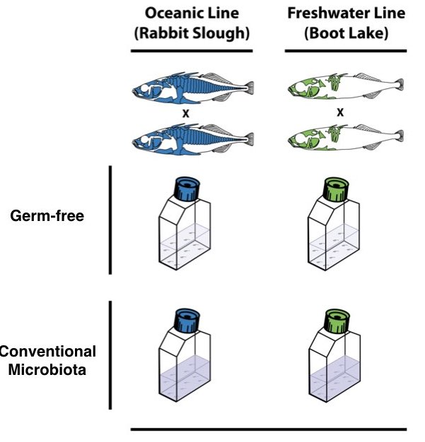

```{r}
#| label: setup
#| include: false

# Packages used in the lecture examples
library(tidyverse)
library(gt)
library(readxl)

# Consistent theme for all plots
theme_set(theme_minimal(base_size = 14))

# Reproducible random numbers
set.seed(2026)
```

## Book reading for this lecture

- [Ch. 7: Files, Pipes, and Redirection](../book/chapters/07-files-pipes.html)
- [Ch. 8: Tidy Data Principles](../book/chapters/08-tidy-data.html)
- [Ch. 9: GREP, Regular Expressions, sed and awk](../book/chapters/09-grep-regex.html) - the grep and regex sections; sed and awk wait for L04
- *Reference:* [App. C: Common Data Formats & Public Repositories](../book/chapters/appendix-C-data-formats.html) · [App. D: Regular Expression Reference](../book/chapters/appendix-D-regex.html)

## Goals for today

- Warm-up: shell scripts and permissions from L02 - ending in your first *Python* script
- Tidy data principles - and is our stickleback table tidy?
- Reading files and chaining commands with Unix pipes
- GREP and regular expressions - applied to our course dataset
- Sequence file formats (FASTA and FASTQ) and compressed files
- Worked example: download a whole human chromosome and explore it with pipes and `grep`

# Warm-up - shell scripts

## Recap: a script is a text file you make runnable

- We rushed the end of L02, so here are the ideas to keep.

::: incremental
- A **shell script** is a plain-text file of the commands you would have typed, run top to bottom
- Line 1 is the **shebang**: `#!` names the program that interprets the rest of the file (`#!/usr/bin/env bash`)
- New files are born `rw-r--r--`
  - **no `x`**
  - so `./hello.sh` answers `Permission denied`
- The one-time fix is
  - `chmod +x hello.sh`
  - after that, `./hello.sh` just runs
- `bash hello.sh` works *without* `x`, because there you are running `bash`, not the script
- Read `ls -l` as a file-type flag + three `rwx` triplets (user, group, other): `755` = `rwxr-xr-x`, the classic script permission
:::

## The `shebang` is not married to bash

Change line 1 and the *same* mechanics run any language:

``` {.bash code-line-numbers="|1|2|3"}
#!/usr/bin/env bash      # a bash script
#!/usr/bin/env python3   # a Python script
#!/usr/bin/env Rscript   # an R script
```

::: incremental
- Commands in a text file → shebang on line 1 → `chmod +x` once → `./script` forever
- The shell does not care what language is inside - it reads the shebang and hands the file over
- So let's go in and remind ourselves of the shell scripts
- Then, let's write our first **Python** script as a preview of L05-L07
- It will read the stickleback table in *one line* which possible only because the file follows **tidy data rules**
:::

## Shell Scripts and Permissions - hands on

- Let's work through our shell scripts

- We will create a directory structure that we will use for the Python script on the next page

## A first Python script

``` {.python code-line-numbers="|1|4-5|9|12-14|17-20"}
#!/usr/bin/env python3
# plot_stickleback.py - total RNA-seq counts per fish, by group

import pandas as pd                  # data tables     (L05-L06)
import matplotlib.pyplot as plt     # plotting        (L06)

# One line to read the whole table - because it is tidy:
# a header of variable names, one row per fish, one value per cell
stickle = pd.read_csv("data/Stickle_RNAseq.tsv", sep="\t")

# One number per fish: total reads across the 600 gene columns
genes = [c for c in stickle.columns if c.startswith("Gene")]
totals = pd.DataFrame({"Group": stickle["Geno&Micro"],
                       "Total": stickle[genes].sum(axis=1)})

# A quick plot: one box per genotype-x-microbiota group
totals.boxplot(column="Total", by="Group")
plt.ylabel("Total reads per fish")
plt.savefig("results/total_counts_by_group.png", dpi=200)
print("Wrote results/total_counts_by_group.png")
```

# Tidy Data

## An example to get us started

{fig-align="center" width="100%"}

## Data set rules of thumb (aka Tidy Data)

- Store a copy of data in nonproprietary software and hardware formats, such as plain ASCII text (aka a flat file)
- Leave an uncorrected file when doing analyses
- Use descriptive names for your data files and variables
- Include a header line with descriptive variable names
- Maintain effective metadata about the data (data dictionary)
- When you add observations to a database, add rows
- When you add variables to a database, add columns, not rows
- A column of data should contain only one data type

## Not all data are tidy to begin with

Straight out of a lab notebook spreadsheet:

| Fish | Treatment | Length | Notes |
|------|-----------|--------|----------------|
| AC1 | conv/A | 42 mm | healthy |
| AC2 | conv/A | 4.1cm | ? |
| AM1 | mono A | missing | died, replaced |
| BC1 | B - conventional | 44 | |

::: incremental
- `Treatment` packs **two variables** (genotype, microbiota) into one column - and codes them three different ways
- `Length` mixes **numbers, units and text** in one column - no tool can average `42 mm`, `4.1cm` and `missing`
- Missing values appear as `?`, `missing` and blank - pick **one** convention (`NA`)
- None of this is wrong *in the lab* - it is just not ready for analysis: fixing it is **data wrangling** (Week 7)
:::

## The same data, tidied

| Individual | Genotype | Microbiota | Length_mm |
|------------|----------|------------|-----------|
| AC1 | A | conventional | 42 |
| AC2 | A | conventional | 41 |
| AM1 | A | mono | NA |
| BC1 | B | conventional | 44 |

::: incremental
- One variable per column, one fish per row, one value - **and one data type** - per cell
- Units live in the **column name**, not the cells
- Also common in the wild: **contingency tables** (counts cross-tabulated by two factors) - compact to read, but reshape to tidy before analysis
:::

## Is our course dataset tidy?

Back in your course folder (`cd ~/projects/comptools`):

``` bash
head -n 2 data/Stickle_RNAseq.tsv | cut -f 1-8
```

```
Individual  Genotype  Microbiota    Geno&Micro  Gene1  Gene2  Gene3  Gene4
AC1         A         conventional  convA       16     15     71     153
```

::: incremental
- One row per **fish**, one column per **variable** - tidy for per-fish questions
- But **600 gene columns** is a "wide" layout: the *gene* is really a variable too. For per-gene questions we will reshape it to **long** format (one row per fish x gene) in Week 7
- The `Geno&Micro` column duplicates two other columns - and the `&` is a name that will annoy every tool we use. Keep an eye on it.
:::

# Reading Files and Unix Pipes

## Commands for Reading Files

- **`cat`** = concatenate and display files
  - Shows entire file at once
  - Good for small files
- **`less`** = view file page by page
  - Navigate with `space` (forward), `b` (back), `q` (quit)
  - Search with `/pattern`
- **`more`** = similar to less but simpler
  - Space to go forward, `q` to quit
- **`head`** = display first 10 lines (default)
  - `head -n 20 file.txt` shows first 20 lines
- **`tail`** = display last 10 lines (default)
  - `tail -n 20 file.txt` shows last 20 lines
  - `tail -f file.txt` follows file as it grows (useful for logs)

## What are Pipes?

- **`|`** = the pipe operator
  - Takes output from one command as input to another
  - Chains commands together
  - No intermediate files needed!
- Basic syntax:
  - `command1 | command2 | command3`
- Power of Unix philosophy:
  - Small tools that do one thing well
  - Combine them to do complex tasks

## Common Pipe Patterns

- **Counting patterns:**
  - `grep "pattern" file.txt | wc -l`
  - Count lines matching a pattern
- **Sorting and uniqueness:**
  - `cat file.txt | sort | uniq`
  - Sort lines and remove duplicates
- **Finding top/bottom items:**
  - `sort data.txt | head -5`
  - Get top 5 after sorting
- **Filtering and processing:**
  - `ls -l | grep ".txt" | awk '{print $5, $9}'`
  - List txt files with sizes

::: callout-note
A few of these preview commands we haven't covered yet: `grep` gets its full treatment later today, and `awk`, `find` and `xargs` are stars of L04. Focus on the *shape* of the pipelines for now.
:::

## Advanced Pipe Examples

- **Multi-step data processing:**
  - `cat data.csv | cut -d',' -f2 | sort | uniq -c | sort -rn`
  - Extract column 2, count unique values, sort by frequency
- **Complex transformations:**
  - `find . -name "*.txt" | xargs wc -l | sort -n`
  - Find all txt files and sort by line count
- **Real-time monitoring:**
  - `tail -f logfile.txt | grep ERROR`
  - Watch log file for errors in real-time

## Tips for Working with Files and Pipes

- Test pipes step by step
  - Build complex pipes incrementally
  - Check output at each stage
- Use `less` for large files instead of `cat`
- Remember: `>` overwrites, `>>` appends
- Pipe efficiency:
  - Filter early in the pipeline
  - Reduces data passed between commands
- Save intermediate results when debugging complex pipes

# GREP and Regular Expressions

## What is GREP?

- **GREP** = Global Regular Expression Print
- Powerful text search tool in Unix
- Searches for patterns in files or input streams
- Returns lines that match the pattern
- Essential for large data processing

Basic syntax:

``` bash
grep [options] pattern [file...]
```

## Basic GREP Usage

``` {.bash code-line-numbers="|1-2|4-5|7-8|10-11|13-14|16-17"}
# Search for a simple pattern
grep "ACGT" sequences.txt

# Case-insensitive search
grep -i "gene" annotations.txt

# Count matching lines
grep -c ">" proteins.fasta

# Show line numbers
grep -n "ERROR" logfile.txt

# Invert match (show non-matching lines)
grep -v "^#" data.txt    # Skip comment lines

# Search multiple files
grep "mutation" *.txt
```

## Introduction to Regular Expressions

Regular expressions (regex) are patterns for matching text:

- **`.`** = any single character
- **`*`** = zero or more of preceding character
- **`+`** = one or more of preceding character
- **`?`** = zero or one of preceding character
- **`^`** = start of line
- **`$`** = end of line
- **`[abc]`** = any character in set
- **`[^abc]`** = any character NOT in set
- **`\`** = escape special characters

## Basic Regex Examples

``` {.bash code-line-numbers="|1-4|6-10|12-15"}
# Match DNA sequences
grep "^ATG" genes.txt         # Lines starting with ATG
grep "TAG$" genes.txt         # Lines ending with TAG
grep "A.G" sequences.txt      # A, any char, then G

# Character classes
grep "[ACGT]" dna.txt         # Any DNA base
grep "[^ACGT]" dna.txt        # Non-DNA characters
grep "[0-9]" data.txt         # Any digit
grep "[A-Za-z]" text.txt      # Any letter

# Quantifiers
grep "A\{3\}" sequence.txt    # Exactly 3 A's
grep "T\{2,4\}" sequence.txt  # 2 to 4 T's
grep "GC*" sequence.txt       # G followed by 0+ C's
```

## Two-minute quiz: which lines match?

The file `test.txt` has four lines:

```         
ATGCCCTAG
CCATG
ATG
ACG
```

Predict the output of each command *before* you run it:

``` {.bash code-line-numbers="|1|2|3"}
grep "^ATG" test.txt
grep "ATG$" test.txt
grep "^A.G$" test.txt
```

::: incremental
- `^ATG` → lines 1 and 3 (must *start* with ATG)
- `ATG$` → lines 2 and 3 (must *end* with ATG)
- `^A.G$` → lines 3 and 4 (exactly three characters: A, anything, G)
:::

## Extended Regular Expressions

Use `grep -E` or `egrep` for extended regex:

``` {.bash code-line-numbers="|1-2|4-5|7-8|10-11|13-15"}
# Alternation (OR)
grep -E "start|stop|pause" commands.txt

# Grouping
grep -E "(ATG|GTG|TTG)" codons.txt

# Plus quantifier (one or more)
grep -E "A+T+G+" sequences.txt

# Question mark (optional)
grep -E "colou?r" british_american.txt

# Complex patterns for bioinformatics
grep -E "^>sp\|[A-Z0-9]+\|" uniprot.fasta  # UniProt headers
grep -E "[ACGT]{20,}" primers.txt          # Sequences 20bp+
```

## Combining GREP with Pipes

``` {.bash code-line-numbers="|1-2|4-5|7-8|10-15|17-18"}
# Count unique sequence headers
grep "^>" sequences.fasta | sort | uniq | wc -l

# Extract gene names from GFF file
grep -v "^#" annotation.gff | cut -f9 | grep -oE "gene=[^;]+"

# Find sequences without stop codons
grep -v -E "(TAA|TAG|TGA)" orfs.txt

# Quality control pipeline: count reads containing an N
# FASTQ records are 4 lines; the sequence is always line 2 of each,
# so awk 'NR % 4 == 2' pulls out sequence lines. (grep "^@" is NOT
# safe here - quality lines can start with @ too, since @ is a valid
# quality character.)
zcat reads.fastq.gz | awk 'NR % 4 == 2' | grep -c "N"

# Search and replace with sed (uses regex - sed is L04)
grep "gene" data.txt | sed 's/gene/GENE/g'
```

## Reminder from L02: the three standard streams

Every Unix program reads and writes through three numbered streams:

```         
          ┌──────────────┐
stdin ───>│              │───> stdout
    (0)   │   program    │      (1)
          │              │───> stderr
          └──────────────┘      (2)
```

- `>` sends **stdout** to a file (overwrites) · `>>` appends · `2>` captures **stderr** · `|` connects one program's stdout to the next one's stdin
- Full treatment in L02 and [Ch. 7](../book/chapters/07-files-pipes.html) - next slide puts them to work on our data

## Running example: streams and `grep` on the stickleback table

``` {.bash code-line-numbers="|1|3-6|8-9|11-12|14-15"}
cd ~/projects/comptools && mkdir -p results

# Keep only the header plus the mono-associated fish, save to a new file
head -n 1 data/Stickle_RNAseq.tsv > results/mono.tsv
grep -w "mono" data/Stickle_RNAseq.tsv >> results/mono.tsv
wc -l results/mono.tsv                        # 41 lines = header + 20 + 20 fish

# Which individuals are genotype B raised conventionally?
grep -w "convB" data/Stickle_RNAseq.tsv | cut -f 1

# A regular expression: individuals whose ID ends in a 1
grep -E "^[A-Z]+1\b" data/Stickle_RNAseq.tsv | cut -f 1-3

# Send errors somewhere useful: a typo in the path goes to the log, not the screen
grep -w "mono" data/Stickle_RNAseq.tsvv 2> results/errors.log; cat results/errors.log
```

::: callout-tip
`>` creates the file, `>>` appends to it, `2>` captures **stderr**. `grep -w "mono"` matches `mono` only as a whole word, so it finds the 40 mono-associated fish through the third column but would *not* match `monoA` on its own. Try `grep -c mono` versus `grep -cw mono`: both give 40 here. Work out why (which column does each one match on?) - experiments like this are how you learn what a flag really does.
:::

# Sequence Files and Compression

## Sequence file formats: FASTA and FASTQ

::::: columns
::: {.column width="50%"}
**FASTA** - sequences (genomes, genes, proteins)

``` bash
>chr21 Homo sapiens chromosome 21
NNNNNNNNNNGATCCTTGAAGCGCCCCCAAGG
GCATCTTCTCTACTTTCACCTAACAGATCCCA
```

- Header line starts with `>`
- Sequence on one or more lines
- Count sequences: `grep -c "^>" file.fa`
:::

::: {.column width="50%"}
**FASTQ** - raw sequencing reads

``` bash
@SRR12345.1 read_1
NCATGCAGCGTACGGTAATTGGCAG
+
#AAAAFFFFFFFFFFFFFFFFFFFF
```

- **4 lines per read**: `@` header, sequence, `+`, per-base quality
- Quality letters encode Phred scores (`!` = lowest, `I` = Q40)
- Count reads: `echo $(( $(wc -l < reads.fastq) / 4 ))`
:::
:::::

::: callout-tip
Both are usually gzip-compressed (`.fa.gz`, `.fastq.gz`) - use `zcat` / `zless` / `zgrep` to read them without unpacking. More formats (CSV/TSV, GFF, BED, VCF, HDF5) in the [Data Formats appendix](../book/chapters/appendix-C-data-formats.html) of the course book.
:::

## Working with Compressed Files

Most genomic data is compressed to save space:

``` {.bash code-line-numbers="|1-5|7-11|13-16|18-20"}
# View compressed files without extracting

zcat file.gz | head
zless file.gz
zgrep "pattern" file.gz

# Compress and decompress

gzip file.txt          # Creates file.txt.gz
gunzip file.txt.gz     # Restores file.txt
gzip -k file.txt       # Keep original file

# Work directly with compressed files
# (count reads: every 4th line is a header; don't grep "^@" - quality lines can start with @)

zcat reads.fastq.gz | awk 'NR % 4 == 1' | wc -l

# Concatenate compressed files

zcat file1.gz file2.gz | gzip > combined.gz
```

# Worked Example - Downloading and Exploring a Large Genomic File

## Human Chromosome Data

- Everything so far - reading files, pipes, redirection, `grep` - in one realistic job: grab a big public dataset and ask it questions, straight from the shell


- Genomic data files can be massive (the full human genome is \~3.1 GB compressed)
- FASTA format is standard for sequence data
- Perfect use case for Unix pipes and redirection
- We will practice on **human chromosome 21** - the smallest autosome (\~13 MB compressed, \~46 Mb of sequence), so every command finishes in seconds
- The same commands work unchanged on the whole genome - only the wait time changes
- The course book works through the same file in [Chapter 9](../book/chapters/09-grep-regex.html#sec-genomic-processing)

## Downloading Genomic Data

Download chromosome 21 of the human genome (hg38 / GRCh38) from UCSC:

``` {.bash code-line-numbers="|1-3|5-8"}
# Using `wget` to download chr21 (~13 MB)

wget https://hgdownload.soe.ucsc.edu/goldenPath/hg38/chromosomes/chr21.fa.gz

# Or using `curl` and save with a specific name (-L follows redirects)

curl -L -o chr21.fa.gz \
  https://hgdownload.soe.ucsc.edu/goldenPath/hg38/chromosomes/chr21.fa.gz
```

- `wget` and `curl` are both tools for downloading files (macOS ships `curl`; install `wget` with Homebrew if you want it)
- The backslash lets a long command span multiple lines
- `.gz` extension means the file is compressed
- The whole genome lives in the same directory as `hg38.fa.gz` (\~1 GB) - same commands, much longer runs

## Examining Large Files Efficiently

Don't use `cat` on huge files! Use these approaches:

``` {.bash code-line-numbers="|1-3|5-9|11-14|16-18"}
# Decompress and look at first 10 lines

gunzip -c chr21.fa.gz | head -10

# Check file size before and after decompression (-k keeps the .gz)

ls -lh chr21.fa.gz
gunzip -k chr21.fa.gz
ls -lh chr21.fa

# Count sequences in FASTA file (lines starting with >)
# grep can't read gzip data directly - use zgrep (or zcat | grep)

zgrep "^>" chr21.fa.gz | wc -l

# View sequence headers only

zgrep "^>" chr21.fa.gz | less
```

::: callout-note
The UCSC file is *soft-masked*: repeats are written in lowercase (`acgt`). Patterns like `GAATTC` will miss sites inside masked regions - add `-i` to `grep`, or uppercase everything first with `tr 'acgt' 'ACGT'`.
:::

## Creating a Subset for Analysis

Make a smaller working file for testing:

``` {.bash code-line-numbers="|1-3|5-8|10-12"}
# Extract the first ~1 Mb of sequence for testing (50 bases per line)

zcat chr21.fa.gz | head -n 20000 > chr21_subset.fa

# Extract a specific record by name from a multi-sequence FASTA
# (e.g. from hg38.fa - chr21.fa has only one record)

awk '/^>chr21$/,/^>chr22$/' hg38.fa | head -n -1 > chr21_from_genome.fa

# Pull out a window of lines from the middle of the chromosome

sed -n '400000,420000p' chr21.fa > region_of_interest.fa
```

::: callout-note
`awk` and `sed` are the stars of L04 - read those two lines as recipes for now.
:::

## Processing FASTA Files with Pipes

Extract specific regions or sequences:

``` {.bash code-line-numbers="|1-3|5-12"}
# Extract just the sequence (no headers) and count bases

grep -v "^>" chr21.fa | tr -d '\n' | wc -c

# Count each type of nucleotide (uppercase first so a == A)

grep -v "^>" chr21.fa | \
  tr 'acgtn' 'ACGTN' | \
  tr -d '\n' | \
  fold -w1 | \
  sort | \
  uniq -c
```

- `grep -v` inverts the match (excludes lines)
- `tr -d '\n'` removes newlines
- `fold -w1` puts each character on its own line
- Expect a lot of `N` - the first \~5 Mb of chr21 is unassembled

## Finding Patterns in Genomic Data

Search for specific sequences and motifs:

``` {.bash code-line-numbers="|1-7|9-14|16-22"}
# Find all instances of a restriction enzyme site (EcoRI: GAATTC)

grep -v "^>" chr21.fa | \
  tr 'acgt' 'ACGT' | \
  tr -d '\n' | \
  grep -o "GAATTC" | \
  wc -l

# Extract 100 bases around each EcoRI site

grep -v "^>" chr21.fa | \
  tr 'acgt' 'ACGT' | \
  tr -d '\n' | \
  grep -oE ".{100}GAATTC.{100}" > ecori_contexts.txt

# Find all start codons (ATG) and their byte offsets

grep -v "^>" chr21.fa | \
  tr 'acgt' 'ACGT' | \
  tr -d '\n' | \
  grep -b -o "ATG" | \
  head -20
```

## Combining Downloads with Processing

Stream processing without saving intermediate files:

``` {.bash code-line-numbers="|1-6|8-15"}
# Download, decompress, and process in one pipeline
curl -sL https://hgdownload.soe.ucsc.edu/goldenPath/hg38/chromosomes/chr21.fa.gz | \
  gunzip -c | \
  grep -v "^>" | \
  tr -d '\n' | \
  cut -c1-1000000 > first_megabase.txt

# Download and immediately analyze GC content
wget -qO - https://hgdownload.soe.ucsc.edu/goldenPath/hg38/chromosomes/chr21.fa.gz | \
  gunzip -c | \
  grep -v "^>" | \
  tr 'acgtn' 'ACGTN' | \
  tr -d 'N\n' | \
  tr 'ATGC' '0011' | \
  awk '{n = length($0); gc = gsub(/1/, ""); print "GC%:", 100 * gc / n}'
```

::: notes
- The `-O -` flag tells wget to output to stdout
- This approach saves disk space and time
:::

## Your turn: sequence content of chr21

Using only today's commands (`grep -v`, `tr`, `fold`, `sort`, `uniq`, `wc`):

1.  Count the total number of bases in `chr21.fa`
2.  Calculate the **GC content** (percent of bases that are G or C)
3.  Find runs of the dinucleotide repeat `AT` five or more units long
4.  *Bonus:* what fraction of the chromosome is `N`?

::: callout-tip
Build each pipeline one command at a time and check the output at every stage. Remember the soft-masking: uppercase first with `tr 'acgt' 'ACGT'`.
:::

::: notes
Solutions:

- Total bases: grep -v "^>" chr21.fa | tr -d '\n' | wc -c
- GC content: grep -v "^>" chr21.fa | tr -d '\n' | tr -cd 'GCgc' | wc -c, divided by the total
- Repeats: grep -v "^>" chr21.fa | tr 'acgt' 'ACGT' | tr -d '\n' | grep -oE "(AT){5,}"
- N fraction: same pipeline with tr -cd 'Nn' | wc -c, divided by the total
:::

## Key Takeaways

- **Real bioinformatics often involves gigabytes of data - these Unix tools scale beautifully!**
- **Never load entire genome files into memory** - use streaming
- **Combine tools** - each does one thing well
- **Test on subsets first** - extract small portions for development
- **Document your pipelines** - save commands in scripts
- **Use compression** - work with .gz files directly when possible
- **Think in streams** - data flows through pipes without intermediate files
