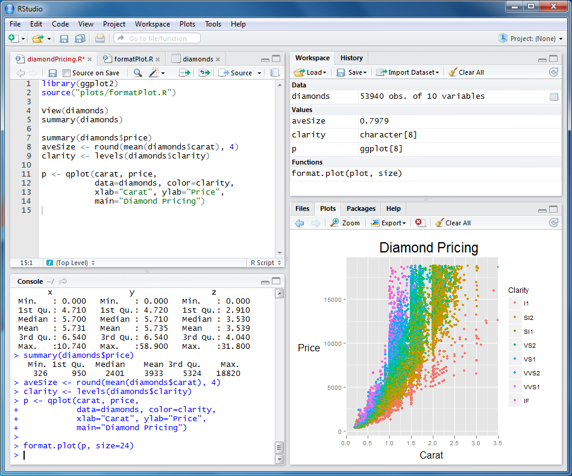
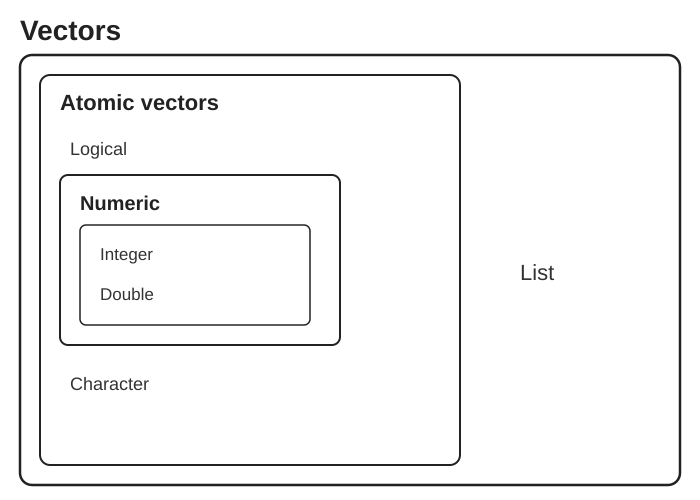

```{r}
#| label: setup
#| include: false

# Packages used in the lecture examples
library(tidyverse)
library(gt)
library(readxl)

# Consistent theme for all plots
theme_set(theme_minimal(base_size = 14))

# Reproducible random numbers
set.seed(2026)
```

## Book reading for this lecture

The course book goes deeper on everything in this lecture. Read before or after class:

- [Ch. 11: R Programming Fundamentals](../book/chapters/11-r-programming.html)
- [Ch. 12: Python Programming Fundamentals](../book/chapters/12-python-programming.html)
- *Reference:* [App. E: R Command Reference](../book/chapters/appendix-E-r.html) · [App. F: Python Quick Reference](../book/chapters/appendix-F-python.html)

## Goals for today

- Warm-up: L04's `fasta_stats.sh` rewritten in R and in Python
- Using Positron, Visual Studio Code and RStudio as script editors
- Why R *and* Python - same ideas, different syntax
- Scripts, variables, arithmetic, strings and vectors
- Types of data and getting help

# Warm-up - last week's script in R and Python

## The same script in R and Python

In L04 we wrote `fasta_stats.sh`. It works, but counting and arithmetic get awkward in bash. Here is the same program as an **R script** and a **Python script** - both take the file name as a command-line argument. Read them as a *preview*: variables, strings, vectors and functions are exactly what L05-L07 teach.

::: panel-tabset
### R

```{r}
#| label: lec06-fasta-stats-r
#| echo: true
#| eval: false

#!/usr/bin/env Rscript
# Script: fasta_stats.R
# Purpose: Calculate basic statistics for a FASTA file

args <- commandArgs(trailingOnly = TRUE)     # like $1 $2 ... in bash
if (length(args) != 1) {
  cat("Usage: Rscript fasta_stats.R sequences.fasta\n")
  quit(status = 1)
}
input <- args[1]
if (!file.exists(input)) {
  cat("Error: File", input, "not found!\n")
  quit(status = 1)
}

lines   <- readLines(input)
headers <- grepl("^>", lines)                # TRUE for header lines
seq     <- paste(lines[!headers], collapse = "")

cat("=== FASTA Statistics for", input, "===\n")
cat("Number of sequences:", sum(headers), "\n")
cat("Total length:", nchar(seq), "bp\n")
cat("Average length:", nchar(seq) / sum(headers), "bp\n")
n_count <- sum(strsplit(seq, "")[[1]] %in% c("N", "n"))
cat("N bases:", n_count, "\n")
gc <- sum(strsplit(toupper(seq), "")[[1]] %in% c("G", "C"))
cat("GC content:", round(100 * gc / nchar(seq), 1), "%\n")
orfs <- regmatches(seq, gregexpr("ATG([ACGT]{3}){20,}(TAA|TAG|TGA)", seq))[[1]]
cat("ORF-like stretches:", length(orfs), "\n")
```

### Python

```python
#!/usr/bin/env python3
# Script: fasta_stats.py
# Purpose: Calculate basic statistics for a FASTA file

import re
import sys
from pathlib import Path

if len(sys.argv) != 2:                       # sys.argv[0] is the script name, like $0
    print("Usage: python3 fasta_stats.py sequences.fasta")
    sys.exit(1)
input_file = Path(sys.argv[1])
if not input_file.is_file():
    print(f"Error: File {input_file} not found!")
    sys.exit(1)

lines   = input_file.read_text().splitlines()
headers = [line for line in lines if line.startswith(">")]
seq     = "".join(line for line in lines if not line.startswith(">"))

print(f"=== FASTA Statistics for {input_file} ===")
print(f"Number of sequences: {len(headers)}")
print(f"Total length: {len(seq)} bp")
print(f"Average length: {len(seq) / len(headers):.1f} bp")
n_count = seq.count("N") + seq.count("n")
print(f"N bases: {n_count}")
gc = seq.upper().count("G") + seq.upper().count("C")
print(f"GC content: {100 * gc / len(seq):.1f}%")
orfs = re.findall(r"ATG(?:[ACGT]{3}){20,}(?:TAA|TAG|TGA)", seq)
print(f"ORF-like stretches: {len(orfs)}")
```
:::

## Running R and Python scripts from the shell

::: panel-tabset
### R

``` bash
Rscript fasta_stats.R chr21.fa        # run with the interpreter ...

chmod +x fasta_stats.R                      # ... or make it executable
./fasta_stats.R chr21.fa              #     (needs the #!/usr/bin/env Rscript shebang)

Rscript -e 'mean(c(1, 2, 3))'               # one-liner without a file
R                                           # interactive console; quit with q()
```

- `Rscript` runs the file top to bottom and prints only what you `cat()` or `print()`
- In **Positron** / **VS Code** / **RStudio**: open the `.R` file and press `Cmd/Ctrl-Enter` to send lines to the console

### Python

``` bash
python3 fasta_stats.py chr21.fa       # run with the interpreter ...

chmod +x fasta_stats.py                     # ... or make it executable
./fasta_stats.py chr21.fa             #     (needs the #!/usr/bin/env python3 shebang)

python3 -c 'print(sum([1, 2, 3]) / 3)'      # one-liner without a file
python3                                     # interactive REPL; quit with exit() or Ctrl-D
```

- `python3 script.py` runs the file top to bottom and prints only what you `print()`
- In **VS Code** / **Positron**: open the `.py` file and press `Cmd/Ctrl-Enter`, or use the Run button
- Keep project packages in a virtual environment: `python3 -m venv .venv && source .venv/bin/activate` (environments get their full story in L07)
:::

::: callout-tip
Both scripts return an **exit status** (`quit(status = 1)` / `sys.exit(1)`), so a shell pipeline or SLURM job can tell whether they succeeded - just like `exit 1` in bash. In Lecture 08 we submit these scripts to Talapas with `Rscript` and `python3` inside an `sbatch` job.
:::

# R and Python: two scripting languages for data

## Why use `R`?

- Good general scripting tool for statistics and mathematics
- Powerful and flexible and free
- Runs on all computer platforms
- New enhancements coming out all the time
- Superb data management & graphics capabilities
- Reproducibility - can keep your scripts to see exactly what was done
- You can write your own functions
- Lots of online help available
- Can use a nice IDE such as `Positron` or `RStudio`
- Can embed your `R` analyses in dynamic, polished files using `Quarto Markdown`
- Quarto Markdown can be reused for websites, papers, books, presentations...

## Why use `Python`?

- A general-purpose language that is also excellent for data analysis (`pandas`, `numpy`, `matplotlib`, `scipy`)
- The language of machine learning, image analysis and instrument control (`scikit-learn`, `PyTorch`, `scikit-image`)
- Free, open source, runs everywhere - including Talapas (`module load python3`)
- Huge ecosystem: `pip install` gives you access to \>500,000 packages on PyPI; `conda` adds compiled scientific tools
- Readable syntax; indentation *is* the structure of the code
- Runs as scripts (`python3 script.py`), interactively (REPL / IPython), in **Jupyter notebooks**, and in **Quarto** `{python}` chunks
- Same IDEs: **Positron** and **VS Code** run R and Python side by side

::: callout-tip
You do not have to choose. Most computational biologists use **both**: R for statistics and figures, Python for pipelines, images and machine learning. This lecture shows every idea in both languages - use the tabs.
:::

## Your IDE: the four panes

{fig-align="center" width="70%"}

| Pane | RStudio location | Positron equivalent | Purpose |
|:---------------|:---------------|:-----------------|:---------------------|
| **Code editor** | Top-left | Editor tabs | Write/edit scripts and `.qmd` files |
| **Console** | Bottom-left | Console (R *or* Python) | Interactive session; run one line |
| **Environment** | Top-right | Variables | Objects you have created, history |
| **Files / Plots / Help** | Bottom-right | Explorer, Plots, Help, Data Explorer | Navigate files, view plots, read docs |

::: callout-tip
`R` and `Python` are the languages; **RStudio**, **Positron** and **VS Code** are the IDEs you write them in. Write code in the *editor* so it is saved, and send lines to the *console* with `Cmd/Ctrl-Enter`. Customize the RStudio layout in Tools → Global Options → Pane Layout; in Positron, drag panes or use View → Appearance.
:::

## R vs Python: same ideas, different syntax

| Idea | R | Python |
|------------------------|------------------------|------------------------|
| Assignment | `x <- 5` | `x = 5` |
| Counting starts at | **1**: `x[1]` is the first element | **0**: `x[0]` is the first element |
| Last element | `x[length(x)]`; `x[-1]` *drops* the first | `x[-1]` *is* the last |
| Sequence of values | vector `c(1, 2, 3)` | list `[1, 2, 3]` or `numpy` array `np.array([1, 2, 3])` |
| Vector arithmetic | `x^2` on any vector | `x**2` only on a numpy array (a list needs a loop) |
| Table of data | `data.frame` / tibble | `pandas` `DataFrame` |
| Load a package | `library(dplyr)` | `import pandas as pd` |
| Install a package | `install.packages("dplyr")` | `pip install pandas` (or `uv`, `conda`) |
| Chain steps | pipe `x \|> f() \|> g()` | method chaining `x.f().g()` |
| Blocks | curly braces `{ }` | indentation (4 spaces) |
| Missing value | `NA` | `None`, `float("nan")`, `pd.NA` |
| Help | `?mean` | `help(statistics.mean)` or `mean?` in Jupyter |

## Scripts, notebooks and Quarto Markdown

::: incremental
- A **script** (`.R`, `.py`) is a text file of commands run top to bottom - you have been writing these since L02 (shebang on line 1, `chmod +x`, run with `Rscript` / `python3`)
- **Quarto Markdown** (`.qmd`) embeds `{r}` and `{python}` code chunks in prose - annotated, reproducible documents (these slides are one!)
- Python also has **Jupyter notebooks** (`.ipynb`): code cells + output + Markdown - popular, but stored as JSON, which is hard to read and diff in Git; Quarto gives the same workflow in plain text
- Chaining steps: R uses the pipe (`x |> f() |> g()`), Python uses **method chaining** (`data.dropna().groupby("x").mean()`)
- Rule of thumb: a **script** for things that just run, **Quarto** when you want prose + code + output together
:::

## BASICS of `R` and `Python`

- Commands can be submitted through the terminal, console or scripts (R: `R` / `Rscript`; Python: `python3` / `python3 script.py`)
- Notice on these slides I'm evaluating the code chunks and showing output
- Also notice that both languages follow the normal priority of mathematical evaluation
- Careful: exponent is `^` in R but `**` in Python (`^` in Python is bitwise XOR!)

::: panel-tabset
### R

```{r}
#| label: lec07-basic-multiplication
#| echo: true
#| eval: true

4*4
```

```{r}
#| label: lec07-more-multiplication
#| echo: true
#| eval: true

(4+3*2^2)
```

### Python

```{python}
#| label: lec07-basic-multiplication-py
#| echo: true
#| eval: false

4*4
# 16
```

```{python}
#| label: lec07-more-multiplication-py
#| echo: true
#| eval: false

(4+3*2**2)
# 16
```
:::

## Assigning Variables

- Assign values with `<-` in R and `=` in Python; names must begin with a letter (or `_` in Python) - and both languages are **case sensitive**

::: panel-tabset
### R

```{r}
#| label: lec07-assigning-variables
#| echo: true
#| eval: true

x <- 2
x*3
y <- x * 3
y-2

```

These do not work

```{r}
#| label: lec07-assigning-variables-2
#| echo: true
#| eval: false

3y <- 3
3*y <- 3
```

### Python

```{python}
#| label: lec07-assigning-variables-py
#| echo: true
#| eval: false

x = 2
x*3
# 6
y = x * 3
y-2
# 4
```

These do not work either (`SyntaxError`)

```python
3y = 3
3*y = 3
```
:::

## Arithmetic operations on functions

- Arithmetic operations can be performed easily on functions as well as numbers.
- Try the following, and then your own.

::: panel-tabset
### R

```{r}
#| label: lec07-functions
#| echo: true
#| eval: false

x+2
x^2
log(x)
```

### Python

```{python}
#| label: lec07-functions-py
#| echo: true
#| eval: false

import math

x+2
x**2
math.log(x)
```
:::

- Note that the last of these - `log` - is a built in function of `R`, and therefore the object of the function needs to be put in parentheses
- In Python, `log` lives in the `math` module, so we `import math` once and call `math.log(x)` (`numpy` has `np.log()` for whole arrays)
- These parentheses will be important, and we'll come back to them later when we add arguments after the object in the parentheses\
- The outcome of calculations can be assigned to new variables as well, and the results can be checked using the 'print' command

## Arithmetic operations on functions

::: panel-tabset
### R

```{r}
#| label: lec07-arithmetic-operations-on-functions
#| echo: true
#| eval: true

y <- 67
print(y)

x <- 124
z <- (x*y)^2
print(z)
```

### Python

```{python}
#| label: lec07-arithmetic-operations-on-functions-py
#| echo: true
#| eval: false

y = 67
print(y)
# 67

x = 124
z = (x*y)**2
print(z)
# 69022864
```
:::

## STRINGS

- Variables and operations can be performed on characters as well
- Note that characters need to be set off by quotation marks to differentiate them from numbers
- The `c` stands for `concatenate`; in Python square brackets `[ ]` build a **list**
- Note that we are using the same variable names as we did previously, which means that we're overwriting our previous assignment
- A good rule of thumb is to use new names for each variable, and make them short but still descriptive

## STRINGS

::: panel-tabset
### R

```{r}
#| label: lec07-strings
#| echo: true
#| eval: true

x <- "I Love"
print (x)
y <- "Bioengineering"
print (y)
z <- c(x,y)
print (z)
```

### Python

```{python}
#| label: lec07-strings-py
#| echo: true
#| eval: false

x = "I Love"
print(x)
# I Love
y = "Bioengineering"
print(y)
# Bioengineering
z = [x, y]
print(z)
# ['I Love', 'Bioengineering']
print(x + " " + y)      # + joins strings
# I Love Bioengineering
```
:::

## VECTORS

- In general `R` thinks in terms of vectors (a list of characters, factors or numerical values).
- It will benefit any `R` user to try to write programs with that in mind, as it will simplify most things.
- Vectors can be assigned directly using the `c()` function and then entering the exact values.
- Python has **lists** (`[ ]`) for any collection, and **numpy arrays** (`np.array()`) when you want R-style vector math
- `x^2` squares every element of an R vector; in Python that only works on a numpy array - a list needs a loop or a *list comprehension*

## VECTORS

::: panel-tabset
### R

```{r}
#| label: lec07-example-vectors
#| echo: true
#| eval: true

x <- c(2,3,4,2,1,2,4,5,10,8,9)
print(x)
```

```{r}
#| label: lec07-example-vector-multiplication
#| echo: true
#| eval: true

x <- c(2,3,4,2,1,2,4,5,10,8,9)
y <- x^2
print(x)
print(y)
```

### Python

```{python}
#| label: lec07-example-vectors-py
#| echo: true
#| eval: false

x = [2,3,4,2,1,2,4,5,10,8,9]     # a list
print(x)
# [2, 3, 4, 2, 1, 2, 4, 5, 10, 8, 9]
```

```{python}
#| label: lec07-example-vector-multiplication-py
#| echo: true
#| eval: false

import numpy as np

x = np.array([2,3,4,2,1,2,4,5,10,8,9])   # a numpy array
y = x**2                                 # element-wise, like R
print(x)
# [ 2  3  4  2  1  2  4  5 10  8  9]
print(y)
# [  4   9  16   4   1   4  16  25 100  64  81]
# with a plain list you would write: y = [v**2 for v in x]
```
:::

## VECTORS (cont.)

::: panel-tabset
### R

```{r}
#| label: fig-lec07-example-vector-plot
#| fig-cap: "Each value of x plotted against its square (y = x^2)"
#| echo: true
#| eval: true

plot(x,y)
```

### Python

```{python}
#| label: fig-lec07-example-vector-plot-py
#| fig-cap: "Each value of x plotted against its square (y = x^2), with matplotlib"
#| echo: true
#| eval: false

import matplotlib.pyplot as plt

plt.scatter(x, y)
plt.xlabel("x")
plt.ylabel("y")
plt.show()
```
:::

## Basic Statistics

- Many functions exist to operate on vectors.
- Combine these with your previous variable to see what happens.
- Also, try to find other functions (e.g. standard deviation).

::: panel-tabset
### R

```{r}
#| label: lec07-basic-statistics
#| echo: true
#| eval: false

mean(x)
median(x)
var(x)
log(x)  # natural log
sqrt(x)
sum(x)
length(x)
sample(x, replace = TRUE)
```

### Python

```{python}
#| label: lec07-basic-statistics-py
#| echo: true
#| eval: false

import random

import numpy as np

x.mean()                     # or np.mean(x)
np.median(x)
x.var(ddof=1)                # sample variance, like R's var()
np.log(x)                    # natural log, element-wise
np.sqrt(x)
x.sum()                      # sum(x) also works
len(x)                       # length(x)
random.choices(list(x), k=len(x))   # sample with replacement
```
:::

- Notice that the last function (`sample`) has an argument (`replace=T`); in Python `random.choices()` samples *with* replacement and `k=` sets how many
- Python functions come in two flavours: `np.median(x)` (function) and `x.mean()` (a **method** attached to the array)
- Arguments simply modify or direct the function in some way
- There are many arguments for each function, some of which are defaults

::: callout-tip
In Weeks 6-7 you will run exactly these functions on real columns of our stickleback table (`data/Stickle_RNAseq.tsv`).
:::

## Getting Help

- Getting Help on any function is very easy - just type a question mark and the name of the function (R), or `help(function)` in Python.
- There are functions for just about anything within `R` and it is easy enough to write your own functions if none already exist to do what you want to do.
- In general, function calls have a simple structure: a function name, a set of parentheses and an optional set of parameters to send to the function.
- Help pages exist for all functions that, at a minimum, explain what parameters exist for the function.\
- Help can be accessed a few ways - try them :

## Getting Help

::: panel-tabset
### R

```{r}
#| label: lec07-getting-help
#| echo: true
#| eval: false

- help(mean)
- ?mean
- example(mean)
- help.search("mean")
- apropos("mean")
- args(mean)
```

### Python

```python
import numpy as np, inspect

help(np.mean)                # full documentation, any Python
np.mean?                     # short help - IPython, Jupyter, Positron only
np.mean??                    # ... plus the source code
dir(np)                      # list everything inside a module
[n for n in dir(np) if "mean" in n]   # like apropos("mean")
inspect.signature(np.mean)   # like args(mean)
```
:::

- Online: <https://docs.python.org/3/>, <https://numpy.org/doc/>, <https://pandas.pydata.org/docs/>

## Creating vectors

- Typing vectors in by hand is a drag - use generating functions instead: `seq()` in R; `range()`, `np.arange()`, `np.linspace()` in Python
- Try the examples and vary the arguments - can you work out what each one does?

::: panel-tabset
### R

```{r}
#| label: lec07-creating-vectors
#| echo: true
#| eval: true

seq_1 <- seq(0.0, 10.0, by = 0.1)
print(seq_1)
seq_2 <- seq(10.0, 0.0, by = -0.1)

seq_square     <- seq_2 * seq_2   # element-wise multiplication ...
seq_square_new <- seq_2^2         # ... or the same thing with the exponent
print(seq_square_new)
```

### Python

```{python}
#| label: lec07-creating-vectors-py
#| echo: true
#| eval: false

import numpy as np

seq_1 = np.linspace(0.0, 10.0, 101)    # 101 points from 0 to 10 (step 0.1)
print(seq_1)
# [ 0.   0.1  0.2 ...  9.8  9.9 10. ]
seq_2 = np.linspace(10.0, 0.0, 101)

seq_square     = seq_2 * seq_2         # element-wise ...
seq_square_new = seq_2**2              # ... same result
print(seq_square_new)
# [100.    98.01  96.04 ...   0.04   0.01   0.  ]

list(range(10))                        # integers 0, 1, ..., 9 (start defaults to 0; stop excluded!)
```
:::

## Types of data

|  |  |  |  |
|:----------------:|:----------------:|:----------------:|:----------------:|
| Categorical |  | Quantitative |  |
| Ordinal | Nominal | Ratio | Interval |
| small, medium, large | apples, oranges, bananas | kilograms, dollars, years | temperature, calendar year |
| ordered character | character | numeric | integer |

'Factor' is a special type of character variable that we will explore more later

## Types of vectors of data

- `int` stands for integers

- `dbl` stands for doubles, or real numbers

- `chr` stands for character vectors, or strings

- `dttm` stands for date-times (a date + a time)

- `lgl` stands for logical, vectors that contain only TRUE or FALSE

- `fctr` stands for factors, which R uses to represent categorical variables with fixed possible values

- `date` stands for dates

<!-- -->

- Integer and double vectors are known collectively as numeric vectors.
- In `R` numbers are doubles by default.

## The hierarchy of R vector types

{fig-align="center" width="85%"}

## Types of vectors of data

- Logical vectors can take only three possible values:
  - `FALSE`
  - `TRUE`
  - `NA` which is 'not available'.
- Integers have one special value: NA, while doubles have four:
  - `NA`
  - `NaN` which is 'not a number'
  - `Inf`
  - `-Inf`

## Types of data in Python

| R | Python | Example |
|-----------------|-------------------------------|------------------------|
| `int` | `int` | `3` |
| `dbl` | `float` | `3.0`, `2.5e-3` |
| `chr` | `str` | `"low"` |
| `lgl` | `bool` | `True`, `False` |
| `fctr` | `pandas.Categorical` | `pd.Categorical(["low", "high"])` |
| `date` / `dttm` | `datetime.date` / `datetime.datetime` | `datetime.date(2026, 11, 9)` |
| `NA` | `None`, `float("nan")`, `np.nan`, `pd.NA` |  |
| `Inf` / `-Inf` | `math.inf` / `-math.inf` |  |

- Ask with `type(x)`; a numpy array or pandas column has one **dtype** for all its values (`x.dtype`)
- `7 / 2` is `3.5` (always a float); `7 // 2` is `3` (integer division); `7 % 2` is the remainder `1`

# Backup - reference slides

Fuller versions of material condensed in the live deck; see [Ch. 11](../book/chapters/11-r-programming.html) and [Ch. 12](../book/chapters/12-python-programming.html).

## `R scripts` and `Quarto Markdown`

- Often we want to write scripts that can just be run - `R scripts`
- We can also embed code in Quarto Markdown files that provide more annotations
- This improves interpretability and reproducibility
- You can insert `R code chunks` into `Quarto Markdown` documents

## `Python scripts`, `notebooks` and `Quarto Markdown`

- A `Python script` (`script.py`) is a text file of Python commands run top to bottom with `python3 script.py`
- A **Jupyter notebook** (`.ipynb`) mixes code cells, output and Markdown - popular in Python, but stored as JSON (hard to read in Git)
- The same `Quarto Markdown` file can hold `{python}` code chunks - Quarto runs them through Jupyter
- So the R and Python workflows are the same: **script** for things that just run, **Quarto** when you want prose + code + output

## `R script` basics

- A series of R commands that will be executed\

- Can add comments using hashtags `#`\

- Can have pipes (`|>`) to connect one step to the next\

## `Python script` basics

- A series of Python commands that will be executed, top to bottom\

- Comments also use hashtags `#`\

- Steps are connected with **method chaining** (`data.dropna().groupby("x").mean()`) rather than pipes\

- Whitespace matters: the body of a loop, `if` or function is **indented** (4 spaces)\

- Start scripts with `#!/usr/bin/env python3` and run them with `python3 script.py` (or `./script.py` after `chmod +x`)
