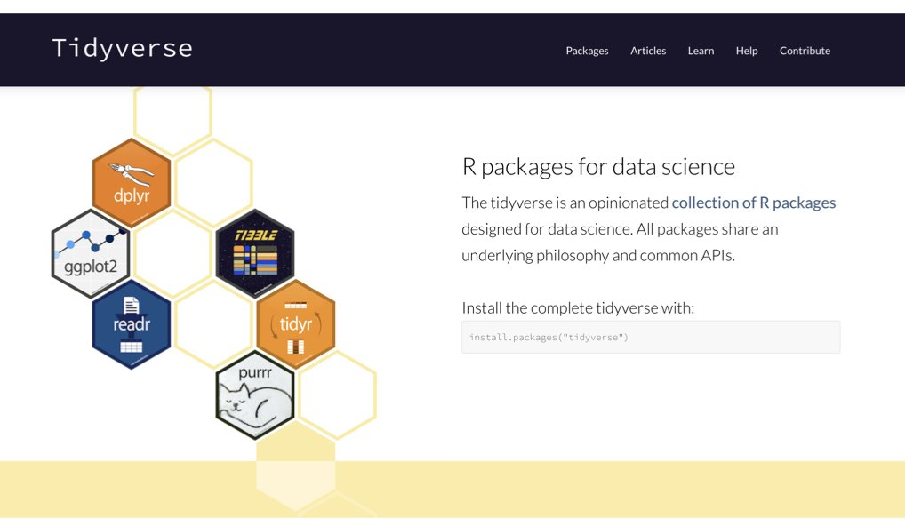
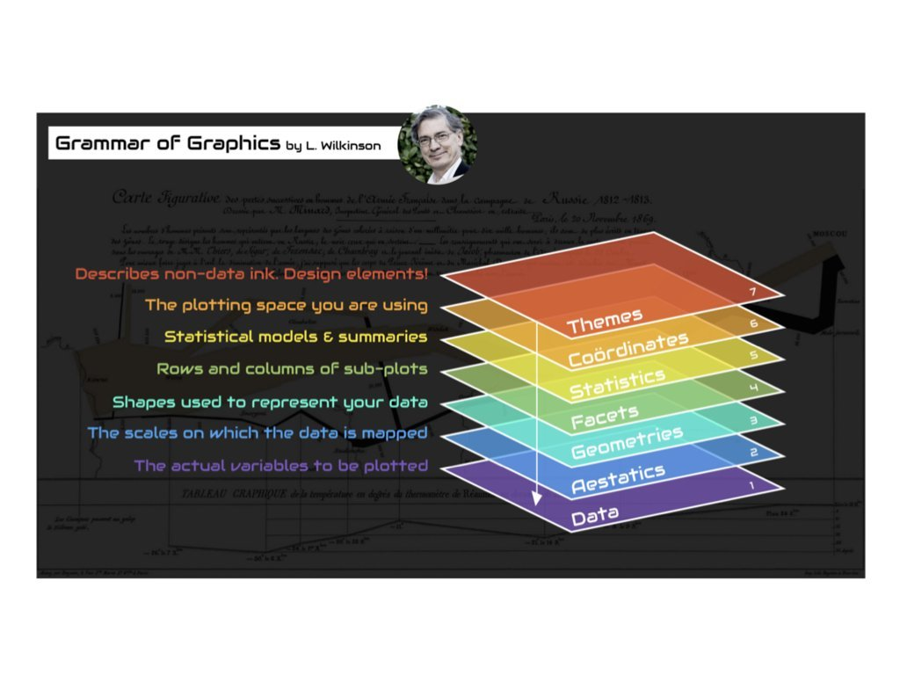
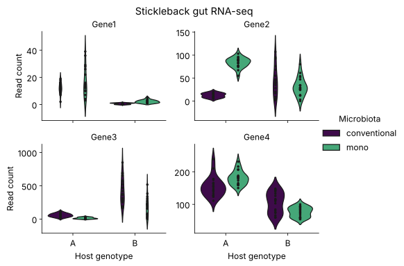
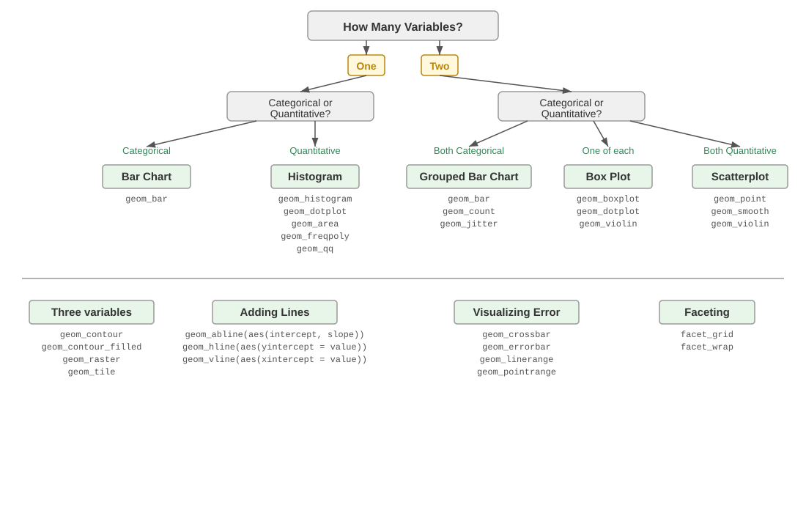
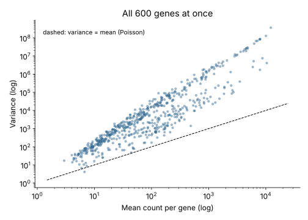
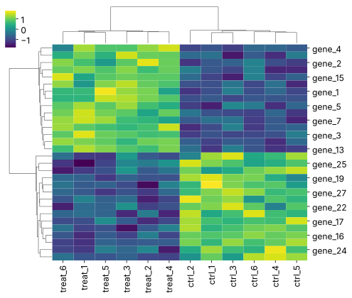
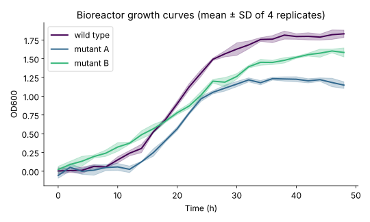
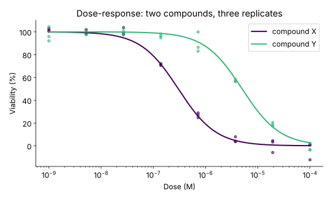
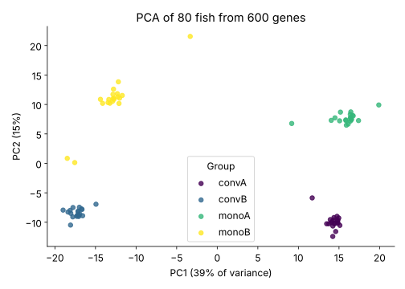

```{r}
#| label: setup
#| include: false

# Packages used in the lecture examples
library(tidyverse)
library(gt)
library(readxl)
library(patchwork)

# Consistent theme for all plots
theme_set(theme_minimal(base_size = 14))

# Reproducible random numbers
set.seed(2026)
```

## Book reading for this lecture

- [Ch. 13: Data Visualization with ggplot2](../book/chapters/13-data-visualization.html)
- [Ch. 14: Data Wrangling with the Tidyverse](../book/chapters/14-data-wrangling.html)
- *Review:*
  - [Ch. 11: R Programming Fundamentals](../book/chapters/11-r-programming.html)
  - [Ch. 12: Python Programming Fundamentals](../book/chapters/12-python-programming.html)
- *Optional:*
  - [Ch. 15: Writing Functions in R](../book/chapters/15-writing-functions.html)
  - [Ch. 22: Working with Databases](../book/chapters/22-databases.html)
- *Reference:*
  - [App. E: R Command Reference](../book/chapters/appendix-E-r.html)
  - [App. F: Python Quick Reference](../book/chapters/appendix-F-python.html)

## Goals for today

- Data frames:

  - creating

  - inspecting

  - summarizing

- Creating data sets using random draws

- The Tidyverse

- ggplot2: the grammar of graphics

- Example figures for bioengineering data

## Example 1 - a panel of figures

```{r}
#| label: fig-lec06-destination-panel
#| echo: false
#| eval: true
#| fig-width: 8
#| fig-height: 4.8
#| out-width: "62%"
#| fig-cap: "**Read Counts of Four Genes.** RNA-seq read counts for Gene1-Gene4 in n = 80 threespine stickleback (20 fish per host genotype x microbiota combination), split by host genotype and colored by microbiota treatment. Violins show each group's full count distribution; each point is one fish, jitter-dodged to reduce overplotting. Panel y-axes are scaled independently."

stickle_dest <- read_tsv("../Data_Folder/Stickle_RNAseq.tsv", show_col_types = FALSE)
stickle_dest_long <- stickle_dest |>
  pivot_longer(starts_with("Gene"), names_to = "gene", values_to = "count")

stickle_dest_long |>
  filter(gene %in% paste0("Gene", 1:4)) |>
  ggplot(aes(Genotype, count, fill = Microbiota)) +
  geom_violin(alpha = 0.4, color = NA, position = position_dodge(0.8)) +
  geom_point(aes(color = Microbiota), alpha = 0.6, size = 0.9,
             position = position_jitterdodge(jitter.width = 0.08, dodge.width = 0.8)) +
  scale_fill_viridis_d(end = 0.7) + scale_color_viridis_d(end = 0.7) +
  facet_wrap(~ gene, scales = "free_y") +
  labs(x = "Host genotype", y = "Read count") +
  theme_minimal(base_size = 12) + theme(legend.position = "top")
```

## Example 2 - A range of 600 genes at once

```{r}
#| label: fig-lec06-destination-meanvar
#| echo: false
#| eval: true
#| fig-width: 7
#| fig-height: 4.6
#| out-width: "55%"
#| fig-cap: "**The mean-variance relationship for all 600 genes.** Each point is one gene, placed by the mean and the variance of its read counts across the 80 fish, on log-log axes. The dashed line marks variance = mean, the expectation under Poisson sampling; nearly all genes fall above it, the overdispersion typical of RNA-seq counts."

stickle_dest_long |>
  group_by(gene) |>
  summarize(mean = mean(count), var = var(count)) |>
  ggplot(aes(mean, var)) +
  geom_point(alpha = 0.4, color = "#31688e") +
  geom_abline(slope = 1, intercept = 0, linetype = "dashed") +
  scale_x_log10() + scale_y_log10() +
  labs(x = "Mean count (log)", y = "Variance (log)") +
  theme_minimal(base_size = 12)
```

# Data frames

## Reading and writing files

| Job | R | Python |
|:-----------------------|:-----------------------|:-----------------------|
| Read a table | `read.delim("data/f.tsv", check.names = FALSE)` | `pd.read_csv("f.tsv", sep="\t")` |
| Write results | `write.csv(x, "results/f.csv", row.names = FALSE)` | `x.to_csv("f.csv", index=False)` |
| Save a figure | `ggsave("results/fig.svg")` · `svg()` … `dev.off()` | `plt.savefig("results/fig.svg")` |
| One column / rows by condition | `df$col` · `df[df$g == "A", ]` | `df["col"]` · `df[df["g"] == "A"]` |

## Reading and writing files

- Plain-text tables (CSV/TSV) in, derived results out:
  - write into `results/`
  - never over anything in `data/` (raw data is read-only)
- **Vector** figure formats (`.svg`, `.pdf`) scale forever
  - use them for papers
  - raster (`.png`) needs 300 dpi
- Every detail - formats, URLs, Excel, script checklists - is in the **Week 6 companion notebooks** (sections 2-4) and [Ch. 11](../book/chapters/11-r-programming.html)/[Ch. 12](../book/chapters/12-python-programming.html)

## Creating Data Frames in R and Python

- Data can come from a file, or you can *generate* it
  - Directly or
  - With random draws - that's the next section
- For now, let's make a small dummy dataset by hand, to get used to dealing with data frames
- Set up three variables (hydrogel_concentration, compression and conductivity) as vectors
- In Python the data frame comes from **pandas** (`import pandas as pd`); it has the same idea - rows are samples, columns are variables

## Creating Data Frames in R and Python

::: panel-tabset
### R

```{r}
#| label: lec06-creating-data-frames-in-r
#| echo: true
#| eval: true

hydrogel_concentration <- factor(c("low", "high", "high", "high", "medium", "medium", "medium","low"))
compression <- c(3.4, 3.4, 8.4, 3, 5.6, 8.1, 8.3, 4.5)
conductivity <- c(0, 9.2, 3.8, 5, 5.6, 4.1, 7.1, 5.3)
```

- Create a data frame where vectors become columns

```{r}
#| label: lec06-creating-data-frames-in-r-2
#| echo: true
#| eval: true

mydata <- data.frame(hydrogel_concentration, compression, conductivity)
row.names(mydata) <- c("Sample_1", "Sample_2", "Sample_3", "Sample_4",
                       "Sample_5", "Sample_6", "Sample_7", "Sample_8")
```

### Python

```{python}
#| label: lec06-creating-data-frames-py
#| echo: true
#| eval: false

import pandas as pd

hydrogel_concentration = pd.Categorical(["low", "high", "high", "high", "medium", "medium", "medium", "low"])
compression = [3.4, 3.4, 8.4, 3, 5.6, 8.1, 8.3, 4.5]
conductivity = [0, 9.2, 3.8, 5, 5.6, 4.1, 7.1, 5.3]
```

- Create a DataFrame from a dictionary of `column name: values`

```{python}
#| label: lec06-creating-data-frames-2-py
#| echo: true
#| eval: false

mydata = pd.DataFrame({"hydrogel_concentration": hydrogel_concentration,
                       "compression": compression,
                       "conductivity": conductivity})
mydata.index = [f"Sample_{i}" for i in range(1, 9)]   # row names = the index
mydata.head(3)
#          hydrogel_concentration  compression  conductivity
# Sample_1                    low          3.4           0.0
# Sample_2                   high          3.4           9.2
# Sample_3                   high          8.4           3.8
```

### Notes

- Now you have a hand-made data frame with row names
- A data frame is a *list of equal-length vectors*:
  - one name per column
  - one type per column
- Take a look at it in Positron's Variables pane, or open it in the **Data Explorer** (R and Python)
:::

## The stickleback table as a data frame

::: panel-tabset
### R

```{r}
#| label: lec06-stickle-read-r
#| echo: true
#| eval: true

stickle <- read.delim("../Data_Folder/Stickle_RNAseq.tsv", check.names = FALSE)
dim(stickle)                          # 80 fish x 604 columns
stickle[1:4, 1:7]                     # first rows, first columns
table(stickle$Genotype, stickle$Microbiota)
summary(stickle$Gene1)
```

### Python

```{python}
#| label: lec06-stickle-read-py
#| echo: true
#| eval: false

import pandas as pd

stickle = pd.read_csv("../Data_Folder/Stickle_RNAseq.tsv", sep="\t")
stickle.shape                          # (80, 604)
stickle.iloc[:4, :7]
pd.crosstab(stickle["Genotype"], stickle["Microbiota"])
stickle["Gene1"].describe()
```

### Notes

- First questions for any new table: how big (`dim` / `.shape`), what's in it (first rows), how do the groups break down (`table` / `pd.crosstab`), what does one column look like (`summary` / `.describe`)
- `check.names = FALSE` keeps the column name `Geno&Micro` exactly as it is in the file
:::

## Summary statistics - overall and by group

::: panel-tabset
### R

```{r}
#| label: lec06-summary-by-group
#| echo: true
#| eval: true

aggregate(Gene1 ~ Genotype + Microbiota, data = stickle, FUN = median)
sapply(stickle[, c("Gene1", "Gene2", "Gene3")], mean)
```

### Python

```{python}
#| label: lec06-summary-by-group-py
#| echo: true
#| eval: false

stickle.groupby(["Genotype", "Microbiota"])["Gene1"].median()
# Genotype  Microbiota
# A         conventional    11.5
#           mono            13.5
# B         conventional     1.0
#           mono             2.0
stickle[["Gene1", "Gene2", "Gene3"]].mean()
```

### Notes

- `aggregate()`'s formula - *response `~` groups* - is the standard R way of saying "this, broken down by that"
- The tidyverse's `group_by() |> summarize()` and pandas' `.groupby().agg()` generalize this to many statistics at once - coming up in a few slides
:::

# Random draws from known distributions

## Why draw random numbers?

- So far data have come from files or from typing - the third source is to **generate** them from a known distribution
- Why a scientist does this constantly:
  - **Test your analysis first**: run it on data where you *know* the right answer, before trusting it on real data
  - **Build a null model**: what would the data look like if *nothing* were going on?
  - **Plan an experiment**: simulate it - how many samples before the effect you expect becomes visible?

## Why draw random numbers?
- Each named distribution is a different *data-generating machine*:
  - **uniform** - every value in a range equally likely (positions, backgrounds)
  - **normal** - measurements that scatter symmetrically around a mean (mass, OD, expression on a log scale)
  - **Poisson** - counts of events in a fixed window (sequencing reads, cells per field, spikes per second)
- `set.seed()` (R) / `np.random.default_rng(seed)` (Python) make the draws **reproducible**: 
  - same seed, same "random" numbers
  - no seed, different "random" numbers each time

## The functions and their arguments

| Distribution | R                              | Python (numpy generator) |
|:-------------|:-------------------------------|:-------------------------|
| Uniform      | `runif(n, min = 0, max = 100)` | `rng.uniform(0, 100, n)` |
| Normal       | `rnorm(n, mean = 50, sd = 10)` | `rng.normal(50, 10, n)`  |
| Poisson      | `rpois(n, lambda = 5)`         | `rng.poisson(5, n)`      |

- The **first argument is always `n`**, how many draws you want
- The remaining arguments are the distribution's **parameters** - the knobs on the machine:
  - uniform: the `min` and `max` of the range
  - normal: the `mean` (center) and `sd` (spread)
  - Poisson: `lambda`, the average count per window (which is also its variance!)
- Set up once, draw everywhere: `set.seed(2026)` in R; `rng <- np.random.default_rng(2026)` in Python, then every draw comes from `rng`
- Each R function has siblings you'll meet in the statistics sequence: `dnorm()` (the density), `pnorm()` (cumulative probability), `qnorm()` (quantiles)

## Three distributions, drawn and plotted

::: panel-tabset
### Figure

```{r}
#| label: fig-lec06-dist-gallery
#| fig-cap: "**Random draws from three workhorse distributions.** Histograms of n = 2,000 draws each from Uniform(0, 100), Normal(mean = 50, sd = 10) and Poisson(lambda = 5), generated with seed 2026 for reproducibility. The uniform spreads evenly across its range, the normal mounds symmetrically around its mean, and the Poisson yields discrete counts concentrated near lambda."
#| fig-width: 10
#| fig-height: 3.6
#| out-width: "90%"
#| echo: false
#| eval: true

set.seed(2026); n <- 2000
par(mfrow = c(1, 3), mar = c(4, 4, 2, 1))      # a 1 x 3 grid of panels
hist(runif(n, 0, 100),  breaks = 40, col = "#31688e", border = "white",
     main = "Uniform(0, 100)",  xlab = "value")
hist(rnorm(n, 50, 10),  breaks = 40, col = "#440154", border = "white",
     main = "Normal(50, 10)",   xlab = "value")
hist(rpois(n, 5),       breaks = seq(-0.5, 20.5, 1), col = "#35b779",
     border = "white", main = "Poisson(5)",    xlab = "count")
```

### R

```{r}
#| label: lec06-dist-gallery-code
#| echo: true
#| eval: false

set.seed(2026); n <- 2000
svg("results/distributions.svg", width = 10, height = 3.6)   # open the file device
par(mfrow = c(1, 3), mar = c(4, 4, 2, 1))      # a 1 x 3 grid of panels
hist(runif(n, 0, 100),  breaks = 40, col = "#31688e", border = "white",
     main = "Uniform(0, 100)",  xlab = "value")
hist(rnorm(n, 50, 10),  breaks = 40, col = "#440154", border = "white",
     main = "Normal(50, 10)",   xlab = "value")
hist(rpois(n, 5),       breaks = seq(-0.5, 20.5, 1), col = "#35b779",
     border = "white", main = "Poisson(5)",    xlab = "count")
dev.off()                                       # close it - the file is written
```

### Python

```{python}
#| label: lec06-dist-gallery-py
#| echo: true
#| eval: false

import numpy as np
import matplotlib.pyplot as plt

rng = np.random.default_rng(2026)
n = 2000
draws = {"Uniform(0, 100)": (rng.uniform(0, 100, n), "#31688e"),
         "Normal(50, 10)":  (rng.normal(50, 10, n),  "#440154"),
         "Poisson(5)":      (rng.poisson(5, n),      "#35b779")}

fig, ax = plt.subplots(1, 3, figsize=(10, 3.6))    # the grid, as an array of axes
for a, (name, (d, c)) in zip(ax, draws.items()):
    a.hist(d, bins=40, color=c, edgecolor="white")
    a.set_title(name)
fig.tight_layout()
plt.savefig("results/distributions.svg")
plt.show()
```


### Notes

- Same machine, three settings: uniform spreads flat, normal mounds around its mean, Poisson is discrete counts piling near `lambda`
- Base R saves differently from ggplot: *open a file device → plot → `dev.off()`* - forget `dev.off()` and the file is empty
- `par(mfrow = c(1, 3))` splits the plotting device into panels; each `hist()` call fills the next one (`plt.subplots(1, 3)` hands Python the grid as an array of axes)
- Change `n`, the parameters and `breaks` - this one figure is a little simulation lab (notebook sections 8-10)
:::

# The Tidyverse for Data Wrangling

## The tidyverse family of packages

{fig-align="center" width="70%"}

::: aside
Source: [tidyverse.org](https://www.tidyverse.org/)
:::

- A family of R packages that share one grammar: data frames in, data frames out
- Loading `tidyverse` loads all of them at once

## The tidyverse packages and their pandas counterparts

| Package | Purpose | pandas / Python equivalent |
|:-----------------|:----------------------------------|:------------------|
| `dplyr` | Data manipulation (`filter`, `select`, `mutate`, `summarise`) | pandas methods |
| `ggplot2` | Data visualization | `matplotlib`, `seaborn`, `plotnine` |
| `tidyr` | Reshaping data (`pivot_longer`, `pivot_wider`, `separate`) | `melt`, `pivot` |
| `readr` | Fast reading of CSV, TSV files | `pd.read_csv` |
| `stringr` | String manipulation | `str` methods, `re` |
| `purrr` | Functional programming tools (`map`) | list comprehensions |

- Today we need three of them: `readr` (read), `tidyr` (reshape), and `ggplot2` (draw) - with `dplyr` verbs in between

## A taste of the tidyverse: the pipe `|>`

::: panel-tabset
### R

``` r
library(tidyverse)

mydata |>
  filter(compression > 4) |>                            # keep rows
  mutate(ratio = conductivity / compression) |>         # add a column
  group_by(hydrogel_concentration) |>                   # define groups
  summarise(n = n(), mean_ratio = mean(ratio))          # one row per group
```

### Python (pandas)

``` python
import pandas as pd

(mydata
   .query("compression > 4")                                  # keep rows
   .assign(ratio=lambda d: d.conductivity / d.compression)    # add a column
   .groupby("hydrogel_concentration", observed=True)          # define groups
   .agg(n=("ratio", "size"), mean_ratio=("ratio", "mean"))    # one row per group
)
```
:::

::: callout-note
- Read `|>` as **"and then"**. 
- The older `%>%` pipe does the same thing. 
- In `pandas` the dot does the same job - wrap the chain in `( )` so you can put each step on its own line.
:::

## The verbs, side by side

::: panel-tabset
### R (dplyr)

| Verb                         | What it does                   |
|------------------------------|--------------------------------|
| `filter()`                   | Keep rows matching a condition |
| `select()`                   | Keep or drop columns           |
| `mutate()`                   | Add or change columns          |
| `arrange()`                  | Sort rows                      |
| `group_by()` + `summarise()` | Summaries per group            |

### Python (pandas)

| dplyr verb                   | pandas method                        |
|------------------------------|--------------------------------------|
| `filter()`                   | `.query("...")` or `df[df.col > 4]`  |
| `select()`                   | `df[["a", "b"]]` / `.drop(columns=)` |
| `mutate()`                   | `.assign(new=...)`                   |
| `arrange()`                  | `.sort_values("col")`                |
| `group_by()` + `summarise()` | `.groupby("col").agg(...)`           |
:::

- Five verbs cover most everyday wrangling
- Each takes a data frame and returns a data frame, which is what makes them chainable

## Wide to long, then summarize

::: panel-tabset
### R

```{r}
#| label: lec07-stickle-long
#| echo: true
#| eval: true
#| message: false

library(tidyverse)
stickle <- read_tsv("../Data_Folder/Stickle_RNAseq.tsv", show_col_types = FALSE) |>
  rename(geno_micro = `Geno&Micro`)          # fix the awkward name once

stickle_long <- stickle |>
  pivot_longer(starts_with("Gene"), names_to = "gene", values_to = "count")
stickle_long                                  # 80 x 600 = 48,000 rows: one per fish x gene

gene_means <- stickle_long |>
  group_by(gene, Genotype, Microbiota) |>
  summarize(mean_count = mean(count), .groups = "drop")
gene_means |> filter(gene == "Gene1")
```

### Python

```{python}
#| label: lec07-stickle-long-py
#| echo: true
#| eval: false

import pandas as pd

stickle = pd.read_csv("../Data_Folder/Stickle_RNAseq.tsv", sep="\t")

stickle_long = stickle.melt(                      # melt = pivot_longer
    id_vars=["Individual", "Genotype", "Microbiota", "Geno&Micro"],
    var_name="gene", value_name="count")
stickle_long.shape
# (48000, 6) - one row per fish x gene

gene_means = (stickle_long
    .groupby(["gene", "Genotype", "Microbiota"], as_index=False)
    .agg(mean_count=("count", "mean")))
gene_means.query("gene == 'Gene1'")
```
:::


# GGplot2: the grammar of graphics

## The grammar of graphics: a plot is a stack of layers

{fig-align="center" width="80%"}

::: aside
Source: Leland Wilkinson, *The Grammar of Graphics*, 1999
:::

## Building a figure layer by layer: 1 - data, aesthetics, a geom

::: panel-tabset
### Figure

```{r}
#| label: fig-lec07-build-1
#| fig-cap: "**Layer 1 - every observation, visible.** Gene1 read counts for all 80 fish by host genotype. Points are individual fish, jittered horizontally (width = 0.08) to prevent overplotting; no summaries are drawn yet."
#| out-width: "55%"
#| echo: false
#| eval: true

gene1 <- stickle_long |> filter(gene == "Gene1")

ggplot(gene1, aes(x = Genotype, y = count)) +
  geom_jitter(width = 0.08)
```

### R

```{r}
#| label: lec07-build-1-code
#| echo: true
#| eval: false

gene1 <- stickle_long |> filter(gene == "Gene1")

ggplot(gene1, aes(x = Genotype, y = count)) +
  geom_jitter(width = 0.08)

ggsave("results/gene1_jitter.svg", width = 7, height = 5)
```

### Python

```{python}
#| label: lec07-build-1-py
#| echo: true
#| eval: false

import seaborn as sns
import matplotlib.pyplot as plt

gene1 = stickle_long.query("gene == 'Gene1'")
sns.stripplot(data=gene1, x="Genotype", y="count", jitter=0.08)
plt.savefig("results/gene1_jitter.svg")
plt.show()
```

### Notes

- `ggplot(data, aes(...))` declares the **mapping**: which column drives which visual channel
- A **geom** draws it; `geom_jitter()` is `geom_point()` plus sideways noise
- Nothing is styled yet - and it is already a readable figure
- **The save-line convention**: 
  every example in this deck ends by writing the figure to `results/` as an SVG - `ggsave()` for ggplot, `plt.savefig()` in Python
:::

## Building a figure layer by layer: 2 - more aesthetics, more geoms

::: panel-tabset
### Figure

```{r}
#| label: fig-lec07-build-2
#| fig-cap: "**Layer 2 - distributions and raw data together.** Gene1 read counts by host genotype, split by microbiota treatment (fill and color). Violins show each group's density; overlaid points are individual fish, jitter-dodged so the two treatments sit side by side within each genotype."
#| out-width: "55%"
#| echo: false
#| eval: true

ggplot(gene1, aes(x = Genotype, y = count, fill = Microbiota)) +
  geom_violin(alpha = 0.4, color = NA, position = position_dodge(0.8)) +
  geom_point(aes(color = Microbiota), alpha = 0.6,
             position = position_jitterdodge(jitter.width = 0.08, dodge.width = 0.8))
```

### R

```{r}
#| label: lec07-build-2-code
#| echo: true
#| eval: false

ggplot(gene1, aes(x = Genotype, y = count, fill = Microbiota)) +
  geom_violin(alpha = 0.4, color = NA, position = position_dodge(0.8)) +
  geom_point(aes(color = Microbiota), alpha = 0.6,
             position = position_jitterdodge(jitter.width = 0.08, dodge.width = 0.8))

ggsave("results/gene1_violin.svg", width = 7, height = 5)
```

### Python

```{python}
#| label: lec07-build-2-py
#| echo: true
#| eval: false

sns.violinplot(data=gene1, x="Genotype", y="count", hue="Microbiota",
               inner=None, alpha=0.4)
sns.stripplot(data=gene1, x="Genotype", y="count", hue="Microbiota",
              dodge=True, size=4, alpha=0.6, legend=False)
plt.savefig("results/gene1_violin.svg")
plt.show()
```

### Notes

- Mapping a column to `fill` / `color` (`hue` in seaborn) splits the groups **and** builds the legend - automatically, from the data
- Layers draw in order: violin first, points on top
- `position_dodge` places the two microbiota groups side by side
:::

## Building a figure layer by layer: 3 - facets, scales, labels, theme

::: panel-tabset
### Figure

```{r}
#| label: fig-lec07-build-3
#| fig-cap: "**Stickleback gut RNA-seq - the assembled panel.** Read counts for Gene1-Gene4 (one panel per gene, independent y-axes) by host genotype and microbiota treatment in all 80 fish. Violins show group distributions; points are individual fish; colors are from the colorblind-safe viridis palette."
#| fig-width: 8
#| fig-height: 5
#| out-width: "60%"
#| echo: false
#| eval: true

stickle_long |>
  filter(gene %in% paste0("Gene", 1:4)) |>
  ggplot(aes(Genotype, count, fill = Microbiota)) +
  geom_violin(alpha = 0.4, color = NA, position = position_dodge(0.8)) +
  geom_point(aes(color = Microbiota), alpha = 0.6, size = 1.2,
             position = position_jitterdodge(jitter.width = 0.08, dodge.width = 0.8)) +
  scale_fill_viridis_d(end = 0.7) + scale_color_viridis_d(end = 0.7) +
  facet_wrap(~ gene, scales = "free_y") +
  labs(x = "Host genotype", y = "Read count",
       title = "",
       subtitle = "") +
  theme_minimal(base_size = 14) + theme(legend.position = "top")
```

### R

```{r}
#| label: lec07-build-3-code
#| echo: true
#| eval: false

stickle_long |>
  filter(gene %in% paste0("Gene", 1:4)) |>
  ggplot(aes(Genotype, count, fill = Microbiota)) +
  geom_violin(alpha = 0.4, color = NA, position = position_dodge(0.8)) +
  geom_point(aes(color = Microbiota), alpha = 0.6, size = 1.2,
             position = position_jitterdodge(jitter.width = 0.08, dodge.width = 0.8)) +
  scale_fill_viridis_d(end = 0.7) + scale_color_viridis_d(end = 0.7) +
  facet_wrap(~ gene, scales = "free_y") +
  labs(x = "Host genotype", y = "Read count",
       title = "Stickleback gut RNA-seq",
       subtitle = "Each point is one fish; violins show the full distribution") +
  theme_minimal(base_size = 14) + theme(legend.position = "top")

ggsave("results/gene_panel.svg", width = 8, height = 5)
```

### Python

```{python}
#| label: lec07-build-3-py
#| echo: true
#| eval: false

long4 = stickle_long[stickle_long["gene"].isin([f"Gene{i}" for i in range(1, 5)])]

g = sns.catplot(data=long4, x="Genotype", y="count", hue="Microbiota",
                col="gene", col_wrap=2, kind="violin", inner="point",
                palette=["#440154", "#35b779"], sharey=False, height=2.6, aspect=1.3)
g.set_axis_labels("Host genotype", "Read count")
g.set_titles("{col_name}")
g.figure.suptitle("Stickleback gut RNA-seq", y=1.02)
plt.savefig("results/gene_panel.svg", bbox_inches="tight")
plt.show()
```

{width="55%"}

### Notes

- `facet_wrap(~ gene)` - one panel per gene, for free; `scales = "free_y"` lets each gene keep its own axis
- This **is** Figure 1 from the start of class - and the last line of the code writes it to `results/gene_panel.svg`
:::

## Common `ggplot2` geoms - each with an example from our data

| Geom | Purpose | Data type | seaborn equivalent |
|:-----------------|:-----------------|:------------------|:------------------|
| `geom_histogram()` | Histograms | Single continuous | `sns.histplot()` |
| `geom_boxplot()` | Boxplots | Continuous by category | `sns.boxplot()` |
| `geom_point()` | Scatterplots | Two continuous | `sns.scatterplot()` |
| `geom_smooth()` | Trend lines | Two continuous | `sns.regplot()` |
| `geom_line()` | Line plots | Continuous over ordered | `sns.lineplot()` |
| `geom_bar()` / `geom_col()` | Bar charts | Categorical counts / values | `sns.countplot()` / `sns.barplot()` |

::: callout-tip
The next six slides draw each one from the stickleback table. `facet_wrap(~ group)` splits any of them into one panel per group, and `ggsave("figure.pdf")` writes the last plot to a file. Full mechanics: [Ch. 13](../book/chapters/13-data-visualization.html).
:::

## Geom example 1: `geom_histogram()`

::: panel-tabset
### Figure

```{r}
#| label: fig-lec06-geom-hist
#| fig-cap: "**The distribution of Gene1 expression.** Histogram of Gene1 read counts across all 80 fish (30 bins). The right-skewed shape - many fish with low counts and a long tail of high expressors - is typical of RNA-seq count data."
#| out-width: "55%"
#| echo: false
#| eval: true

ggplot(gene1, aes(x = count)) +
  geom_histogram(bins = 30, fill = "#31688e", color = "white") +
  labs(x = "Gene1 read count", y = "Number of fish")
```

### R

```{r}
#| label: lec06-geom-hist-code
#| echo: true
#| eval: false

ggplot(gene1, aes(x = count)) +
  geom_histogram(bins = 30, fill = "#31688e", color = "white") +
  labs(x = "Gene1 read count", y = "Number of fish")

ggsave("results/gene1_histogram.svg", width = 7, height = 5)
```

### Python

```{python}
#| label: lec06-geom-hist-py
#| echo: true
#| eval: false

sns.histplot(data=gene1, x="count", bins=30, color="#31688e")
plt.xlabel("Gene1 read count"); plt.ylabel("Number of fish")
plt.savefig("results/gene1_histogram.svg")
plt.show()
```

### Notes

- One continuous column mapped to `x`; the geom does the binning
- `bins` changes the story - always try a few values
- The smooth cousin is `geom_density()`
:::

## Geom example 2: `geom_boxplot()`

::: panel-tabset
### Figure

```{r}
#| label: fig-lec06-geom-box
#| fig-cap: "**Gene2 expression by genotype and microbiota.** Boxes show the median, interquartile range and 1.5 x IQR whiskers of Gene2 read counts per host genotype (n = 40 each), split by microbiota treatment (n = 20 per box); values beyond the whiskers are plotted as individual points."
#| out-width: "55%"
#| echo: false
#| eval: true

stickle_long |>
  filter(gene == "Gene2") |>
  ggplot(aes(x = Genotype, y = count, fill = Microbiota)) +
  geom_boxplot(alpha = 0.7) +
  scale_fill_viridis_d(end = 0.7) +
  labs(x = "Host genotype", y = "Gene2 read count")
```

### R

```{r}
#| label: lec06-geom-box-code
#| echo: true
#| eval: false

stickle_long |>
  filter(gene == "Gene2") |>
  ggplot(aes(x = Genotype, y = count, fill = Microbiota)) +
  geom_boxplot(alpha = 0.7) +
  scale_fill_viridis_d(end = 0.7) +
  labs(x = "Host genotype", y = "Gene2 read count")

ggsave("results/gene2_boxplot.svg", width = 7, height = 5)
```

### Python

```{python}
#| label: lec06-geom-box-py
#| echo: true
#| eval: false

gene2 = stickle_long.query("gene == 'Gene2'")
sns.boxplot(data=gene2, x="Genotype", y="count", hue="Microbiota",
            palette=["#440154", "#35b779"])
plt.xlabel("Host genotype"); plt.ylabel("Gene2 read count")
plt.savefig("results/gene2_boxplot.svg")
plt.show()
```

### Notes

- Continuous by category: the five-number summary per group, at a glance
- A second categorical variable maps to `fill` / `hue` and dodges automatically
- When the *shape* of the distribution matters, swap in `geom_violin()` (as in Figure 1)
:::

## Geom example 3: `geom_point()`

::: panel-tabset
### Figure

```{r}
#| label: fig-lec06-geom-point
#| fig-cap: "**Covariation of two genes.** Gene2 versus Gene1 read counts; each point is one of the 80 fish, colored by host genotype. Fish with jointly elevated counts suggest shared regulation - or simply deeper sequencing."
#| out-width: "55%"
#| echo: false
#| eval: true

ggplot(stickle, aes(x = Gene1, y = Gene2, color = Genotype)) +
  geom_point(size = 2.5, alpha = 0.7) +
  scale_color_viridis_d(end = 0.6) +
  labs(x = "Gene1 read count", y = "Gene2 read count")
```

### R

```{r}
#| label: lec06-geom-point-code
#| echo: true
#| eval: false

ggplot(stickle, aes(x = Gene1, y = Gene2, color = Genotype)) +
  geom_point(size = 2.5, alpha = 0.7) +
  scale_color_viridis_d(end = 0.6) +
  labs(x = "Gene1 read count", y = "Gene2 read count")

ggsave("results/gene1_gene2_scatter.svg", width = 7, height = 5)
```

### Python

```{python}
#| label: lec06-geom-point-py
#| echo: true
#| eval: false

sns.scatterplot(data=stickle, x="Gene1", y="Gene2", hue="Genotype",
                s=50, alpha=0.7)
plt.savefig("results/gene1_gene2_scatter.svg")
plt.show()
```

### Notes

- Two continuous columns: the workhorse for relationships between variables
- A third column rides along as `color` - no extra work
- With thousands of points, lower `alpha` so density shows through
:::

## Geom example 4: `geom_smooth()`

::: panel-tabset
### Figure

```{r}
#| label: fig-lec06-geom-smooth
#| fig-cap: "**A fitted trend as a layer.** Gene2 versus Gene1 read counts for all 80 fish (points), with an ordinary least-squares line fitted by geom_smooth(method = 'lm'); the gray ribbon is the 95 percent confidence interval of the fit."
#| out-width: "55%"
#| echo: false
#| eval: true
#| message: false

ggplot(stickle, aes(x = Gene1, y = Gene2)) +
  geom_point(alpha = 0.5, color = "#31688e") +
  geom_smooth(method = "lm", color = "#440154") +
  labs(x = "Gene1 read count", y = "Gene2 read count")
```

### R

```{r}
#| label: lec06-geom-smooth-code
#| echo: true
#| eval: false

ggplot(stickle, aes(x = Gene1, y = Gene2)) +
  geom_point(alpha = 0.5, color = "#31688e") +
  geom_smooth(method = "lm", color = "#440154") +
  labs(x = "Gene1 read count", y = "Gene2 read count")

ggsave("results/gene1_gene2_trend.svg", width = 7, height = 5)
```

### Python

```{python}
#| label: lec06-geom-smooth-py
#| echo: true
#| eval: false

sns.regplot(data=stickle, x="Gene1", y="Gene2",
            scatter_kws={"alpha": 0.5, "color": "#31688e"},
            line_kws={"color": "#440154"})
plt.savefig("results/gene1_gene2_trend.svg")
plt.show()
```

### Notes

- A trend is just **another layer** on the scatter - that is the grammar at work
- `method = "lm"` fits a straight line (with its confidence ribbon); the default is a flexible loess curve
- The fitted line previews the statistics sequence: this *is* a regression
:::

## Geom example 5: `geom_line()`

::: panel-tabset
### Figure

```{r}
#| label: fig-lec06-geom-line
#| fig-cap: "**The ranked expression profile of the transcriptome.** Mean read count per gene for all 600 genes, ordered from most to least expressed, on a log10 y-axis. A handful of highly expressed genes dominate, followed by a long shallow tail - the characteristic shape of an RNA-seq expression profile."
#| out-width: "55%"
#| echo: false
#| eval: true

stickle_long |>
  group_by(gene) |>
  summarize(mean_count = mean(count)) |>
  arrange(desc(mean_count)) |>
  mutate(rank = row_number()) |>
  ggplot(aes(x = rank, y = mean_count)) +
  geom_line(color = "#440154", linewidth = 1) +
  scale_y_log10() +
  labs(x = "Gene rank (by mean expression)", y = "Mean read count (log)")
```

### R

```{r}
#| label: lec06-geom-line-code
#| echo: true
#| eval: false

stickle_long |>
  group_by(gene) |>
  summarize(mean_count = mean(count)) |>
  arrange(desc(mean_count)) |>
  mutate(rank = row_number()) |>
  ggplot(aes(x = rank, y = mean_count)) +
  geom_line(color = "#440154", linewidth = 1) +
  scale_y_log10() +
  labs(x = "Gene rank (by mean expression)", y = "Mean read count (log)")

ggsave("results/gene_rank_means.svg", width = 7, height = 5)
```

### Python

```{python}
#| label: lec06-geom-line-py
#| echo: true
#| eval: false

genes = [c for c in stickle.columns if c.startswith("Gene")]
means = stickle[genes].mean().sort_values(ascending=False)

fig, ax = plt.subplots()
ax.plot(range(1, len(means) + 1), means, color="#440154", lw=2)
ax.set(yscale="log", xlabel="Gene rank (by mean expression)",
       ylabel="Mean read count (log)")
plt.savefig("results/gene_rank_means.svg")
plt.show()
```

### Notes

- Lines need an **ordered** x - time, position, or (here) rank; connecting unordered categories draws meaningless slopes
- The shape is classic transcriptomics: a few genes dominate, then a long tail - which is why the log scale is essential
- The whole pipeline is dplyr verbs feeding the plot: `group_by |> summarize |> arrange |> mutate |> ggplot`
:::

## Geom example 6: `geom_col()`

::: panel-tabset
### Figure

```{r}
#| label: fig-lec06-geom-col
#| fig-cap: "**Group medians of Gene1 expression.** Median Gene1 read count per host genotype x microbiota group (n = 20 fish per bar), with microbiota treatments dodged within each genotype. Bars begin at zero, keeping relative magnitudes honest."
#| out-width: "55%"
#| echo: false
#| eval: true

gene1 |>
  group_by(Genotype, Microbiota) |>
  summarize(median_count = median(count), .groups = "drop") |>
  ggplot(aes(x = Genotype, y = median_count, fill = Microbiota)) +
  geom_col(position = "dodge") +
  scale_fill_viridis_d(end = 0.7) +
  labs(x = "Host genotype", y = "Median Gene1 read count")
```

### R

```{r}
#| label: lec06-geom-col-code
#| echo: true
#| eval: false

gene1 |>
  group_by(Genotype, Microbiota) |>
  summarize(median_count = median(count), .groups = "drop") |>
  ggplot(aes(x = Genotype, y = median_count, fill = Microbiota)) +
  geom_col(position = "dodge") +
  scale_fill_viridis_d(end = 0.7) +
  labs(x = "Host genotype", y = "Median Gene1 read count")

ggsave("results/gene1_group_medians.svg", width = 7, height = 5)
```

### Python

```{python}
#| label: lec06-geom-col-py
#| echo: true
#| eval: false

import numpy as np

sns.barplot(data=gene1, x="Genotype", y="count", hue="Microbiota",
            estimator=np.median, errorbar=None,
            palette=["#440154", "#35b779"])
plt.xlabel("Host genotype"); plt.ylabel("Median Gene1 read count")
plt.savefig("results/gene1_group_medians.svg")
plt.show()
```

### Notes

- `geom_bar()` **counts rows** for you; `geom_col()` plots **values you computed** - here, the group medians from `summarize()`
- Bars start at zero by construction, which keeps magnitudes honest
- A bar hides the distribution behind one number - prefer boxplots or violins when the spread matters
:::

## Choosing the right kind of plot

{fig-align="center" width="90%"}

## Four genes in one figure

::: panel-tabset
### Figure

```{r}
#| label: fig-lec06-closer-panel
#| fig-cap: "**Example 1, rebuilt from the raw file.** Read counts for Gene1-Gene4 in all 80 fish, by host genotype and microbiota treatment, produced by the complete script shown in the R and Python tabs: read the raw TSV, reshape to long format, filter to four genes, plot, and save."
#| fig-width: 8
#| fig-height: 5
#| out-width: "60%"
#| echo: false
#| eval: true
#| message: false

stickle <- read_tsv("../Data_Folder/Stickle_RNAseq.tsv", show_col_types = FALSE) |>
  rename(geno_micro = `Geno&Micro`)

stickle_long <- stickle |>
  pivot_longer(starts_with("Gene"), names_to = "gene", values_to = "count")

stickle_long |>
  filter(gene %in% paste0("Gene", 1:4)) |>
  ggplot(aes(Genotype, count, fill = Microbiota)) +
  geom_violin(alpha = 0.4, color = NA, position = position_dodge(0.8)) +
  geom_point(aes(color = Microbiota), alpha = 0.6, size = 1.2,
             position = position_jitterdodge(jitter.width = 0.08, dodge.width = 0.8)) +
  scale_fill_viridis_d(end = 0.7) + scale_color_viridis_d(end = 0.7) +
  facet_wrap(~ gene, scales = "free_y") +
  labs(x = "Host genotype", y = "Read count",
       title = "Stickleback gut RNA-seq",
       subtitle = "Each point is one fish; violins show the full distribution") +
  theme_minimal(base_size = 14) + theme(legend.position = "top")
```

### R

```{r}
#| label: lec06-closer-panel-code
#| echo: true
#| eval: false

library(tidyverse)

stickle <- read_tsv("data/Stickle_RNAseq.tsv", show_col_types = FALSE) |>
  rename(geno_micro = `Geno&Micro`)

stickle_long <- stickle |>
  pivot_longer(starts_with("Gene"), names_to = "gene", values_to = "count")

stickle_long |>
  filter(gene %in% paste0("Gene", 1:4)) |>
  ggplot(aes(Genotype, count, fill = Microbiota)) +
  geom_violin(alpha = 0.4, color = NA, position = position_dodge(0.8)) +
  geom_point(aes(color = Microbiota), alpha = 0.6, size = 1.2,
             position = position_jitterdodge(jitter.width = 0.08, dodge.width = 0.8)) +
  scale_fill_viridis_d(end = 0.7) + scale_color_viridis_d(end = 0.7) +
  facet_wrap(~ gene, scales = "free_y") +
  labs(x = "Host genotype", y = "Read count",
       title = "Stickleback gut RNA-seq",
       subtitle = "Each point is one fish; violins show the full distribution") +
  theme_minimal(base_size = 14) + theme(legend.position = "top")

ggsave("results/gene_panel.svg", width = 8, height = 6)
```

### Python

```{python}
#| label: lec06-closer-panel-py
#| echo: true
#| eval: false

import pandas as pd
import seaborn as sns
import matplotlib.pyplot as plt

stickle = pd.read_csv("data/Stickle_RNAseq.tsv", sep="\t")

stickle_long = stickle.melt(
    id_vars=["Individual", "Genotype", "Microbiota", "Geno&Micro"],
    var_name="gene", value_name="count")

long4 = stickle_long[stickle_long["gene"].isin([f"Gene{i}" for i in range(1, 5)])]
g = sns.catplot(data=long4, x="Genotype", y="count", hue="Microbiota",
                col="gene", col_wrap=2, kind="violin", inner="point",
                palette=["#440154", "#35b779"], sharey=False, height=2.6, aspect=1.3)
g.set_axis_labels("Host genotype", "Read count")
g.set_titles("{col_name}")
g.figure.suptitle("Stickleback gut RNA-seq", y=1.02)

plt.savefig("results/gene_panel.svg", bbox_inches="tight")
plt.show()
```

{width="55%"}

### Notes

- This is **Example 1 from the start of class**, now as one complete, visible script: read the raw TSV → `rename` the awkward column → `pivot_longer` → filter → plot → save
- Every line was derived earlier today: the reshape in the tidyverse section, each plot layer in the build-up slides
- About 20 lines, exactly as promised - and swapping the four gene names reuses it for *any* genes (Ex 6 asks you to do exactly that)
:::

## All 600 genes in one figure

::: panel-tabset
### Figure

```{r}
#| label: fig-lec07-meanvar
#| fig-cap: "**Mean versus variance for every gene, with a fitted trend.** Each of the 600 points is one gene, placed by the mean and variance of its read counts across the 80 fish (log10 axes). Dashed line: variance = mean, the Poisson expectation; solid curve: loess trend through the observed genes. Essentially every gene lies above the line - the overdispersion that motivates negative-binomial models of RNA-seq."
#| out-width: "55%"
#| echo: false
#| eval: true
#| message: false

stickle_long |>
  group_by(gene) |>
  summarize(mean = mean(count), var = var(count)) |>
  ggplot(aes(mean, var)) +
  geom_point(alpha = 0.4, color = "#31688e") +
  geom_abline(slope = 1, intercept = 0, linetype = "dashed") +
  geom_smooth(se = FALSE, color = "#440154") +
  scale_x_log10() + scale_y_log10() +
  labs(x = "Mean count per gene (log)", y = "Variance (log)",
       title = "All 600 genes at once",
       subtitle = "Dashed line: variance = mean (Poisson). Real RNA-seq runs hotter.") +
  theme_minimal(base_size = 14)
```

### R

```{r}
#| label: lec07-meanvar-code
#| echo: true
#| eval: false

stickle_long |>
  group_by(gene) |>
  summarize(mean = mean(count), var = var(count)) |>
  ggplot(aes(mean, var)) +
  geom_point(alpha = 0.4, color = "#31688e") +
  geom_abline(slope = 1, intercept = 0, linetype = "dashed") +
  geom_smooth(se = FALSE, color = "#440154") +
  scale_x_log10() + scale_y_log10() +
  labs(x = "Mean count per gene (log)", y = "Variance (log)",
       title = "All 600 genes at once",
       subtitle = "Dashed line: variance = mean (Poisson). Real RNA-seq runs hotter.") +
  theme_minimal(base_size = 14)

ggsave("results/mean_variance.svg", width = 7, height = 5)
```

### Python

```{python}
#| label: lec07-meanvar-py
#| echo: true
#| eval: false

import numpy as np

genes = [c for c in stickle.columns if c.startswith("Gene")]
mv = pd.DataFrame({"mean": stickle[genes].mean(), "var": stickle[genes].var()})

fig, ax = plt.subplots()
ax.scatter(mv["mean"], mv["var"], s=10, alpha=0.4, color="#31688e")
lims = np.array([mv["mean"].min() / 2, mv["mean"].max() * 2])
ax.plot(lims, lims, ls="--", color="black")              # variance = mean
ax.set(xscale="log", yscale="log",
       xlabel="Mean count per gene (log)", ylabel="Variance (log)",
       title="All 600 genes at once")
plt.savefig("results/mean_variance.svg")
plt.show()
```

{width="50%"}

### Notes

- `group_by(gene) |> summarize()` collapses 48,000 rows to 600 - one point per gene
- The biology in one glance: variance **outruns** the mean, which is why RNA-seq models use the negative binomial rather than the Poisson - a preview of the statistics to come
- This is Figure 2 from the start of class, plus a trend layer - **you can now build both opening figures**
:::

# A gallery of figures for bioengineering data

## Matching the figure to the question

| Figure | The question it answers | R | Python |
|:-----------------|:-----------------|:-----------------|:-----------------|
| Clustered **heatmap** + dendrograms | which samples / genes behave alike? | `heatmap()` | `sns.clustermap()` |
| **Time course** with ribbons | how do trajectories differ, and how noisy are they? | `geom_ribbon()` + `geom_line()` | `plt.fill_between()` |
| **Dose-response** curve | where is the IC50? | `geom_point()` + `geom_smooth()`, log-x | `plt.semilogx()` |
| **PCA** scores plot | what structures 600 dimensions? | `prcomp()` + `geom_point()` | `sklearn` `PCA` + scatter |
| **Violin** + jitter | what does the whole distribution look like, by group? | `geom_violin()` | `sns.violinplot()` |

- The next four slides draw each one - two from *synthesized* data (so you can see the generating process), two from the real stickleback table
- Full walk-throughs live in the book's [Ch. 13 figure gallery](../book/chapters/13-data-visualization.html)

## Gallery 1: a clustered heatmap, from synthesized expression data

::: panel-tabset
### Figure

```{r}
#| label: fig-lec07-zoo-heatmap
#| fig-cap: "**Hierarchical clustering of a synthesized expression matrix.** Simulated log-expression for 30 genes (rows) across 12 samples (columns): per-gene baselines drawn from Normal(8, 1) with Normal(0, 0.4) measurement noise, genes 1-15 shifted up (+2) and genes 16-30 shifted down (-1.5) in the six treated samples. Values are row-standardized before coloring (viridis scale); marginal dendrograms show hierarchical clustering, which recovers both the control/treated split and the two gene modules."
#| fig-width: 7
#| fig-height: 6
#| out-width: "48%"
#| echo: false
#| eval: true

set.seed(2026)
expr <- matrix(rnorm(30 * 12, mean = 8, sd = 0.4), nrow = 30) +
        rnorm(30)                                 # a baseline level per gene
expr[1:15, 7:12]  <- expr[1:15, 7:12] + 2         # module 1: up in treated
expr[16:30, 7:12] <- expr[16:30, 7:12] - 1.5      # module 2: down in treated
rownames(expr) <- paste0("gene_", 1:30)
colnames(expr) <- c(paste0("ctrl_", 1:6), paste0("treat_", 1:6))

heatmap(expr, scale = "row", col = hcl.colors(50, "viridis"), margins = c(6, 5))
```

### R

```{r}
#| label: lec07-zoo-heatmap-code
#| echo: true
#| eval: false

set.seed(2026)
expr <- matrix(rnorm(30 * 12, mean = 8, sd = 0.4), nrow = 30) +
        rnorm(30)                                 # a baseline level per gene
expr[1:15, 7:12]  <- expr[1:15, 7:12] + 2         # module 1: up in treated
expr[16:30, 7:12] <- expr[16:30, 7:12] - 1.5      # module 2: down in treated
rownames(expr) <- paste0("gene_", 1:30)
colnames(expr) <- c(paste0("ctrl_", 1:6), paste0("treat_", 1:6))

svg("results/heatmap.svg", width = 7, height = 6)
heatmap(expr, scale = "row", col = hcl.colors(50, "viridis"), margins = c(6, 5))
dev.off()
```

### Python

```{python}
#| label: lec07-zoo-heatmap-py
#| echo: true
#| eval: false

expr = pd.DataFrame(
    rng.normal(8, 0.4, size=(30, 12)) + rng.normal(0, 1, size=(30, 1)),
    index=[f"gene_{i+1}" for i in range(30)],
    columns=[f"ctrl_{i+1}" for i in range(6)] + [f"treat_{i+1}" for i in range(6)])
expr.iloc[:15, 6:] += 2.0          # module 1: up in treated
expr.iloc[15:, 6:] -= 1.5          # module 2: down in treated

sns.clustermap(expr, z_score=0, cmap="viridis", figsize=(7, 6))
plt.savefig("results/heatmap.svg", bbox_inches="tight")
plt.show()
```

{width="42%"}

### Notes

- `scale = "row"` / `z_score=0` standardizes each gene, so the colors compare *patterns*, not absolute levels
- The dendrograms are hierarchical clustering - both tools run it for you; richer R options: `pheatmap`, `ComplexHeatmap`
- The synthesis is the random-draws section at work: `rnorm()` baselines plus shifted modules
:::

## Gallery 2: growth curves with ribbons

::: panel-tabset
### Figure

```{r}
#| label: fig-lec07-zoo-timecourse
#| fig-cap: "**Simulated bioreactor growth of three strains.** Optical density (OD600) over 48 h for three strains following logistic growth with differing carrying capacities (K = 1.2-1.8) and growth rates (r = 0.15-0.35 per h), sampled every 2 h in quadruplicate with Normal(0, 0.05) measurement noise. Lines are replicate means; shaded ribbons span plus or minus one standard deviation."
#| out-width: "55%"
#| echo: false
#| eval: true
#| message: false

params <- tibble(strain = c("wild type", "mutant A", "mutant B"),
                 K = c(1.8, 1.2, 1.6),            # carrying capacity
                 r = c(0.25, 0.35, 0.15))         # growth rate
growth <- expand_grid(params, rep = 1:4, time = seq(0, 48, by = 2)) |>
  mutate(od = K / (1 + exp(-r * (time - 20))) + rnorm(n(), sd = 0.05))

growth |>
  group_by(strain, time) |>
  summarize(mean = mean(od), sd = sd(od), .groups = "drop") |>
  ggplot(aes(time, mean, color = strain, fill = strain)) +
  geom_ribbon(aes(ymin = mean - sd, ymax = mean + sd), alpha = 0.25, color = NA) +
  geom_line(linewidth = 1) +
  scale_color_viridis_d(end = 0.8) + scale_fill_viridis_d(end = 0.8) +
  labs(x = "Time (h)", y = "OD600",
       title = "Bioreactor growth curves (mean ± SD of 4 replicates)") +
  theme_minimal(base_size = 14)
```

### R

```{r}
#| label: lec07-zoo-timecourse-code
#| echo: true
#| eval: false

params <- tibble(strain = c("wild type", "mutant A", "mutant B"),
                 K = c(1.8, 1.2, 1.6),            # carrying capacity
                 r = c(0.25, 0.35, 0.15))         # growth rate
growth <- expand_grid(params, rep = 1:4, time = seq(0, 48, by = 2)) |>
  mutate(od = K / (1 + exp(-r * (time - 20))) + rnorm(n(), sd = 0.05))

growth |>
  group_by(strain, time) |>
  summarize(mean = mean(od), sd = sd(od), .groups = "drop") |>
  ggplot(aes(time, mean, color = strain, fill = strain)) +
  geom_ribbon(aes(ymin = mean - sd, ymax = mean + sd), alpha = 0.25, color = NA) +
  geom_line(linewidth = 1) +
  scale_color_viridis_d(end = 0.8) + scale_fill_viridis_d(end = 0.8) +
  labs(x = "Time (h)", y = "OD600",
       title = "Bioreactor growth curves (mean ± SD of 4 replicates)") +
  theme_minimal(base_size = 14)

ggsave("results/growth_curves.svg", width = 7, height = 5)
```

### Python

```{python}
#| label: lec07-zoo-timecourse-py
#| echo: true
#| eval: false

t = np.arange(0, 49, 2)
strains = {"wild type": (1.8, 0.25), "mutant A": (1.2, 0.35), "mutant B": (1.6, 0.15)}

fig, ax = plt.subplots()
for (name, (K, r)), c in zip(strains.items(), ["#440154", "#31688e", "#35b779"]):
    reps = np.array([K / (1 + np.exp(-r * (t - 20))) + rng.normal(0, 0.05, len(t))
                     for _ in range(4)])
    m, s = reps.mean(axis=0), reps.std(axis=0)
    ax.plot(t, m, color=c, lw=2, label=name)
    ax.fill_between(t, m - s, m + s, color=c, alpha=0.25)
ax.set(xlabel="Time (h)", ylabel="OD600")
ax.legend()
plt.savefig("results/growth_curves.svg")
plt.show()
```

{width="52%"}

### Notes

- The `group_by() |> summarize()` + ribbon pattern works for *any* repeated time course: sensor logs, qPCR curves, cyclic loading of a hydrogel
- The synthesis itself is the random-draws section at work: a deterministic logistic curve plus `rnorm()` noise
:::

## Gallery 3: dose-response curves

::: panel-tabset
### Figure

```{r}
#| label: fig-lec07-zoo-doseresponse
#| fig-cap: "**Simulated dose-response curves for two compounds.** Cell viability (percent) across eight doses spanning 1 nM to 100 uM (log-scaled x-axis), three replicates per dose, generated from logistic decay with IC50 = 0.3 uM (compound X) and 5 uM (compound Y), Hill slope 1.2, plus Normal(0, 4) noise. Points are individual replicates; curves are loess fits; each compound's IC50 is where its curve crosses 50 percent viability."
#| out-width: "55%"
#| echo: false
#| eval: true
#| message: false

dr <- expand_grid(tibble(compound = c("compound X", "compound Y"),
                         ic50 = c(3e-7, 5e-6)),
                  rep = 1:3,
                  dose = 10^seq(-9, -4, length.out = 8)) |>
  mutate(viability = 100 / (1 + (dose / ic50)^1.2) + rnorm(n(), sd = 4))

ggplot(dr, aes(dose, viability, color = compound)) +
  geom_point(alpha = 0.7, size = 2) +
  geom_smooth(se = FALSE) +
  scale_x_log10() +
  scale_color_viridis_d(end = 0.6) +
  labs(x = "Dose (M)", y = "Viability (%)",
       title = "Dose-response: two compounds, three replicates") +
  theme_minimal(base_size = 14)
```

### R

```{r}
#| label: lec07-zoo-doseresponse-code
#| echo: true
#| eval: false

dr <- expand_grid(tibble(compound = c("compound X", "compound Y"),
                         ic50 = c(3e-7, 5e-6)),
                  rep = 1:3,
                  dose = 10^seq(-9, -4, length.out = 8)) |>
  mutate(viability = 100 / (1 + (dose / ic50)^1.2) + rnorm(n(), sd = 4))

ggplot(dr, aes(dose, viability, color = compound)) +
  geom_point(alpha = 0.7, size = 2) +
  geom_smooth(se = FALSE) +
  scale_x_log10() +
  scale_color_viridis_d(end = 0.6) +
  labs(x = "Dose (M)", y = "Viability (%)",
       title = "Dose-response: two compounds, three replicates") +
  theme_minimal(base_size = 14)

ggsave("results/dose_response.svg", width = 7, height = 5)
```

### Python

```{python}
#| label: lec07-zoo-doseresponse-py
#| echo: true
#| eval: false

dose = np.logspace(-9, -4, 8)
fig, ax = plt.subplots()
for (name, ic50), c in zip({"compound X": 3e-7, "compound Y": 5e-6}.items(),
                           ["#440154", "#35b779"]):
    for _ in range(3):
        viab = 100 / (1 + (dose / ic50) ** 1.2) + rng.normal(0, 4, len(dose))
        ax.scatter(dose, viab, s=18, alpha=0.6, color=c)
    grid = np.logspace(-9, -4, 200)
    ax.plot(grid, 100 / (1 + (grid / ic50) ** 1.2), color=c, lw=2, label=name)
ax.set(xscale="log", xlabel="Dose (M)", ylabel="Viability (%)")
ax.legend()
plt.savefig("results/dose_response.svg")
plt.show()
```

{width="52%"}

### Notes

- A log-scaled x axis (`scale_x_log10()` / `xscale="log"`) is what makes dose-response curves readable - doses span five orders of magnitude
- `geom_smooth()` draws a data-driven trend; a real assay would fit a four-parameter logistic model (coming in the statistics sequence)
:::

## Gallery 4: PCA of the real stickleback fish

::: panel-tabset
### Figure

```{r}
#| label: fig-lec07-zoo-pca
#| fig-cap: "**Principal component analysis of all 80 fish.** PCA of log-transformed (log1p), unit-scaled read counts for 600 genes. Each point is one fish, placed by its scores on the first two principal components and colored by genotype x microbiota group; distance between points reflects overall transcriptome similarity."
#| out-width: "55%"
#| echo: false
#| eval: true

gene_mat <- stickle |> select(starts_with("Gene"))
pca <- prcomp(log1p(gene_mat), scale. = TRUE)     # log1p tames the counts

bind_cols(as_tibble(pca$x[, 1:2]),
          stickle |> select(geno_micro)) |>
  ggplot(aes(PC1, PC2, color = geno_micro)) +
  geom_point(size = 2.5, alpha = 0.8) +
  scale_color_viridis_d(name = "Group") +
  labs(title = "PCA: 80 fish from 600 genes",
       subtitle = "Distance between points = overall expression similarity") +
  theme_minimal(base_size = 14)
```

### R

```{r}
#| label: lec07-zoo-pca-code
#| echo: true
#| eval: false

gene_mat <- stickle |> select(starts_with("Gene"))
pca <- prcomp(log1p(gene_mat), scale. = TRUE)     # log1p tames the counts

bind_cols(as_tibble(pca$x[, 1:2]),
          stickle |> select(geno_micro)) |>
  ggplot(aes(PC1, PC2, color = geno_micro)) +
  geom_point(size = 2.5, alpha = 0.8) +
  scale_color_viridis_d(name = "Group") +
  labs(title = "PCA: 80 fish from 600 genes",
       subtitle = "Distance between points = overall expression similarity") +
  theme_minimal(base_size = 14)

ggsave("results/pca_fish.svg", width = 7, height = 5)
```

### Python

```{python}
#| label: lec07-zoo-pca-py
#| echo: true
#| eval: false

from sklearn.decomposition import PCA

X = np.log1p(stickle[genes].to_numpy())
X = (X - X.mean(axis=0)) / X.std(axis=0)          # like scale. = TRUE
scores = PCA(n_components=2).fit_transform(X)

fig, ax = plt.subplots()
for grp, c in zip(sorted(stickle["Geno&Micro"].unique()),
                  ["#440154", "#31688e", "#35b779", "#fde725"]):
    sel = stickle["Geno&Micro"] == grp
    ax.scatter(scores[sel, 0], scores[sel, 1], s=30, alpha=0.8, color=c, label=grp)
ax.set(xlabel="PC1", ylabel="PC2", title="PCA of 80 fish from 600 genes")
ax.legend(title="Group")
plt.savefig("results/pca_fish.svg")
plt.show()
```

{width="50%"}

### Notes

- PCA compresses 600 correlated gene columns into a few axes of maximal variation - the workhorse first look at any high-dimensional data set
- One `prcomp()` call plus one `ggplot()` call; the groups separate because the biology is real
:::

## Self-study this week: the rest of the toolbox

The lecture built the spine; these carry the rest. All of it is on the [Examples page](../Examples.html) and in the book - budget a couple of hours before next Monday:

| Topic | Where it lives |
|:-----------------------------------|:-----------------------------------|
| Reading & writing files, saving figures, in full | Notebook §2-4 · [Ch. 11](../book/chapters/11-r-programming.html)/[Ch. 12](../book/chapters/12-python-programming.html) |
| Random draws, honest density overlays, base graphics | Notebook §8-11 |
| **Control flow: `if`, `for`, `while` - and when a vector beats a loop** | Notebook §16-18 · Parisa's `s2`-`s4` · Ch. 11/12 |
| Logical operators and membership (`%in%` / `.isin()`) | Notebook §15 |
| Inspecting objects, common gotchas, reading error messages | Notebook §14, §30-31 · Ch. 11/12 |
| Writing your own functions | [Ch. 15](../book/chapters/15-writing-functions.html) · Parisa's `s4` |

- The companion notebooks (`Lecture06_R_companion.ipynb`, `Lecture06_Python_companion.ipynb`) are a matched R/Python pair with the same 31 sections - run them side by side
- Installing packages and managing **environments** get their own lecture in Week 9
- [Ex 6](../Exercise_Folder/Exercises_Week06.qmd) practices all of today plus the self-study - including rebuilding the four-gene panel for your own genes
- Next Monday (L07): **Quarto** - your code, figures and writing become one reproducible document
