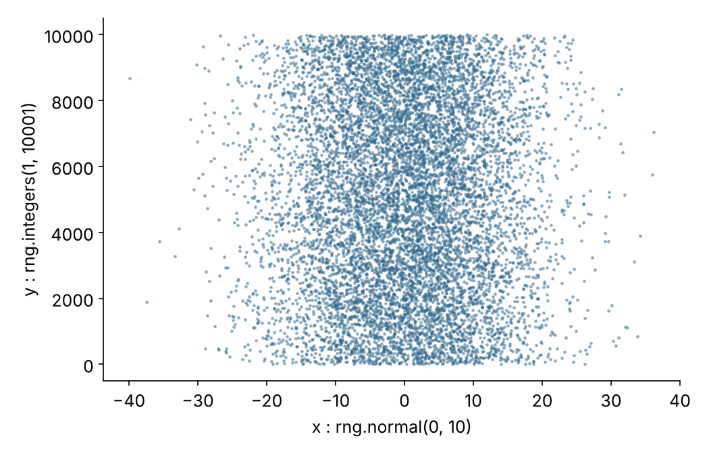
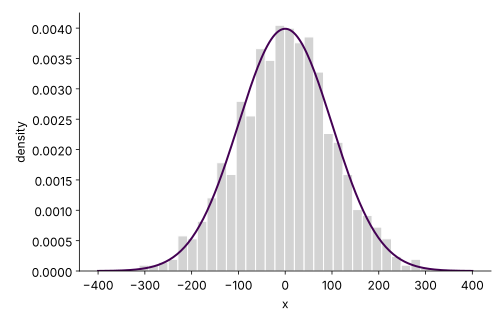
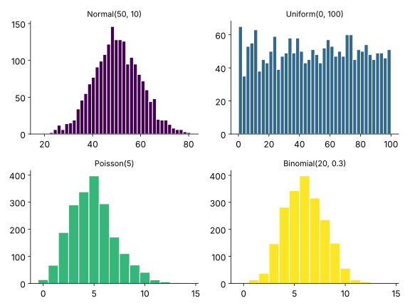
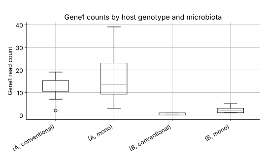
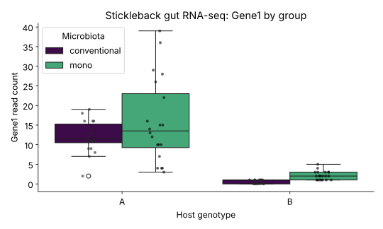

```{r}
#| label: setup
#| include: false

# Packages used in the lecture examples
library(tidyverse)
library(gt)
library(readxl)
library(patchwork)

# Consistent theme for all plots
theme_set(theme_minimal(base_size = 14))

# Reproducible random numbers
set.seed(2026)
```

## Book reading for this lecture

The course book goes deeper on everything in this lecture. Read before or after class:

-   *Review:* [Ch. 11: R Programming Fundamentals](../book/chapters/11-r-programming.html)
-   *Review:* [Ch. 12: Python Programming Fundamentals](../book/chapters/12-python-programming.html)
-   [Ch. 13: Data Visualization with ggplot2](../book/chapters/13-data-visualization.html)
-   *Reference:* [App. E: R Command Reference](../book/chapters/appendix-E-r.html) · [App. F: Python Quick Reference](../book/chapters/appendix-F-python.html)

## Goals for today

-   Where we are headed: one publication-quality figure, built over two lectures
-   Recap: indexing data frames (L05)
-   Reading and writing files - tables, scripts and figures (moved in from L05)
-   Drawing samples from distributions
-   Base graphics: histograms, scatterplots and multi-panel figures
-   Creating data frames and computing summary statistics

## Where we are headed: one figure, two lectures

```{r}
#| label: fig-lec06-destination
#| echo: false
#| eval: true
#| fig-width: 12
#| fig-height: 4.6
#| out-width: "100%"
#| fig-cap: "Left: four genes, every fish, split by genotype and microbiota. Right: mean vs. variance for all 600 genes at once. About 20 lines of R, starting from the raw TSV."

stickle_dest <- read_tsv("../Data_Folder/Stickle_RNAseq.tsv", show_col_types = FALSE)
stickle_dest_long <- stickle_dest |>
  pivot_longer(starts_with("Gene"), names_to = "gene", values_to = "count")

p1 <- stickle_dest_long |>
  filter(gene %in% paste0("Gene", 1:4)) |>
  ggplot(aes(Genotype, count, fill = Microbiota)) +
  geom_violin(alpha = 0.4, color = NA, position = position_dodge(0.8)) +
  geom_point(aes(color = Microbiota), alpha = 0.6, size = 0.9,
             position = position_jitterdodge(jitter.width = 0.08, dodge.width = 0.8)) +
  scale_fill_viridis_d(end = 0.7) + scale_color_viridis_d(end = 0.7) +
  facet_wrap(~ gene, scales = "free_y") +
  labs(x = "Host genotype", y = "Read count", title = "Four genes, every fish") +
  theme_minimal(base_size = 12) + theme(legend.position = "top")

p2 <- stickle_dest_long |>
  group_by(gene) |>
  summarize(mean = mean(count), var = var(count)) |>
  ggplot(aes(mean, var)) +
  geom_point(alpha = 0.4, color = "#31688e") +
  geom_abline(slope = 1, intercept = 0, linetype = "dashed") +
  scale_x_log10() + scale_y_log10() +
  labs(x = "Mean count (log)", y = "Variance (log)", title = "All 600 genes") +
  theme_minimal(base_size = 12)

p1 + p2 + plot_layout(widths = c(3, 2))
```

-   **Today**: reading and writing files, data frames, random draws, and first figures
-   **Next Monday (L07)**: the tidyverse, reshaping, and the grammar of graphics - we end by building exactly this figure, line by line
-   Every slide between here and there is one ingredient of it


## Recap from L05: indexing a data frame

Last week ended with indexing - today builds straight on it. The one-slide version:

| Job | R | Python |
|:---|:---|:---|
| One column | `df$col` · `df[["weird name"]]` | `df["col"]` |
| Rows and cells | `df[1:5, c("a", "b")]` · `df[3, 2]` | `df.loc[0:4, ["a", "b"]]` · `df.iloc[2, 1]` |
| Rows by condition | `df[df$g == "A", ]` | `df[df["g"] == "A"]` |

-   Full details: the L05 deck, [Ch. 11](../book/chapters/11-r-programming.html) and [Ch. 12](../book/chapters/12-python-programming.html)

# Reading and writing files

## Reading tabular data

::: panel-tabset
### R

```{r}
#| label: lec06-reading-tabular
#| echo: true
#| eval: true

# comma-separated:   read.csv("file.csv")
# tab-separated:     read.delim("file.tsv")
stickle <- read.delim("../Data_Folder/Stickle_RNAseq.tsv",
                      header = TRUE,          # first line is column names (default)
                      check.names = FALSE)    # keep "Geno&Micro" exactly as written
dim(stickle)      # rows, columns
stickle[1:2, 1:5]
```

### Python

```{python}
#| label: lec06-reading-tabular-py
#| echo: true
#| eval: false

import pandas as pd

# pd.read_csv handles both - sep="\t" makes it tab-separated
stickle = pd.read_csv("../Data_Folder/Stickle_RNAseq.tsv", sep="\t")
stickle.shape     # (rows, columns)
# (80, 604)
stickle.iloc[0:2, 0:5]

# pandas reads URLs directly - handy for course data:
# stickle = pd.read_csv("https://wcresko.github.io/BioE_Comp_Tools_Fa2026/Data_Folder/Stickle_RNAseq.tsv", sep="\t")
```
:::

- The two questions every reader function asks: *where are the column names?* (`header`) and *what separates the values?* (`sep`)
- Without `check.names = FALSE`, R "fixes" `Geno&Micro` to `Geno.Micro` - fine, until your column names no longer match the file
- One new trick for today: `read.table(..., row.names = 1)` / `pd.read_csv(..., index_col=0)` when the file's first column holds row *labels* rather than data
- The tidyverse's `readr` (`read_tsv()`, faster and friendlier) takes over next week in L07

## Writing tabular data

::: panel-tabset
### R

```{r}
#| label: lec06-writing-tabular
#| echo: true
#| eval: false

totals <- data.frame(Individual = stickle$Individual,
                     Total = rowSums(stickle[, grep("^Gene", names(stickle))]))

write.csv(totals, "results/totals.csv", row.names = FALSE)
write.table(totals, "results/totals.tsv", sep = "\t",
            row.names = FALSE, quote = FALSE)
```

### Python

```{python}
#| label: lec06-writing-tabular-py
#| echo: true
#| eval: false

genes  = [c for c in stickle.columns if c.startswith("Gene")]
totals = pd.DataFrame({"Individual": stickle["Individual"],
                       "Total": stickle[genes].sum(axis=1)})

totals.to_csv("results/totals.csv", index=False)
totals.to_csv("results/totals.tsv", sep="\t", index=False)
```
:::

- `row.names = FALSE` / `index=False` - otherwise both languages sneak an extra unnamed column of row numbers into your file
- Write **derived** tables into `results/` or `output/`; never overwrite anything in `data/` (raw data is read-only - the L01 project structure exists for exactly this reason)

## What can you read and write?

| Format | R | Python |
|:-----------------------|:-----------------------|:-----------------------|
| CSV / TSV (plain text) | `read.csv()` / `write.csv()` | `pd.read_csv()` / `.to_csv()` |
| Excel `.xlsx` | `readxl::read_excel()` / `writexl` | `pd.read_excel()` / `.to_excel()` |
| Plain text, line by line | `readLines()` / `writeLines()` | `Path.read_text()`, `open()` |
| JSON | `jsonlite::fromJSON()` | `json.load()`, `pd.read_json()` |
| Native binary objects | `saveRDS()` / `readRDS()` | `pickle` |
| Big columnar data | `arrow::read_parquet()` | `pd.read_parquet()` |

- **Plain-text formats (CSV/TSV) are the default**: portable, future-proof, readable by `grep`/`awk`, and diff-able in Git
- Binary formats (`.rds`, `.pickle`, `.parquet`) are faster and preserve types exactly - but only their own language (or ecosystem) can read them
- Excel files are for *exchanging with humans*; convert to CSV/TSV before analysis when you can (remember the gene-name-to-date horror stories)

## Reading and writing in a script

The warm-up scripts already showed the whole pattern - here it is as a checklist:

``` r
infile <- "data/Stickle_RNAseq.tsv"        # 1. relative path from the project root
if (!file.exists(infile)) {                # 2. check before reading,
  cat("Error: File", infile, "not found!\n")
  quit(status = 1)                         #    fail loudly with an exit status
}
stickle <- read.delim(infile, check.names = FALSE)   # 3. read
# ... compute ...
dir.create("results", showWarnings = FALSE)          # 4. make the output folder
write.csv(totals, "results/totals.csv", row.names = FALSE)  # 5. write results
```

- **Relative paths** from the project root (`data/...`, `results/...`) - never `/Users/yourname/...`, which breaks on every other machine (including Talapas)
- Python's version of each step: `Path("data/f.tsv")`, `.is_file()`, `sys.exit(1)`, `Path("results").mkdir(exist_ok=True)`, `.to_csv()`
- Run scripts **from the project root** so the relative paths resolve

## Saving figures to files

::: panel-tabset
### R

```{r}
#| label: lec06-saving-figures
#| echo: true
#| eval: false

svg("results/boxplot.svg", width = 7, height = 5)   # open a file 'device'
boxplot(totals ~ group)                             # draw into it
dev.off()                                           # close it - ALWAYS

png("results/boxplot.png", width = 7, height = 5,
    units = "in", res = 300)                        # raster needs a resolution
boxplot(totals ~ group)
dev.off()

# pdf("results/boxplot.pdf", ...) works the same way
# ggplot figures: ggsave("results/boxplot.svg") - coming in L07
```

### Python

```{python}
#| label: lec06-saving-figures-py
#| echo: true
#| eval: false

import matplotlib.pyplot as plt

plt.boxplot([1, 2, 3])                 # draw ...
plt.savefig("results/boxplot.svg")     # ... the extension picks the format
plt.savefig("results/boxplot.png", dpi=300)   # raster needs a resolution
plt.savefig("results/boxplot.pdf")
```
:::

- **Vector** formats (`.svg`, `.pdf`) scale forever - use them for papers and posters; **raster** formats (`.png`, 300 dpi) for slides and the web
- R's pattern is *open device → plot → `dev.off()`* (forget `dev.off()` and the file is empty or locked); matplotlib's is simply `plt.savefig()`

# Drawing samples from distributions

## Drawing random samples

-   R has a family of `r*` functions - `rnorm()`, `runif()`, `rpois()`, `rbinom()` - that draw random numbers from named distributions; `sample()` draws from anything you give it
-   In Python random numbers come from a numpy **generator**: `rng = np.random.default_rng(2026)` (the number is the seed, like `set.seed(2026)` in R)
-   Play with the arguments and watch the figure change

::: panel-tabset
### R

```{r}
#| label: fig-lec06-random-draws
#| fig-cap: "10,000 normal draws (x) against 10,000 equal-probability integers (y)"
#| out-width: "60%"
#| echo: true
#| eval: true

x <- rnorm(10000, mean = 0, sd = 10)
y <- sample(1:10000, 10000, replace = TRUE)
plot(x, y, pch = 16, cex = 0.3, col = adjustcolor("#31688e", 0.4))
```

### Python

```{python}
#| label: lec06-random-draws-py
#| echo: true
#| eval: false

import numpy as np
import matplotlib.pyplot as plt

rng = np.random.default_rng(2026)
x = rng.normal(0, 10, 10000)                 # rnorm(10000, 0, 10)
y = rng.integers(1, 10001, size=10000)       # sample(1:10000, ..., replace = TRUE)
plt.scatter(x, y, s=2, alpha=0.4, color="#31688e")
plt.xlabel("x : rng.normal(0, 10)"); plt.ylabel("y : rng.integers(1, 10001)")
plt.show()
```

{width="55%"}
:::

## Histograms - and an honest density overlay

::: panel-tabset
### R

```{r}
#| label: fig-lec06-hist-density
#| fig-cap: "1,000 normal draws on the density scale, with the theoretical curve on top"
#| out-width: "60%"
#| echo: true
#| eval: true

x <- rnorm(1000, mean = 0, sd = 100)
hist(x, breaks = 30, freq = FALSE, col = "grey90", border = "white")
curve(dnorm(x, mean = 0, sd = 100), add = TRUE, col = "#440154", lwd = 2)
```

### Python

```{python}
#| label: lec06-hist-density-py
#| echo: true
#| eval: false

from scipy.stats import norm

x = rng.normal(0, 100, 1000)
plt.hist(x, bins=30, density=True, color="lightgrey", edgecolor="white")
grid = np.linspace(-400, 400, 200)
plt.plot(grid, norm.pdf(grid, 0, 100), color="#440154", lw=2)
plt.xlabel("x"); plt.ylabel("density")
plt.show()
```

{width="55%"}
:::

-   `freq = FALSE` / `density=True` puts the bars on the **density** scale, so the theoretical curve (`dnorm()` / `norm.pdf()`) drops straight on top - no magic scaling constants
-   `hist()` is a **high-level** call (starts a fresh figure); `curve(..., add = TRUE)` is a **low-level** call (draws onto the open one)

## Four distributions at once - and multi-panel figures

::: panel-tabset
### R

```{r}
#| label: fig-lec06-dist-gallery
#| fig-cap: "2,000 draws each from four workhorse distributions"
#| fig-width: 8
#| fig-height: 6
#| out-width: "65%"
#| echo: true
#| eval: true

set.seed(2026); n <- 2000
par(mfrow = c(2, 2), mar = c(4, 4, 2, 1))      # a 2 x 2 grid of panels
hist(rnorm(n, 50, 10),     breaks = 40, col = "#440154", border = "white",
     main = "Normal(50, 10)",     xlab = "value")
hist(runif(n, 0, 100),     breaks = 40, col = "#31688e", border = "white",
     main = "Uniform(0, 100)",    xlab = "value")
hist(rpois(n, 5),          breaks = seq(-0.5, 20.5, 1), col = "#35b779",
     border = "white", main = "Poisson(5)",         xlab = "count")
hist(rbinom(n, 20, 0.3),   breaks = seq(-0.5, 20.5, 1), col = "#fde725",
     border = "white", main = "Binomial(20, 0.3)",  xlab = "successes")
```

### Python

```{python}
#| label: lec06-dist-gallery-py
#| echo: true
#| eval: false

n = 2000
draws = {"Normal(50, 10)":    rng.normal(50, 10, n),
         "Uniform(0, 100)":   rng.uniform(0, 100, n),
         "Poisson(5)":        rng.poisson(5, n),
         "Binomial(20, 0.3)": rng.binomial(20, 0.3, n)}

fig, ax = plt.subplots(2, 2, figsize=(8, 6))    # the grid, as an array of axes
for a, (name, d), c in zip(ax.flat, draws.items(),
                           ["#440154", "#31688e", "#35b779", "#fde725"]):
    a.hist(d, bins=40, color=c, edgecolor="white")
    a.set_title(name)
fig.tight_layout()
plt.show()
```

{width="55%"}
:::

-   `par(mfrow = c(2, 2))` splits the plotting device into panels; each high-level call fills the next one (`plt.subplots(2, 2)` hands Python the grid as an array of axes)
-   Four workhorses: **normal** (measurements), **uniform** (anything equally likely), **Poisson** (counts), **binomial** (successes out of *n* tries)
-   Change `n`, the parameters and `breaks` - this one figure is a little simulation lab

## Base graphics vocabulary

-   **High-level** functions start a figure: `plot()`, `hist()`, `boxplot()`, `barplot()`
-   **Low-level** functions add to the open one: `points()`, `lines()`, `curve(add = TRUE)`, `legend()`, `text()`
-   Arguments do the styling: `type =` (points vs. lines), `col =`, `pch =` (point shape), `lwd =` (line width), `xlab = / ylab = / main =`

::: panel-tabset
### R

```{r}
#| label: fig-lec06-base-vocab
#| fig-cap: "One high-level call, then two low-level calls on top"
#| out-width: "55%"
#| echo: true
#| eval: true

seq_1 <- seq(0, 10, by = 0.1)
plot(seq_1, sin(seq_1), type = "l", lwd = 2, col = "#440154",
     xlab = "x", ylab = "sin(x)", main = "plot(), then points(), then legend()")
points(seq_1[seq(1, 101, by = 10)], sin(seq_1)[seq(1, 101, by = 10)],
       pch = 16, col = "#35b779")
legend("topright", legend = c("line", "every 10th point"),
       col = c("#440154", "#35b779"), lty = c(1, NA), pch = c(NA, 16), bty = "n")
```

### Python

```{python}
#| label: lec06-base-vocab-py
#| echo: true
#| eval: false

seq_1 = np.linspace(0, 10, 101)
plt.plot(seq_1, np.sin(seq_1), lw=2, color="#440154")          # the line
plt.plot(seq_1[::10], np.sin(seq_1)[::10], "o", color="#35b779")  # every 10th point
plt.xlabel("x"); plt.ylabel("sin(x)")
plt.title("matplotlib layers the same way")
plt.legend(["line", "every 10th point"])
plt.show()
```
:::

-   Most *published* figures skip the hand-styling and use **ggplot2** (R) or **seaborn** (Python) - that is next Monday's centerpiece


# Data frames

## Creating Data Frames in R and Python

-   As you have seen, in R you can generate your own random data set drawn from nearly any distribution very easily.
-   Often we will want to use collected data.
-   Now, let’s make a dummy dataset to get used to dealing with data frames
-   Set up three variables (hydrogel_concentration, compression and conductivity) as vectors
-   In Python the data frame comes from **pandas** (`import pandas as pd`); it has the same idea - rows are samples, columns are variables

## Creating Data Frames in R and Python

::: panel-tabset
### R

```{r}
#| label: lec06-creating-data-frames-in-r
#| echo: true
#| eval: true

hydrogel_concentration <- factor(c("low", "high", "high", "high", "medium", "medium", "medium","low"))
compression <- c(3.4, 3.4, 8.4, 3, 5.6, 8.1, 8.3, 4.5)
conductivity <- c(0, 9.2, 3.8, 5, 5.6, 4.1, 7.1, 5.3)
```

-   Create a data frame where vectors become columns

```{r}
#| label: lec06-creating-data-frames-in-r-2
#| echo: true
#| eval: true

mydata <- data.frame(hydrogel_concentration, compression, conductivity)
row.names(mydata) <- c("Sample_1", "Sample_2", "Sample_3", "Sample_4",
                       "Sample_5", "Sample_6", "Sample_7", "Sample_8")
```

### Python

```{python}
#| label: lec06-creating-data-frames-py
#| echo: true
#| eval: false

import pandas as pd

hydrogel_concentration = pd.Categorical(["low", "high", "high", "high", "medium", "medium", "medium", "low"])
compression = [3.4, 3.4, 8.4, 3, 5.6, 8.1, 8.3, 4.5]
conductivity = [0, 9.2, 3.8, 5, 5.6, 4.1, 7.1, 5.3]
```

-   Create a DataFrame from a dictionary of `column name: values`

```{python}
#| label: lec06-creating-data-frames-2-py
#| echo: true
#| eval: false

mydata = pd.DataFrame({"hydrogel_concentration": hydrogel_concentration,
                       "compression": compression,
                       "conductivity": conductivity})
mydata.index = [f"Sample_{i}" for i in range(1, 9)]   # row names = the index
mydata.head(3)
#          hydrogel_concentration  compression  conductivity
# Sample_1                    low          3.4           0.0
# Sample_2                   high          3.4           9.2
# Sample_3                   high          8.4           3.8
```
:::

-   Now you have a hand-made data frame with row names
-   Take a look at it in Positron's Variables pane, or open it in the **Data Explorer** (R and Python)

## Running example: the stickleback table as a data frame

::: panel-tabset
### R

```{r}
#| label: lec06-stickle-read-r
#| echo: true
#| eval: true

stickle <- read.delim("../Data_Folder/Stickle_RNAseq.tsv", check.names = FALSE)
dim(stickle)                          # 80 fish x 604 columns
stickle[1:4, 1:7]                     # first rows, first columns
table(stickle$Genotype, stickle$Microbiota)
summary(stickle$Gene1)
```

### Python

```{python}
#| label: lec06-stickle-read-py
#| echo: true
#| eval: false

import pandas as pd

stickle = pd.read_csv("../Data_Folder/Stickle_RNAseq.tsv", sep="\t")
stickle.shape                          # (80, 604)
stickle.iloc[:4, :7]
pd.crosstab(stickle["Genotype"], stickle["Microbiota"])
stickle["Gene1"].describe()
```
:::

## Summary statistics - overall and by group

::: panel-tabset
### R

```{r}
#| label: lec06-summary-by-group
#| echo: true
#| eval: true

aggregate(Gene1 ~ Genotype + Microbiota, data = stickle, FUN = median)
sapply(stickle[, c("Gene1", "Gene2", "Gene3")], mean)
```

### Python

```{python}
#| label: lec06-summary-by-group-py
#| echo: true
#| eval: false

stickle.groupby(["Genotype", "Microbiota"])["Gene1"].median()
# Genotype  Microbiota
# A         conventional    11.5
#           mono            13.5
# B         conventional     1.0
#           mono             2.0
stickle[["Gene1", "Gene2", "Gene3"]].mean()
```
:::

-   `aggregate()`'s formula - *response `~` groups* - is exactly the formula `boxplot()` uses, next slide
-   The tidyverse's `group_by() |> summarize()` and pandas' `.groupby().agg()` generalize this to many statistics at once (L07)

## A first real figure

::: panel-tabset
### R

```{r}
#| label: fig-lec06-stickle-boxplot
#| fig-cap: "Gene1 counts by host genotype and microbiota treatment"
#| out-width: "60%"
#| echo: true
#| eval: true

boxplot(Gene1 ~ Genotype + Microbiota, data = stickle,
        col = c("steelblue", "tomato", "steelblue", "tomato"),
        ylab = "Gene1 read count", las = 2)
```

### Python

```{python}
#| label: lec06-stickle-boxplot-py
#| echo: true
#| eval: false

stickle.boxplot(column="Gene1", by=["Genotype", "Microbiota"])
plt.suptitle("")
plt.title("Gene1 counts by host genotype and microbiota")
plt.ylabel("Gene1 read count")
plt.show()
```

{width="55%"}
:::

::: callout-tip
`check.names = FALSE` keeps the column name `Geno&Micro` as it is in the file; without it R would rename it `Geno.Micro`. Either way, wrapping an awkward name in back-ticks lets you refer to it:

``` r
stickle$`Geno&Micro`
```
:::

## The same figure, dressed for a lab meeting

::: panel-tabset
### R

```{r}
#| label: fig-lec06-stickle-styled
#| fig-cap: "Low-level polish: colors, names, a legend and real labels"
#| out-width: "60%"
#| echo: true
#| eval: true

boxplot(Gene1 ~ Microbiota + Genotype, data = stickle,
        col = c("#44015499", "#35b77999"),
        names = c("conv\nA", "mono\nA", "conv\nB", "mono\nB"),
        las = 1, xlab = "", ylab = "Gene1 read count",
        main = "Stickleback gut RNA-seq: Gene1 by group")
legend("topright", fill = c("#44015499", "#35b77999"), title = "Microbiota",
       legend = c("conventional", "mono"), bty = "n")
```

### Python

```{python}
#| label: lec06-stickle-styled-py
#| echo: true
#| eval: false

import seaborn as sns

sns.boxplot(data=stickle, x="Genotype", y="Gene1", hue="Microbiota",
            palette=["#440154", "#35b779"])
sns.stripplot(data=stickle, x="Genotype", y="Gene1", hue="Microbiota",
              dodge=True, size=4, alpha=0.6, palette="dark:black", legend=False)
plt.xlabel("Host genotype"); plt.ylabel("Gene1 read count")
plt.title("Stickleback gut RNA-seq: Gene1 by group")
plt.show()
```

{width="55%"}
:::

-   Every improvement is one argument or one extra call - it works, but it is manual bookkeeping
-   ggplot2 and seaborn derive the grouping, colors and legend *from the data* - that is why they take over next week

## Your turn

1.  **Script it**: write `scripts/summarize_stickleback.R` or `.py` that reads `data/Stickle_RNAseq.tsv`, writes a per-group median table for a gene of your choice to `results/`, and saves today's distribution gallery to `results/distributions.svg` *and* a 300-dpi PNG
2.  **Vary it**: change the gallery's parameters (means, sds, probabilities, `breaks`) until each panel surprises you
3.  **Stretch**: find the gene with the largest group difference you can, and re-draw the styled boxplot for it

Working versions of the script (R and Python) are on the [Examples page](../Examples.html) - but only look after your own runs.

::: callout-tip
-   Parisa's `s7` (pandas data frames) and `s8` (plotting) notebooks on the [Examples page](../Examples.html) are the perfect companions to today
-   Everything on today's slides is in [Ch. 11](../book/chapters/11-r-programming.html), [Ch. 12](../book/chapters/12-python-programming.html) and [Ch. 13](../book/chapters/13-data-visualization.html)
:::

## Summary

-   **Files**: read with `read.delim()` / `pd.read_csv()`; write results into `results/`, never over raw data; save figures as vector SVG/PDF (or 300-dpi PNG for slides)
-   **Random draws**: `rnorm()`, `runif()`, `rpois()`, `rbinom()` and numpy's `rng.*` - data-generating machines for testing ideas before touching real data
-   **Base graphics**: high-level calls start a figure, low-level calls add to it, `par(mfrow)` / `plt.subplots()` makes panels
-   **Data frames**: columns are vectors with names; `summary()`, `table()`, `aggregate()` / `.describe()`, `pd.crosstab()`, `.groupby()` answer the first questions
-   Next Monday (L07): the tidyverse, `pivot_longer()` and ggplot2 - we finish the destination figure from the start of today
