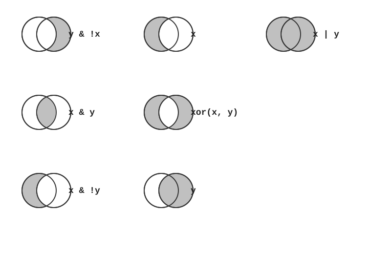

```{r}
#| label: setup
#| include: false

# Packages used in the lecture examples
library(tidyverse)
library(gt)
library(readxl)
library(patchwork)

# Consistent theme for all plots
theme_set(theme_minimal(base_size = 14))

# Reproducible random numbers
set.seed(2026)
```

## Book reading for this lecture

The course book goes deeper on everything in this lecture. Read before or after class:

-   *Review:* [Ch. 8: Tidy Data Principles](../book/chapters/08-tidy-data.html)
-   [Ch. 13: Data Visualization with ggplot2](../book/chapters/13-data-visualization.html)
-   [Ch. 14: Data Wrangling with the Tidyverse](../book/chapters/14-data-wrangling.html)
-   [Ch. 15: Writing Functions in R](../book/chapters/15-writing-functions.html)
-   *Reference:* [App. E: R Command Reference](../book/chapters/appendix-E-r.html) · [App. F: Python Quick Reference](../book/chapters/appendix-F-python.html)
-   *Optional:* [Ch. 22: Working with Databases](../book/chapters/22-databases.html) - for when project data outgrow flat files

## Goals for today

-   The destination figure, one more time - **today we build it**
-   Installing vs. loading packages; inspecting objects and reading error messages
-   Control flow: `if`, `for` and `while` - and when a vector beats a loop
-   The tidyverse and the pipe `|>` for data wrangling
-   ggplot2: the grammar of graphics, built up layer by layer
-   A gallery of figures for bioengineering data: heatmaps, growth curves, dose-response and PCA

## Where we are headed - today we arrive

```{r}
#| label: fig-lec07-destination
#| echo: false
#| eval: true
#| fig-width: 12
#| fig-height: 4.6
#| out-width: "100%"
#| fig-cap: "L06's opening figure. By the end of today you can write every line of it."

stickle_dest <- read_tsv("../Data_Folder/Stickle_RNAseq.tsv", show_col_types = FALSE)
stickle_dest_long <- stickle_dest |>
  pivot_longer(starts_with("Gene"), names_to = "gene", values_to = "count")

p1 <- stickle_dest_long |>
  filter(gene %in% paste0("Gene", 1:4)) |>
  ggplot(aes(Genotype, count, fill = Microbiota)) +
  geom_violin(alpha = 0.4, color = NA, position = position_dodge(0.8)) +
  geom_point(aes(color = Microbiota), alpha = 0.6, size = 0.9,
             position = position_jitterdodge(jitter.width = 0.08, dodge.width = 0.8)) +
  scale_fill_viridis_d(end = 0.7) + scale_color_viridis_d(end = 0.7) +
  facet_wrap(~ gene, scales = "free_y") +
  labs(x = "Host genotype", y = "Read count", title = "Four genes, every fish") +
  theme_minimal(base_size = 12) + theme(legend.position = "top")

p2 <- stickle_dest_long |>
  group_by(gene) |>
  summarize(mean = mean(count), var = var(count)) |>
  ggplot(aes(mean, var)) +
  geom_point(alpha = 0.4, color = "#31688e") +
  geom_abline(slope = 1, intercept = 0, linetype = "dashed") +
  scale_x_log10() + scale_y_log10() +
  labs(x = "Mean count (log)", y = "Variance (log)", title = "All 600 genes") +
  theme_minimal(base_size = 12)

p1 + p2 + plot_layout(widths = c(3, 2))
```

-   The ingredients you already own: reading files, data frames, logical tests, distributions (L05-L06)
-   Today's new ingredients: the **pipe**, `pivot_longer()`, and the **grammar of graphics**


# Going further with R and Python

## Installing vs. loading packages

::: panel-tabset
### R

``` r
install.packages("tidyverse")   # download & install - ONCE per computer
library(tidyverse)              # load - EVERY new R session
```

::: incremental
-   **`install.packages()`** puts a package on your computer (from CRAN)
-   **`library()`** makes it available in *this* session - restarting R means re-running `library()`
-   "there is no package called ..." means you never installed it
-   Bioconductor packages (genomics) use `BiocManager::install("name")`
-   Use one function without loading the package: `readxl::read_excel("file.xlsx")`
:::

### Python

``` bash
pip install pandas matplotlib seaborn   # install - ONCE per environment
# (activate your project's environment first - environments get their full story in L08)
# alternatives: uv add pandas   |   conda install pandas
```

```python
import pandas as pd                 # load - EVERY new Python session (pd is the usual alias)
import matplotlib.pyplot as plt
from pathlib import Path            # one name from a module
```

::: incremental
-   **`pip install`** (from PyPI) puts a package in the *active environment*; `conda` also handles compiled tools (e.g. `bioconda`); `uv` is a fast modern all-in-one
-   **`import`** makes it available in *this* session
-   `ModuleNotFoundError: No module named 'pandas'` means it is not installed *in this environment*
-   `pip freeze > requirements.txt` records versions, like `renv` in R
:::
:::

## Inspecting objects and getting help

::: panel-tabset
### R

``` r
str(mydata)        # structure: type, dimensions, first values - your #1 tool
summary(mydata)    # quick summary of every column
class(mydata)      # what kind of object is this?
dim(mydata)        # rows x columns
names(mydata)      # column names
?mean              # help page for a function
??"linear model"   # search help across all packages
sessionInfo()      # R version + loaded package versions - put at the end of reports
```

### Python

```python
mydata.info()          # columns, dtypes, non-null counts - your #1 tool
mydata.describe()      # quick summary of every numeric column
type(mydata)           # what kind of object is this?  <class 'pandas.core.frame.DataFrame'>
mydata.shape           # (rows, columns)
mydata.columns         # column names
mydata.dtypes          # type of each column
help(pd.read_csv)      # help page for a function (or pd.read_csv? in Jupyter/Positron)
import sys; print(sys.version); print(pd.__version__)   # versions - put at the end of reports
```
:::

::: callout-tip
When an object surprises you, run `str()` (R) or `.info()` / `type()` (Python) on it first. In **Positron**, the Variables pane shows the same information.
:::

## Common gotchas that bite everyone *(reference - skim now, return when bitten)*

::: panel-tabset
### R

::: incremental
-   **R counts from 1**, and `x[-1]` *drops* the first element (it is not "the last" as in Python)
-   **`=` vs `==`**: `=` assigns or names an argument; `==` tests equality
-   **`NA` is contagious**: `mean(c(1, NA, 3))` is `NA` - use `na.rm = TRUE`
-   **Floating point**: `0.1 + 0.2 == 0.3` is `FALSE` - use `all.equal()`
-   **Case matters**: `Data` and `data` are different objects
-   **Working directory**: "cannot open file" usually means R is looking in the wrong folder - check `getwd()` and use project-relative paths
-   **Factors in disguise**: `as.numeric()` on a factor returns the level *codes*, not the labels - use `as.numeric(as.character(x))`
:::

### Python

::: incremental
-   **Python counts from 0**, `x[-1]` *is* the last element, and a slice `x[1:3]` **excludes** the end (elements 1 and 2)
-   **`=` vs `==`**: same as R - `=` assigns, `==` tests equality
-   **`^` is not power**: use `**`
-   **`y = x` does not copy a list or array** - both names point to the same object; use `x.copy()`
-   **`NaN` is contagious** in numpy, but `pandas` `.mean()` skips it by default (`skipna=True`)
-   **Floating point**: `0.1 + 0.2 == 0.3` is `False` - use `math.isclose()`
-   **Indentation is syntax** - mixing tabs and spaces, or a missing `:`, gives `IndentationError` / `SyntaxError`
-   **Wrong environment**: `ModuleNotFoundError` usually means the package is installed in a *different* Python - check `which python3`
-   **Working directory**: `FileNotFoundError` - check `Path.cwd()` and use project-relative paths
-   **Whole-column conversion**: `pd.to_numeric(col, errors="coerce")` turns bad values into `NaN` instead of raising - then `col.isna()` finds them
:::
:::

## Reading error messages *(reference)*

::: panel-tabset
### R

| Error message             | Meaning                 | Fix                                        |
|:--------------------------|:------------------------|:-------------------------------------------|
| `object 'x' not found`    | Variable doesn't exist  | Check spelling; run the line that creates it |
| `could not find function` | Package not loaded      | `library()` the package, or check spelling |
| `unexpected ')'` / `unexpected symbol` | Mismatched brackets or quotes | Count opening/closing brackets |
| `non-numeric argument to binary operator` | Wrong data type | Check with `class()` or `str()`      |
| `cannot open file ... No such file` | Wrong working directory or path | `getwd()`, `list.files()`, fix the path |

### Python

| Error message             | Meaning                 | Fix                                        |
|:--------------------------|:------------------------|:-------------------------------------------|
| `NameError: name 'x' is not defined` | Variable doesn't exist | Check spelling; run the cell that creates it |
| `ModuleNotFoundError`     | Package not installed *in this environment* | `pip install`, check `which python3` |
| `SyntaxError` / `IndentationError` | Missing `:`, bracket, or bad indentation | Look at the line **above** the arrow too |
| `TypeError: unsupported operand` | Wrong data type   | Check with `type()` or `.dtypes`           |
| `FileNotFoundError`       | Wrong working directory or path | `Path.cwd()`, fix the path         |
:::

::: callout-tip
Read error messages carefully - R reports the failing call, Python reports a **traceback** where the *last* line tells you what went wrong. Then paste the exact message into a search engine or an AI assistant. And a preview: on Talapas next week, a `ModuleNotFoundError` inside a batch job usually means you forgot `conda activate` in the job script.
:::

## Logical operators and filtering a vector

::::: columns
::: {.column width="55%"}
| Operator     | Meaning           | R example           | Python example        |
|:-------------|:------------------|:--------------------|:----------------------|
| `==`, `!=`   | equal / not equal | `x == 5`            | `x == 5`              |
| `<`, `>`, `<=`, `>=` | comparisons | `x < 10`          | `x < 10`              |
| and          | both true         | `x > 0 & x < 10`    | `(x > 0) & (x < 10)`  |
| or           | either true       | `x < 0 \| x > 10`   | `(x < 0) \| (x > 10)` |
| not          | negation          | `!(x > 5)`          | `~(x > 5)`            |
| membership   | is element of     | `x %in% c(1, 2, 3)` | `np.isin(x, [1, 2, 3])` |
:::

::: {.column width="45%"}
{fig-align="center" width="100%"}
:::
:::::

-   `x[x > 10]` - the logical indexing you used all through L05, unchanged
-   New today: **membership** - `x %in% c(1, 2, 3)` in R, `np.isin(x, [1, 2, 3])` or `col.isin([...])` in pandas
-   In pandas/numpy, use `&`, `|`, `~` with **parentheses** around each comparison

## Control flow: making decisions with `if`

-   Everything so far ran every line, top to bottom - **control flow** lets a script choose and repeat
-   You already know this from bash (L03's `if [ ... ]; then`); only the spelling changes

::: panel-tabset
### R

```{r}
#| label: lec07-control-if
#| echo: true
#| eval: true

mass <- 1.42
if (mass > 1.0) {
  cat("big fish\n")
} else if (mass > 0.5) {
  cat("medium fish\n")
} else {
  cat("small fish\n")
}

# the vectorized cousin: one answer per element, no loop needed
x <- c(0.3, 0.8, 1.42)
ifelse(x > 1.0, "big", "small")
```

### Python

```{python}
#| label: lec07-control-if-py
#| echo: true
#| eval: false

mass = 1.42
if mass > 1.0:
    print("big fish")          # the indented lines ARE the block
elif mass > 0.5:
    print("medium fish")
else:
    print("small fish")
# big fish

# the vectorized cousin, for numpy arrays / pandas columns
import numpy as np
x = np.array([0.3, 0.8, 1.42])
np.where(x > 1.0, "big", "small")
# ['small' 'small' 'big']
```
:::

-   R wraps blocks in `{ }`; Python's blocks are the **indentation** (4 spaces) - and `else if` becomes `elif`
-   The condition is exactly the logical test from two slides ago

## Control flow: repeating with `for` (and `while`)

::: panel-tabset
### R

```{r}
#| label: lec07-control-for
#| echo: true
#| eval: true

genes <- c("tp53", "brca1", "myc")
for (g in genes) {              # loop directly over the elements
  cat(toupper(g), "\n")
}

for (i in seq_along(genes)) {   # ... or over the positions 1, 2, 3
  cat(i, genes[i], "\n")
}

i <- 1
while (i < 8) {                 # while: repeat until the condition fails
  i <- i * 2
}
i
```

### Python

```{python}
#| label: lec07-control-for-py
#| echo: true
#| eval: false

genes = ["tp53", "brca1", "myc"]
for g in genes:                   # loop directly over the elements
    print(g.upper())

for i, g in enumerate(genes):     # enumerate: position AND element (0-based!)
    print(i, g)

i = 1
while i < 8:                      # while: repeat until the condition fails
    i = i * 2
print(i)
# 8
```
:::

-   Both languages loop directly over a collection's *elements* - no counters required (bash's `for f in *.txt` worked the same way)
-   `break` leaves a loop early; skip to the next turn with `next` (R) / `continue` (Python)

## When you do *not* need a loop

-   Your first instinct from other languages may be "loop over everything" - resist it:

| Task | Loop version | The better way |
|:---|:---|:---|
| Square every element | `for (i in seq_along(x)) ...` | `x^2` / `x**2` |
| Sum each row | nested loops | `rowSums(df[, genes])` / `df[genes].sum(axis=1)` |
| Label by condition | loop + `if` | `ifelse()` / `np.where()` |
| Mean by group | loop over groups | `tapply()`, `group_by()` (today!) / `.groupby()` |

-   Vectorized code is shorter, faster and easier to read - in R and numpy/pandas the loop still happens, but in fast compiled code
-   Loops *earn their keep* for: iterating over **files**, per-sequence reports (the L05 `fasta_stats` stretch goal), simulations, and anything where step *n* depends on step *n - 1*
-   More practice: Parisa's `s2`-`s3` notebooks, [Ch. 11](../book/chapters/11-r-programming.html) and [Ch. 12](../book/chapters/12-python-programming.html) control-flow sections

# The tidyverse

## The tidyverse family of packages

{fig-align="center" width="70%"}

::: {.aside}
Source: [tidyverse.org](https://www.tidyverse.org/)
:::

| Package   | Purpose                                                   | pandas / Python equivalent      |
|:----------|:----------------------------------------------------------|:--------------------------------|
| `dplyr`   | Data manipulation (`filter`, `select`, `mutate`, `summarise`) | pandas methods              |
| `ggplot2` | Data visualization                                        | `matplotlib`, `seaborn`, `plotnine` |
| `tidyr`   | Reshaping data (`pivot_longer`, `pivot_wider`, `separate`) | `melt`, `pivot`                |
| `readr`   | Fast reading of CSV, TSV files                            | `pd.read_csv`                   |
| `stringr` | String manipulation                                       | `str` methods, `re`             |
| `purrr`   | Functional programming tools (`map`)                      | list comprehensions             |

Loading `tidyverse` loads all of these at once (plus `tibble` and `forcats`).

## A taste of the tidyverse: the pipe `|>`

::: panel-tabset
### R

``` r
library(tidyverse)

mydata |>
  filter(compression > 4) |>                            # keep rows
  mutate(ratio = conductivity / compression) |>         # add a column
  group_by(hydrogel_concentration) |>                   # define groups
  summarise(n = n(), mean_ratio = mean(ratio))          # one row per group
```

| Verb          | What it does                       |
|---------------|------------------------------------|
| `filter()`    | Keep rows matching a condition     |
| `select()`    | Keep or drop columns               |
| `mutate()`    | Add or change columns              |
| `arrange()`   | Sort rows                          |
| `group_by()` + `summarise()` | Summaries per group |

### Python (pandas)

```python
import pandas as pd

(mydata
   .query("compression > 4")                                  # keep rows
   .assign(ratio=lambda d: d.conductivity / d.compression)    # add a column
   .groupby("hydrogel_concentration", observed=True)          # define groups
   .agg(n=("ratio", "size"), mean_ratio=("ratio", "mean"))    # one row per group
)
```

| dplyr verb                   | pandas method                         |
|------------------------------|---------------------------------------|
| `filter()`                   | `.query("...")` or `df[df.col > 4]`    |
| `select()`                   | `df[["a", "b"]]` / `.drop(columns=)`  |
| `mutate()`                   | `.assign(new=...)`                    |
| `arrange()`                  | `.sort_values("col")`                 |
| `group_by()` + `summarise()` | `.groupby("col").agg(...)`            |
:::

::: callout-note
Read `|>` as **"and then"**. The older `%>%` pipe does the same thing. In pandas the dot does the same job - wrap the chain in `( )` so you can put each step on its own line.
:::

## Running example: wide to long, then summarize

::: panel-tabset
### R

```{r}
#| label: lec07-stickle-long
#| echo: true
#| eval: true
#| message: false

library(tidyverse)
stickle <- read_tsv("../Data_Folder/Stickle_RNAseq.tsv", show_col_types = FALSE) |>
  rename(geno_micro = `Geno&Micro`)          # fix the awkward name once

stickle_long <- stickle |>
  pivot_longer(starts_with("Gene"), names_to = "gene", values_to = "count")
stickle_long                                  # 80 x 600 = 48,000 rows: one per fish x gene

gene_means <- stickle_long |>
  group_by(gene, Genotype, Microbiota) |>
  summarize(mean_count = mean(count), .groups = "drop")
gene_means |> filter(gene == "Gene1")
```

### Python

```{python}
#| label: lec07-stickle-long-py
#| echo: true
#| eval: false

import pandas as pd

stickle = pd.read_csv("../Data_Folder/Stickle_RNAseq.tsv", sep="\t")

stickle_long = stickle.melt(                      # melt = pivot_longer
    id_vars=["Individual", "Genotype", "Microbiota", "Geno&Micro"],
    var_name="gene", value_name="count")
stickle_long.shape
# (48000, 6) - one row per fish x gene

gene_means = (stickle_long
    .groupby(["gene", "Genotype", "Microbiota"], as_index=False)
    .agg(mean_count=("count", "mean")))
gene_means.query("gene == 'Gene1'")
```
:::

::: callout-tip
Same data, three tools: `awk` gave us one gene's mean per group in Week 4, base R's `boxplot()` one figure in L06, and one `pivot_longer()` / `.melt()` now unlocks *every* gene at once. This is the payoff of tidy, long-format data.
:::

# ggplot2: the grammar of graphics

## The grammar of graphics: a plot is a stack of layers

{fig-align="center" width="80%"}

::: {.aside}
Source: Leland Wilkinson, *The Grammar of Graphics*, 1999
:::

## Building a figure layer by layer: 1 - data, aesthetics, a geom

::: panel-tabset
### R

```{r}
#| label: fig-lec07-build-1
#| fig-cap: "Layer 1: every Gene1 count, jittered sideways so 80 fish don't overprint"
#| out-width: "55%"
#| echo: true
#| eval: true

gene1 <- stickle_long |> filter(gene == "Gene1")

ggplot(gene1, aes(x = Genotype, y = count)) +
  geom_jitter(width = 0.08)
```

### Python

```{python}
#| label: lec07-build-1-py
#| echo: true
#| eval: false

import seaborn as sns
import matplotlib.pyplot as plt

gene1 = stickle_long.query("gene == 'Gene1'")
sns.stripplot(data=gene1, x="Genotype", y="count", jitter=0.08)
plt.show()
```
:::

-   `ggplot(data, aes(...))` declares the **mapping**: which column drives which visual channel
-   A **geom** draws it; `geom_jitter()` is `geom_point()` plus sideways noise
-   Nothing is styled yet - and it is already a readable figure

## Building a figure layer by layer: 2 - more aesthetics, more geoms

::: panel-tabset
### R

```{r}
#| label: fig-lec07-build-2
#| fig-cap: "Layer 2: map Microbiota to fill/color, and stack a violin under the points"
#| out-width: "55%"
#| echo: true
#| eval: true

ggplot(gene1, aes(x = Genotype, y = count, fill = Microbiota)) +
  geom_violin(alpha = 0.4, color = NA, position = position_dodge(0.8)) +
  geom_point(aes(color = Microbiota), alpha = 0.6,
             position = position_jitterdodge(jitter.width = 0.08, dodge.width = 0.8))
```

### Python

```{python}
#| label: lec07-build-2-py
#| echo: true
#| eval: false

sns.violinplot(data=gene1, x="Genotype", y="count", hue="Microbiota",
               inner=None, alpha=0.4)
sns.stripplot(data=gene1, x="Genotype", y="count", hue="Microbiota",
              dodge=True, size=4, alpha=0.6, legend=False)
plt.show()
```
:::

-   Mapping a column to `fill` / `color` (`hue` in seaborn) splits the groups **and** builds the legend - automatically, from the data
-   Layers draw in order: violin first, points on top
-   `position_dodge` places the two microbiota groups side by side

## Building a figure layer by layer: 3 - facets, scales, labels, theme

::: panel-tabset
### R

```{r}
#| label: fig-lec07-build-3
#| fig-cap: "Layers 3-5: one panel per gene, colorblind-safe viridis colors, real labels"
#| fig-width: 8
#| fig-height: 5
#| out-width: "60%"
#| echo: true
#| eval: true

stickle_long |>
  filter(gene %in% paste0("Gene", 1:4)) |>
  ggplot(aes(Genotype, count, fill = Microbiota)) +
  geom_violin(alpha = 0.4, color = NA, position = position_dodge(0.8)) +
  geom_point(aes(color = Microbiota), alpha = 0.6, size = 1.2,
             position = position_jitterdodge(jitter.width = 0.08, dodge.width = 0.8)) +
  scale_fill_viridis_d(end = 0.7) + scale_color_viridis_d(end = 0.7) +
  facet_wrap(~ gene, scales = "free_y") +
  labs(x = "Host genotype", y = "Read count",
       title = "Stickleback gut RNA-seq",
       subtitle = "Each point is one fish; violins show the full distribution") +
  theme_minimal(base_size = 14) + theme(legend.position = "top")
```

### Python

```{python}
#| label: lec07-build-3-py
#| echo: true
#| eval: false

long4 = stickle_long[stickle_long["gene"].isin([f"Gene{i}" for i in range(1, 5)])]

g = sns.catplot(data=long4, x="Genotype", y="count", hue="Microbiota",
                col="gene", col_wrap=2, kind="violin", inner="point",
                palette=["#440154", "#35b779"], sharey=False, height=2.6, aspect=1.3)
g.set_axis_labels("Host genotype", "Read count")
g.set_titles("{col_name}")
g.figure.suptitle("Stickleback gut RNA-seq", y=1.02)
plt.show()
```

{width="55%"}
:::

-   `facet_wrap(~ gene)` - one panel per gene, for free; `scales = "free_y"` lets each gene keep its own axis
-   This **is** the left half of the destination figure - and it saves to a file in one line:

``` r
ggsave("results/gene_panel.svg", width = 8, height = 6)   # last plot drawn
# g.figure.savefig("results/gene_panel.svg")              # the seaborn version
```


## Common `ggplot2` geoms

| Geom               | Purpose      | Data type               | seaborn equivalent       |
|:-------------------|:-------------|:------------------------|:-------------------------|
| `geom_point()`     | Scatterplots | Two continuous          | `sns.scatterplot()`      |
| `geom_line()`      | Line plots   | Continuous over ordered | `sns.lineplot()`         |
| `geom_bar()`       | Bar charts   | Categorical counts      | `sns.countplot()`        |
| `geom_histogram()` | Histograms   | Single continuous       | `sns.histplot()`         |
| `geom_boxplot()`   | Boxplots     | Continuous by category  | `sns.boxplot()`          |
| `geom_smooth()`    | Trend lines  | Two continuous          | `sns.regplot()`          |

::: callout-tip
`facet_wrap(~ group)` splits any plot into one panel per group, and `ggsave("figure.pdf")` writes the last plot to a file. Data-visualization mechanics get a full chapter in the [course book](../book/chapters/13-data-visualization.html).
:::

## Choosing the right kind of plot

{fig-align="center" width="90%"}

## The closer: all 600 genes in one figure

::: panel-tabset
### R

```{r}
#| label: fig-lec07-meanvar
#| fig-cap: "Mean vs. variance for every gene, on log scales"
#| out-width: "55%"
#| echo: true
#| eval: true
#| message: false

stickle_long |>
  group_by(gene) |>
  summarize(mean = mean(count), var = var(count)) |>
  ggplot(aes(mean, var)) +
  geom_point(alpha = 0.4, color = "#31688e") +
  geom_abline(slope = 1, intercept = 0, linetype = "dashed") +
  geom_smooth(se = FALSE, color = "#440154") +
  scale_x_log10() + scale_y_log10() +
  labs(x = "Mean count per gene (log)", y = "Variance (log)",
       title = "All 600 genes at once",
       subtitle = "Dashed line: variance = mean (Poisson). Real RNA-seq runs hotter.") +
  theme_minimal(base_size = 14)
```

### Python

```{python}
#| label: lec07-meanvar-py
#| echo: true
#| eval: false

import numpy as np

genes = [c for c in stickle.columns if c.startswith("Gene")]
mv = pd.DataFrame({"mean": stickle[genes].mean(), "var": stickle[genes].var()})

fig, ax = plt.subplots()
ax.scatter(mv["mean"], mv["var"], s=10, alpha=0.4, color="#31688e")
lims = np.array([mv["mean"].min() / 2, mv["mean"].max() * 2])
ax.plot(lims, lims, ls="--", color="black")              # variance = mean
ax.set(xscale="log", yscale="log",
       xlabel="Mean count per gene (log)", ylabel="Variance (log)",
       title="All 600 genes at once")
plt.show()
```

{width="50%"}
:::

-   `group_by(gene) |> summarize()` collapses 48,000 rows to 600 - one point per gene
-   The biology in one glance: variance **outruns** the mean, which is why RNA-seq models use the negative binomial rather than the Poisson - a preview of the statistics to come
-   And this is the right half of the destination figure - **you can now build all of it**

# A gallery of figures for bioengineering data

## Matching the figure to the question

| Figure | The question it answers | R | Python |
|:---|:---|:---|:---|
| Clustered **heatmap** + dendrograms | which samples / genes behave alike? | `heatmap()` | `sns.clustermap()` |
| **Time course** with ribbons | how do trajectories differ, and how noisy are they? | `geom_ribbon()` + `geom_line()` | `plt.fill_between()` |
| **Dose-response** curve | where is the IC50? | `geom_point()` + `geom_smooth()`, log-x | `plt.semilogx()` |
| **PCA** scores plot | what structures 600 dimensions? | `prcomp()` + `geom_point()` | `sklearn` `PCA` + scatter |
| **Violin** + jitter | what does the whole distribution look like, by group? | `geom_violin()` | `sns.violinplot()` |

-   The next four slides draw each one - two from *synthesized* data (so you can see the generating process), two from the real stickleback table
-   Full walk-throughs live in the book's [Ch. 13 figure gallery](../book/chapters/13-data-visualization.html)

## Gallery 1: a clustered heatmap, from synthesized expression data

::: panel-tabset
### R

```{r}
#| label: fig-lec07-zoo-heatmap
#| fig-cap: "30 genes x 12 samples; the dendrograms rediscover the two gene modules and the control/treated split we built in"
#| fig-width: 7
#| fig-height: 6
#| out-width: "48%"
#| echo: true
#| eval: true

set.seed(2026)
expr <- matrix(rnorm(30 * 12, mean = 8, sd = 0.4), nrow = 30) +
        rnorm(30)                                 # a baseline level per gene
expr[1:15, 7:12]  <- expr[1:15, 7:12] + 2         # module 1: up in treated
expr[16:30, 7:12] <- expr[16:30, 7:12] - 1.5      # module 2: down in treated
rownames(expr) <- paste0("gene_", 1:30)
colnames(expr) <- c(paste0("ctrl_", 1:6), paste0("treat_", 1:6))

heatmap(expr, scale = "row", col = hcl.colors(50, "viridis"), margins = c(6, 5))
```

### Python

```{python}
#| label: lec07-zoo-heatmap-py
#| echo: true
#| eval: false

expr = pd.DataFrame(
    rng.normal(8, 0.4, size=(30, 12)) + rng.normal(0, 1, size=(30, 1)),
    index=[f"gene_{i+1}" for i in range(30)],
    columns=[f"ctrl_{i+1}" for i in range(6)] + [f"treat_{i+1}" for i in range(6)])
expr.iloc[:15, 6:] += 2.0          # module 1: up in treated
expr.iloc[15:, 6:] -= 1.5          # module 2: down in treated

sns.clustermap(expr, z_score=0, cmap="viridis", figsize=(7, 6))
plt.show()
```

{width="42%"}
:::

-   `scale = "row"` / `z_score=0` standardizes each gene, so the colors compare *patterns*, not absolute levels
-   The dendrograms are hierarchical clustering - both tools run it for you; richer R options: `pheatmap`, `ComplexHeatmap`

## Gallery 2: growth curves with ribbons

::: panel-tabset
### R

```{r}
#| label: fig-lec07-zoo-timecourse
#| fig-cap: "Synthesized bioreactor growth: logistic curves plus measurement noise"
#| out-width: "55%"
#| echo: true
#| eval: true
#| message: false

params <- tibble(strain = c("wild type", "mutant A", "mutant B"),
                 K = c(1.8, 1.2, 1.6),            # carrying capacity
                 r = c(0.25, 0.35, 0.15))         # growth rate
growth <- expand_grid(params, rep = 1:4, time = seq(0, 48, by = 2)) |>
  mutate(od = K / (1 + exp(-r * (time - 20))) + rnorm(n(), sd = 0.05))

growth |>
  group_by(strain, time) |>
  summarize(mean = mean(od), sd = sd(od), .groups = "drop") |>
  ggplot(aes(time, mean, color = strain, fill = strain)) +
  geom_ribbon(aes(ymin = mean - sd, ymax = mean + sd), alpha = 0.25, color = NA) +
  geom_line(linewidth = 1) +
  scale_color_viridis_d(end = 0.8) + scale_fill_viridis_d(end = 0.8) +
  labs(x = "Time (h)", y = "OD600",
       title = "Bioreactor growth curves (mean ± SD of 4 replicates)") +
  theme_minimal(base_size = 14)
```

### Python

```{python}
#| label: lec07-zoo-timecourse-py
#| echo: true
#| eval: false

t = np.arange(0, 49, 2)
strains = {"wild type": (1.8, 0.25), "mutant A": (1.2, 0.35), "mutant B": (1.6, 0.15)}

fig, ax = plt.subplots()
for (name, (K, r)), c in zip(strains.items(), ["#440154", "#31688e", "#35b779"]):
    reps = np.array([K / (1 + np.exp(-r * (t - 20))) + rng.normal(0, 0.05, len(t))
                     for _ in range(4)])
    m, s = reps.mean(axis=0), reps.std(axis=0)
    ax.plot(t, m, color=c, lw=2, label=name)
    ax.fill_between(t, m - s, m + s, color=c, alpha=0.25)
ax.set(xlabel="Time (h)", ylabel="OD600")
ax.legend()
plt.show()
```

{width="52%"}
:::

-   The `group_by() |> summarize()` + ribbon pattern works for *any* repeated time course: sensor logs, qPCR curves, cyclic loading of a hydrogel
-   Note the synthesis itself is L06 material: a deterministic curve plus `rnorm()` noise

## Gallery 3: dose-response curves

::: panel-tabset
### R

```{r}
#| label: fig-lec07-zoo-doseresponse
#| fig-cap: "Two synthesized compounds, three replicates each; the IC50 is where a curve crosses 50%"
#| out-width: "55%"
#| echo: true
#| eval: true
#| message: false

dr <- expand_grid(tibble(compound = c("compound X", "compound Y"),
                         ic50 = c(3e-7, 5e-6)),
                  rep = 1:3,
                  dose = 10^seq(-9, -4, length.out = 8)) |>
  mutate(viability = 100 / (1 + (dose / ic50)^1.2) + rnorm(n(), sd = 4))

ggplot(dr, aes(dose, viability, color = compound)) +
  geom_point(alpha = 0.7, size = 2) +
  geom_smooth(se = FALSE) +
  scale_x_log10() +
  scale_color_viridis_d(end = 0.6) +
  labs(x = "Dose (M)", y = "Viability (%)",
       title = "Dose-response: two compounds, three replicates") +
  theme_minimal(base_size = 14)
```

### Python

```{python}
#| label: lec07-zoo-doseresponse-py
#| echo: true
#| eval: false

dose = np.logspace(-9, -4, 8)
fig, ax = plt.subplots()
for (name, ic50), c in zip({"compound X": 3e-7, "compound Y": 5e-6}.items(),
                           ["#440154", "#35b779"]):
    for _ in range(3):
        viab = 100 / (1 + (dose / ic50) ** 1.2) + rng.normal(0, 4, len(dose))
        ax.scatter(dose, viab, s=18, alpha=0.6, color=c)
    grid = np.logspace(-9, -4, 200)
    ax.plot(grid, 100 / (1 + (grid / ic50) ** 1.2), color=c, lw=2, label=name)
ax.set(xscale="log", xlabel="Dose (M)", ylabel="Viability (%)")
ax.legend()
plt.show()
```

{width="52%"}
:::

-   A log-scaled x axis (`scale_x_log10()` / `xscale="log"`) is what makes dose-response curves readable - doses span five orders of magnitude
-   `geom_smooth()` draws a data-driven trend; a real assay would fit a four-parameter logistic model (coming in the statistics sequence)

## Gallery 4: PCA of the real stickleback fish

::: panel-tabset
### R

```{r}
#| label: fig-lec07-zoo-pca
#| fig-cap: "80 fish placed by the first two principal components of 600 log-counts"
#| out-width: "55%"
#| echo: true
#| eval: true

gene_mat <- stickle |> select(starts_with("Gene"))
pca <- prcomp(log1p(gene_mat), scale. = TRUE)     # log1p tames the counts

bind_cols(as_tibble(pca$x[, 1:2]),
          stickle |> select(geno_micro)) |>
  ggplot(aes(PC1, PC2, color = geno_micro)) +
  geom_point(size = 2.5, alpha = 0.8) +
  scale_color_viridis_d(name = "Group") +
  labs(title = "PCA: 80 fish from 600 genes",
       subtitle = "Distance between points = overall expression similarity") +
  theme_minimal(base_size = 14)
```

### Python

```{python}
#| label: lec07-zoo-pca-py
#| echo: true
#| eval: false

from sklearn.decomposition import PCA

X = np.log1p(stickle[genes].to_numpy())
X = (X - X.mean(axis=0)) / X.std(axis=0)          # like scale. = TRUE
scores = PCA(n_components=2).fit_transform(X)

fig, ax = plt.subplots()
for grp, c in zip(sorted(stickle["Geno&Micro"].unique()),
                  ["#440154", "#31688e", "#35b779", "#fde725"]):
    sel = stickle["Geno&Micro"] == grp
    ax.scatter(scores[sel, 0], scores[sel, 1], s=30, alpha=0.8, color=c, label=grp)
ax.set(xlabel="PC1", ylabel="PC2", title="PCA of 80 fish from 600 genes")
ax.legend(title="Group")
plt.show()
```

{width="50%"}
:::

-   PCA compresses 600 correlated gene columns into a few axes of maximal variation - the workhorse first look at any high-dimensional data set
-   One `prcomp()` call plus one `ggplot()` call; the groups separate because the biology is real

## Your turn

1.  **Rebuild the destination figure** for four *different* genes - in the language you know less well - and `ggsave()` / `savefig()` it into `results/`
2.  **Color the mean-variance plot**: compute each gene's mean separately for genotypes A and B, and color each point by which genotype is higher
3.  **Stretch**: adapt the gallery heatmap to the real data - take the 30 most *variable* stickleback genes and cluster the 80 fish (`scale = "row"` matters!)

::: callout-tip
-   Parisa's `s8` (plotting) and `s9` (numpy matrices) notebooks on the [Examples page](../Examples.html) pair perfectly with today
-   Everything on today's slides is in [Ch. 13](../book/chapters/13-data-visualization.html) (including the new figure gallery) and [Ch. 14](../book/chapters/14-data-wrangling.html)
:::

## Key Takeaways

-   **Same ideas, two syntaxes**: pipes and method chains, `pivot_longer()` and `.melt()`, `group_by() |> summarize()` and `.groupby().agg()`
-   **Install once, load every session**: `install.packages()` + `library()` vs `pip install` + `import` - and record versions so anyone can rebuild (environments get their full story next week)
-   **The grammar of graphics**: data + aesthetic mappings + layered geoms; facets give small multiples for free; `ggsave()` writes the file
-   **Match the figure to the question**: distributions → violins, similarity → heatmaps, trajectories → ribbons, potency → dose-response, high dimensions → PCA
-   When in doubt: `str()` / `.info()`, `?fun` / `help(fun)`, and read the error message
-   Next Monday (L08): Talapas - environments, modules, and running your scripts as SLURM batch jobs
