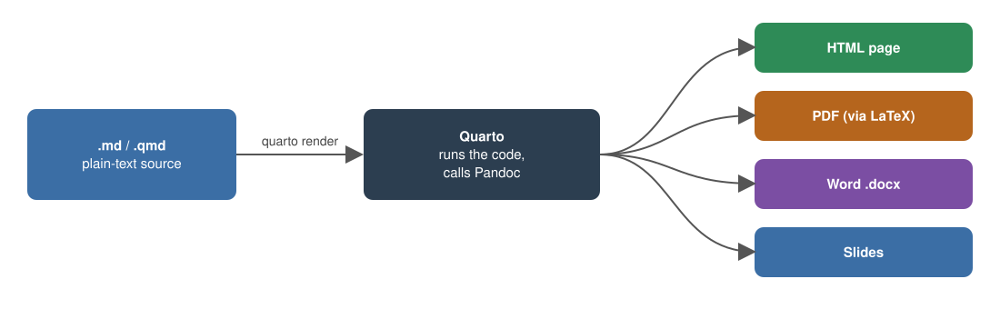

```{r}
#| label: setup
#| include: false

# Packages used in the lecture examples
library(tidyverse)

# Consistent theme for all plots
theme_set(theme_minimal(base_size = 14))

# Reproducible random numbers
set.seed(2026)
```

## Book reading for this lecture

The course book goes deeper on everything in this lecture. Read before or after class:

- [Ch. 16: Reproducible Documents with Quarto](../book/chapters/16-quarto-documents.html)
- [Ch. 17: LaTeX for Scientific Documents](../book/chapters/17-latex-basics.html)
- [Ch. 18: Coding with AI Assistants](../book/chapters/18-ai-assisted-coding.html)
- *Reference:* [App. G: LaTeX Command Reference](../book/chapters/appendix-G-latex.html)

## Goals for today

- Why **literate programming** is the backbone of reproducible, FAIR science
- The anatomy of a Quarto document - YAML, prose, and code chunks (**R** and **Python**)
- Typesetting mathematics with **LaTeX**
- Inserting Citations from a **`.bib`** file
- Three live demos, one per output format: **slides**, a **manuscript PDF**, and a **website**
- AI-assisted coding - the core principles

::: callout-tip
The three demo files are yours to download, break, and reuse: [Example Files, Week 7](../Examples.qmd#week-7).
:::

# Literate programming and reproducible science

## Your paper and your analysis drift apart

::: incremental
- The classic workflow:
  - analyze *over here* (scripts, console)
  - write *over there* (Word)
  - hand-carry numbers and figures between them
- Every revision re-opens the gap:
  - figure version five in a version-three draft
  - a mean in the text the code no longer produces
  - methods that describe last month's analysis
- Scientific bugs are usually **silent** - nothing crashes when the pasted number is stale
- An analysis you cannot regenerate is one you cannot defend - to reviewers, collaborators, or yourself in six months
:::

## Literate programming: the document *is* the analysis

> "Instead of imagining that our main task is to instruct a computer what to do, let us concentrate rather on explaining to human beings what we want a computer to do." - Donald Knuth, *Literate Programming* (1984)

::: incremental
- One plain-text document holds the **prose, the code, and the results** - rendering re-runs everything from data to figures
- The numbers *in your sentences* are computed, not typed, so they can never disagree with your data
- Your methods become **self-documenting** so inconsistencies between what you say and what you do become visible
- We already do this - our lab notebook templates, the companion notebooks, this very slide deck and the course book are all Quarto
:::

## Reproducibility has a policy behind it: FAIR

::: incremental
- Funders (including NIH and NSF) expect research outputs to be **FAIR**:
  - **F**indable - deposited somewhere with a persistent identifier, not "available upon request"
  - **A**ccessible - retrievable by standard tools, no special software or permission maze
  - **I**nteroperable - open, documented formats (tidy `.tsv` and `.qmd`)
  - **R**eusable - enough documentation and provenance that someone else can use it
- Literate documents are FAIR practice
  - plain text any tool can read
  - methods that travel *with* the analysis
  - one source anyone can re-run
- The arc of the rest of the course:
  - today the **documents**
  - → Week 8 & 9 the **environments** and **Talapas**
  - → Week 10 **sharing it all** on GitHub
:::

# Quarto Markdown

## Markdown: formatting in plain text

**Markdown** is a lightweight language: you type plain text with a few marks, and a renderer turns it into formatted output.

::::: columns
::: {.column width="50%"}
You type:

``` markdown
**bold** and *italic*,
`code`, ~~struck out~~,
x^2^ and H~2~O,
[a link](https://quarto.org)
```
:::

::: {.column width="50%"}
You get:

**bold** and *italic*,

`code`, ~~struck out~~,

x^2^ and H~2~O,

[a link](https://quarto.org)
:::
:::::

Headers mark the document's structure - one `#` per level:

``` markdown
# Chapter
## Section
### Subsection
```

## Markdown: lists, quotes, tables, and images {.smaller}

::::: columns
::: {.column width="50%"}
You type:

``` markdown
-   stickleback
-   zebrafish
    -   AB strain

1.  collect
2.  measure
3.  analyze

> Form follows function.
```
:::

::: {.column width="50%"}
You get:

- stickleback
- zebrafish
  - AB strain

1.  collect
2.  measure
3.  analyze

> Form follows function.
:::
:::::

A **table** is rows of `|`-separated cells; the dashed line separates the header from the body (a colon on the dashes sets alignment):

::::: columns
::: {.column width="50%"}
``` markdown
| Genotype | n  | Mean |
|----------|---:|-----:|
| A        | 40 | 11.2 |
| B        | 40 | 14.6 |
```
:::

::: {.column width="50%"}
| Genotype | n  | Mean |
|----------|---:|-----:|
| A        | 40 | 11.2 |
| B        | 40 | 14.6 |
:::
:::::

An image is one line - a path or URL, with optional sizing:

``` markdown
{width="60%"}
```

## Quarto Markdown

- **Quarto** extends Markdown into a scientific publishing system.

- A `.qmd` file is `Markdown` plus three ingredients:

::: incremental
1.  A **YAML header** - document settings and metadata at the top
2.  **Executable code chunks** - R or Python that runs when the document renders
3.  **Scholarly machinery** - callouts, cross-references, LaTeX math, and citations
:::

. . .

- One `.qmd` source renders to HTML, PDF, Word, slides, websites, and books

- This slide deck, the course site, and the course book are all Quarto.

## Ingredient 1: the YAML header

``` yaml
---
title: "Genotype effects on gut gene expression"
author: "Your Name"
date: today
format: html
---
```

- The `---` fences mark it off at the very top
- Inside the YAML header is `key: value` pairs
- It controls the **whole document**: `format:` picks the output (`html`, `pdf`, `docx`, `revealjs`, ...)
- Options for a format nest beneath it, and `execute:` sets defaults for every code chunk:

``` yaml
format:
  html:
    toc: true          # table of contents
execute:
  echo: false          # hide code everywhere, unless a chunk overrides
```

## Ingredient 2: Markdown prose between the chunks

```` markdown
## Methods

We measured 600 genes in 80 fish across
**2 genotypes x 2 microbiota treatments**.

```{{r}}
counts <- read_tsv("data/Stickle_RNAseq.tsv")
```

## Results

The counts were *overdispersed*, so we...
````

- Everything from the last two slides works unchanged - headings, emphasis, lists, images
- The document reads as a **narrative** with the **analysis** embedded at the right moments
- This is **literate programming**
- Headings organize the output *and* your thinking: Methods, Results, etc....

## Ingredient 3: executable code chunks

::: panel-tabset
### R

```` markdown
```{{r}}
#| label: my-first-chunk

x <- 5
print(x^2)
```
````

### Python

```` markdown
```{{python}}
#| label: my-first-chunk-py

x = 5
print(x**2)
```
````
:::

- Three back ticks fence a chunk
  - `{r}` runs it through **knitr**
  - `{python}` through **Jupyter**
- Everything else about the chunk - options, labels, captions - is identical in both languages
- Mixing R and Python in one file works too (via the R package `reticulate`) - details in [Ch. 16](../book/chapters/16-quarto-documents.html)

## Chunk options: the hash-pipe `#|`

Options go *inside* the chunk, one per line - identical in every language:

```` markdown
```{{r}}
#| label: fig-stiffness
#| echo: false
#| fig-cap: "Stiffness by hydrogel concentration"
boxplot(compression ~ hydrogel_concentration, data = mydata)
```
````

| Option           | Effect                                         |
|------------------|------------------------------------------------|
| `echo: false`    | Run the code, **hide** the code (manuscripts!) |
| `eval: false`    | **Show** the code, don't run it                |
| `include: false` | Run it, show **nothing** (setup chunks)        |
| `fig-cap:`       | Figure caption                                 |
| `label: fig-...` | Makes the figure numbered and referenceable    |

::: callout-tip
- Set document-wide defaults in the YAML under `execute:`

- Override chunk by chunk only where needed.
:::

## Inline code so sentences don't go stale

```` markdown
```{{r}}
#| include: false
stickle <- read_tsv("data/Stickle_RNAseq.tsv")
```

We measured `r knitr::inline_expr("ncol(stickle) - 3")` genes in
`r knitr::inline_expr("nrow(stickle)")` fish (@fig-gene1).
````

- Renders as:
  - "We measured 600 genes in 80 fish (Figure 1)."
- Re-run with more fish next month, or add a figure
  - the sentence updates itself
  - the figures are re-numbered automatically
- This is a big practical win of literate programming

## Callouts: boxes that organize your reader's attention {.smaller}

You type:

``` markdown
::: {.callout-tip title="Save your eyes"}
Five types: note, tip, warning, important, caution.
:::

::: {.callout-warning}
This step overwrites `results/`.
:::
```

You get:

::: {.callout-tip title="Save your eyes"}
Five types: note, tip, warning, important, caution.
:::

::: callout-warning
This step overwrites `results/`.
:::

## Cross-references: label it once, `@` it anywhere {.smaller}

Label a figure, table, equation, or section; reference it with `@`; Quarto numbers everything, and renumbers on every render:

| Type     | Label                                 | Reference   |
|:---------|:--------------------------------------|:------------|
| Figure   | `#| label: fig-name` or `{#fig-name}` | `@fig-name` |
| Table    | `#| label: tbl-name` or `{#tbl-name}` | `@tbl-name` |
| Equation | `$$ ... $$ {#eq-name}`                | `@eq-name`  |
| Section  | `## Heading {#sec-name}`              | `@sec-name` |

You type:

``` markdown
The render pipeline (@fig-pipeline) runs your code every time.
```

You get - a live, clickable reference to a figure that sits several slides ahead:

> The render pipeline (@fig-pipeline) runs your code every time.

# Mathematics with LaTeX

## Inline math: a single pair of `$` {.smaller}

LaTeX notation dropped between `$` signs flows with the sentence:

| You type                          | You get                         |
|:----------------------------------|:--------------------------------|
| `$\sigma = E\varepsilon$`         | $\sigma = E\varepsilon$         |
| `$\bar{x} \pm 1.96\, s/\sqrt{n}$` | $\bar{x} \pm 1.96\, s/\sqrt{n}$ |
| `$\mu = 2.5\ \mathrm{kPa}$`       | $\mu = 2.5\ \mathrm{kPa}$       |
| `$H_0\!: \beta_1 = 0$`            | $H_0\!: \beta_1 = 0$            |

- Subscripts with `_`, superscripts with `^`, Greek letters by name (`\sigma`, `\mu`, `\beta`)
- Works identically in HTML, PDF, Word, and slides

## Display math: a double pair of `$$` {.smaller}

A `$$` pair puts the expression on its own centered line:

``` markdown
$$Pr(Y=r) = \frac{e^{-\mu}\mu^r}{r!}$$
```

$$Pr(Y=r) = \frac{e^{-\mu}\mu^r}{r!}$$

``` markdown
$$f(x) = \frac{1}{\sigma\sqrt{2\pi}}
         \, e^{-\frac{(x-\mu)^2}{2\sigma^2}}$$
```

$$f(x) = \frac{1}{\sigma\sqrt{2\pi}} \, e^{-\frac{(x-\mu)^2}{2\sigma^2}}$$

``` markdown
$$\iint xy^2 \, dx \, dy = \frac{1}{6}x^2y^3$$
```

$$\iint xy^2 \, dx \, dy = \frac{1}{6}x^2y^3$$

## Numbered equations are cross-references too

You type (the `{#eq-...}` label sits on the *same line* as the closing `$$`):

``` markdown
$$
\mathrm{SE} = \frac{s}{\sqrt{n}}
$$ {#eq-se}

The standard error (@eq-se) shrinks with sample size.
```

You get:

$$
\mathrm{SE} = \frac{s}{\sqrt{n}}
$$ {#eq-se}

The standard error (@eq-se) shrinks with sample size.

::: callout-tip
- Nearly every Greek letter, operator, matrix, and aligned multi-line derivation you will ever need: [Ch. 17](../book/chapters/17-latex-basics.html) and [App. G](../book/chapters/appendix-G-latex.html).
- You'll see matrices and aligned equations live in the manuscript demo.
:::

# Citations

## The reference database: a `.bib` file

**BibTeX** is a plain-text database - one entry per source, each with a citation **key**:

``` bibtex
@article{knuth1984literate,
  author  = {Knuth, Donald E.},
  title   = {Literate Programming},
  journal = {The Computer Journal},
  year    = {1984}
}
```

Wire it up in the YAML header:

``` yaml
---
bibliography: references.bib
csl: nature.csl        # optional: any journal's citation style
---
```

- Zotero exports BibTeX directly
- Google Scholar's "Cite" button offers an entry for any paper
- Keep **one `.bib` per project** and let it grow
- Swap the `.csl` file and every citation re-styles itself for a different journal

## Citing with `@key` - and what it renders {.smaller}

You type:

``` markdown
Knuth introduced literate programming [@knuth1984literate].
@knuth1984literate argued that programs are written for people.
Research outputs should be FAIR [@wilkinson2016fair; @knuth1984literate].
```

You get (these are real citations - this deck has its own `.bib` file):

> Knuth introduced literate programming [@knuth1984literate]. @knuth1984literate argued that programs are written for people. Research outputs should be FAIR [@wilkinson2016fair; @knuth1984literate].

And Quarto builds the reference list for free, wherever you put a `#refs` div:

::: {#refs}
:::

# Rendering: one source, many outputs

## What happens when you press render

{#fig-pipeline fig-align="center" width="90%"}

- The code runs **every time**, so figures, tables, and inline numbers can never drift from the data
- This figure is `@fig-pipeline` - the cross-reference you clicked three sections ago

## Rendering commands

``` bash
quarto render report.qmd              # the format named in the YAML
quarto render report.qmd --to pdf     # override: PDF (needs TinyTeX, installed once)
quarto render report.qmd --to docx    # override: Word
quarto preview report.qmd             # live preview - re-renders every time you save
quarto render                         # render a whole project or website
```

- In **Positron**:
  - the Preview button, or `Cmd/Ctrl + Shift + K`
  - Or use the `quarto preview` and `quarto render` commands in the terminal
- `quarto preview` is the one to use *while writing*: it opens the document beside your editor and refreshes on every save
- PDF goes through LaTeX - install once with `quarto install tinytex`, then forget it's there
- Emailing a report? Set `embed-resources: true` under `format: html:` - images, CSS, and JS are bundled into one self-contained `.html` file that travels on its own

## One source, several formats

List several formats in the YAML and render them all at once:

``` yaml
format:
  html: default
  pdf: default
  docx: default
```

``` bash
quarto render report.qmd --to all     # without --to all: first format only
```

| Output type            | Formats                                      |
|------------------------|----------------------------------------------|
| **Documents**          | HTML, PDF (via LaTeX), Word                  |
| **Presentations**      | RevealJS (these slides!), PowerPoint, Beamer |
| **Websites and books** | HTML (all of our class material!)            |

# Three demos with the same skeleton, three outputs

## Demo 1: slides (`example_slides.qmd`)

**`format: revealjs`** - a deck like this one, from one `.qmd`.

Watch for:

- `##` = new slide, `#` = section divider
- `::: incremental` and `. . .` to reveal content stepwise
- Two-column layouts, executed R chunks, stepwise code highlighting
- Tabsets, callouts, and math on slides
- Speaker notes (press **S**) and the overview (press **O**)

## Demo 2: a manuscript (`example_manuscript.qmd`)

**`format: pdf`** - a Science/Nature-style article, LaTeX without writing LaTeX.

Watch for:

- Scholarly YAML: authors, **affiliations**, ORCID, corresponding author, abstract, keywords
- `echo: false` - readers see results, never code
- Inline and display math, **numbered equations**, and `@fig-`/`@tbl-`/`@eq-`/`@sec-` cross-references throughout
- Superscript citations from `example_manuscript.bib` + `nature.csl`, reference list built for free
- Companion files travel with the source: `.bib`, `.csl`, `title.tex`

::: callout-important
Your **term project report** should start from this skeleton - create the `.qmd` this week.
:::

## Demo 3: a website (`example_website.zip`)

**A folder, not a file** - `_quarto.yml` turns it into a project; every `.qmd` becomes a page.

Watch for:

- `_quarto.yml`: the navbar, theme, and `output-dir: docs`
- An `about:` landing page template for your photo + links
- `quarto preview` for a live local version while you edit
- Research / publications / CV pages - a complete academic site for a graduate student

::: callout-tip
Keep your copy. In **Week 10** we push exactly this folder to GitHub and flip on GitHub Pages - it becomes `your-username.github.io`, for free.
:::

# AI-assisted coding

## "Vibe coding" and why it can fail in science

::: incremental
- A **large language model (LLM)** predicts the most *plausible* next text - including code
- **Vibe coding** = describe, accept, run, paste the error, repeat - *without reading the code*
- Fun for a weekend project; a problem for science:
  - you have to **defend** every result
  - scientific bugs are usually **silent** (wrong number, no crash)
  - you stop **learning**
- Here's a different approach:
  - keep the speed, drop the blindness
  - **the assistant writes, you read,**
  - **a tiny test decides**
:::

## The loop

::: incremental
1.  **Describe** the goal precisely - language, versions, sample input, expected output
2.  **Get** code
3.  **READ** it - every line; look up anything you don't recognize
4.  **Run** it on a tiny test you can check by hand
5.  **Check** the result against something you already know
6.  **Iterate** - paste the exact error or wrong output, say what you expected
:::

::: callout-important
Steps 3 and 5 are the ones people skip. Don't.
:::

## Where LLMs fail - the short list

::: incremental
- **Hallucinated** functions, packages, and arguments - delivered with total confidence
- **Outdated APIs** - last year's function names in this year's package
- **Subtly wrong statistics** - `sd(x) / n` instead of `sd(x) / sqrt(n)`; `mean()` when you asked for `median()`
- **Silently changing your data** - dropping every row with an `NA`, re-sorting and breaking an alignment
:::

. . .

- The failures have the same root cause

- The model predicts text, it does not reason about *your* data

- The fix: **read the code, test on an input where you know the answer**.

- [Ch. 18](../book/chapters/18-ai-assisted-coding.html) has worked examples of each failure and a review checklist.

## Data rules and the course policy

**Never paste into an unsupported AI tool:**

- Unpublished data or results · human-subjects data / PHI · credentials
- UO data classes:
  - **green** (published data, your code)
  - **amber** (unpublished research, FERPA)
  - **red** (HIPAA).
- Unsupported tools: **green only**; Microsoft Copilot Chat with your UO login is covered by UO's agreement - see [UO's AI Service Offerings](https://service.uoregon.edu/TDClient/2030/Portal/KB/Article/140911/AI-Service-Offerings)

------------------------------------------------------------------------

## Summary

- **Literate programming** keeps prose, code, and results in one executable document - the practical core of reproducible, **FAIR** science
- **Quarto** renders one `.qmd` to HTML, PDF, Word, slides, or a website; chunk options, cross-references, LaTeX math, and `.bib` citations are the same everywhere
- The three demo files are templates for *your* work: slides for your next talk, the manuscript for your **term project report** (start it this week!), the website for Week 10
- **AI assistants**: the assistant writes, *you read*, a tiny test decides - and nothing above green classification goes into an unsupported tool ([Ch. 18](../book/chapters/18-ai-assisted-coding.html) for the full treatment)
- Next Monday (L08): **Talapas** - running your scripts on UO's cluster. Check that your account works *before* class ([Ex 7](../Exercise_Folder/Exercises_Week07.qmd) ends with the account check), and remember **HW1 is due next Monday**